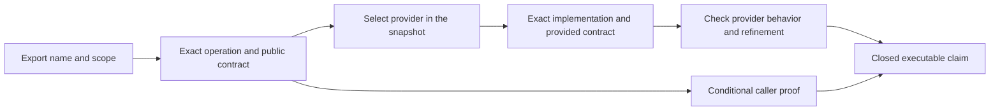

# RT-00 B — Audit the evidence behind public interface integration

**Status:** Exact-tree claim and prototype review complete for the stated sample.

**Baseline:** `35078012d728f21b054bc90e4715fd7ffc1104f7`. The complete Dependency Graph prototype tree matches main `6ea8f0891190b9c3029a879fd1f7fa61fb84d7b8`.

**Evidence type:** Versioned document comparison and replay of bounded prototype suites.

**Tracking:** PLAN §0.1, with evidence for §1.3.1.

## Question and scope

The [public interface proposal](../../semantic-representation/RT-05/PUBLIC-INTERFACES-AND-CONTRACT-REFINEMENT.md) introduces exact public-contract revisions, implementation-owned contracts and versioned provider bindings. Its integration commit `789ff65923d55d6ea803f322b0f261010026b477` changed 54 Markdown files. We reviewed the proposal against the typed graph, scoped bindings, contract identity and call-target merge reports, then replayed six prototype suites from the pinned Git tree. The question was which implementation alternatives the existing evidence can discriminate.

## Findings



The fixtures exercise graph identities, selection and migration up to the implementation binding. Behavioral verification at the right side of the diagram requires additional evidence before a caller proof can be closed.

| Question | Reproduced result | Consequence for comparison |
| --- | --- | --- |
| Concrete calls versus operation bindings | Rebinding only `binding:provider` changes the operation caller's result from 5 to 6 on input 4. The original direct caller still returns 5. The fixture stores the same operation caller body. | A caller-only execution key misses observable changes. Exact resolved dependencies or a sufficiently inclusive snapshot key capture the tested rebind. |
| Positive-only resolution keys versus complete consulted inputs | The fixture enumerates 3,240 unordered state pairs. The projected key allows 216 reuses with matching observations. The whole-view key allows zero and a positive-only key gives 516 false reuses. A lower-layer mismatch can reject an otherwise valid higher-layer selection under the tested policy. | The resolution projection needs applicable absence and conflict information. One derived key also collides after a duplicate is introduced into an unrelated layer of an invalid input. A separate whole-layer validation precondition is required. |
| Stable names versus semantic identity | An exported-name edit changes the operation and implementation selections in the current SPG fixture. A local parameter rename leaves its encoded graph equal. The proposal also permits investigating a stable operation plus an external scoped catalog and aliases. | The fixture implements an export-name policy. The catalog alternative needs its own alias and name-observability evidence. The two documents therefore describe different candidate boundaries, with the fixture behavior explicit. |
| Exact binding versus behavioral conformance | The typed fixture accepts a stored binding while executing an ordered trace outside the declared contract. The dependency index and candidate validator check required/provided contract identities and selected exact callees. | Structural admission cannot close body correctness or refinement. A separate behavior check is required even for an immutable binding. |
| Ambient retargeting versus explicit per-call selection | Independent call retargets export consistently in the merge fixture. Competing retargets, an undeclared guard change and a stale or unavailable exact target fail the scoped merge or migration checks. | The bounded result supports explicit occurrence and snapshot binding. It leaves language-wide selection and publication guarantees open. |

The exact contract identity and refinement distinction is consistent across the [typed SPG](../../semantic-representation/RT-05/RT-05-TYPED-SEMANTIC-PROGRAM-GRAPH.md#7-results-and-falsifiers) and [RT-20 compatibility report](../../toolchain-and-collaboration/RT-20/RT-20-CONTRACT-IDENTITY-AND-COMPATIBILITY.md). In particular, the stored SPG binding counterexample rules out treating a valid binding declaration as proof that a provider refines the public contract. A design that separates provider body correctness and contract refinement, or checks the body directly against the exact public contract, has an explicit obligation missing from the selection fixtures.

## Reproduction

From a clean checkout of the pinned baseline with CPython 3.12.14 and Git 2.56.1:

```sh
git diff --name-only 789ff65923d55d6ea803f322b0f261010026b477^ \
  789ff65923d55d6ea803f322b0f261010026b477
cd research/PROTOTYPES/DEPENDENCY-GRAPH-01
python3 -B -m unittest -v \
  tests.test_spg_representation tests.test_scoped_binding \
  tests.test_rt06_negative_binding_reads tests.test_semantic_dependency_index \
  tests.test_candidate_validation tests.test_rt24_call_target_merge
```

All **63** tests passed in the six exact archived suites. The [observation register](RT-00-B-PUBLIC-INTERFACE-EVIDENCE-AUDIT-2026-11-24.json) preserves suite and source Git blobs, test names, tool versions, and the fixture denominators. The binding counts enumerate a finite fixture and carry no sampling interval. Mermaid source was checked without locally rendering it.

## Decision boundaries

The sample supports keeping abstract and direct calls distinct, tracking consulted resolution inputs, and retaining separate validation of provider behavior. It yields no runtime-dispatch, ABI, resource, proof-reuse or full-source correspondence result. The remaining architectural gate is a public-interface/contract refinement oracle independently cross-checked by a second backend, followed by demonstration that the compiled caller, selected snapshot and proof subjects agree. Independent review and the decision on whether exported names enter semantic identity remain open. The evidence informs implementation comparison and leaves `draft/` unchanged.
