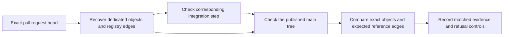

# Reconcile research evidence after the Git integration batch

PR #648 publishes a Git tree assembled from 18 research pull requests. Each pull contributes dedicated reports, fixtures or ledgers and may edit the same project registries. This audit compares each pull's exact last head with its integration step and the published `main` tree. It tests which checks establish custody of the dedicated files and retention of their research links as shared documents evolve. [Batch publication](https://github.com/aivibeflow/LLMLang/pull/648) · [Earlier corpus relationship audit](RT-00-B-09-CURRENT-MAIN-CORPUS-RELATIONSHIP-DELTA-2026-11-24.md)

## Exact inputs and checks

The input ledger pins the last head of each included pull, the matching first-parent integration commit, the pre-batch `main` tip, the integration head and the final main commit. The final main commit is a squash of that integration head. Each pull's single-commit path delta is compared with its corresponding single-commit integration step. Four registries are jointly edited in the batch. The remaining changed files are unique to their own pull within this batch.

Dedicated file identity includes the exact path, object mode, object type and Git object ID. The link check reads additions in each shared registry patch and keeps the relative Markdown links resolving to dedicated files from the same pull. It compares the referrer, resolved target and literal fragment at the integration step and the published tree. It verifies file presence at the resolved target. Anchor rendering and external links are outside this check.



The alternatives compare path presence, exact preservation of dedicated objects, exact preservation plus registry edges, and requiring every changed blob to equal the blob from its pull head. The last alternative includes shared registries, which intentionally accumulate updates. Four in-memory controls remove or replace a ledger or remove or retarget a registry edge. The retargeted edge points to an existing file and keeps the number of links constant. The Git trees themselves remain the pinned inputs throughout the controls.

## Results

The final `main` at `c06ad1b9c30c806dea0fddb8c362322f8587a5b3` and the integration head `5d14486c7dafde8525c87e770142690bb00d2b10` have the same tree, `a03082c05fa642cca22525b47758c4c033b90fae`. All pull path deltas agree with their integration steps. The batch adds 87 dedicated files, including 18 Markdown files, 22 JSON files, four Lean sources and native/runtime fixture sources. The exact file check succeeds for all 87 at both the integration step and published main. All 18 pulls retain a direct registry reference to their own evidence within the audited set of links.

| Published evidence | Count |
|---|---:|
| Pull requests | 18 |
| PR path touches | 122 |
| Distinct published paths | 91 |
| Exact dedicated files | 87 |
| Shared registries | 4 |
| Registry blobs rewritten between PR head and integration step | 30 |
| Exact registry edges to the corresponding PR evidence | 35 |

| Case | Presence | Exact dedicated files | Exact files and registry edges | Every PR blob unchanged |
|---|---|---|---|---|
| Published main | Admit | Admit | Admit | Refuse |
| Remove one ledger path | Refuse | Refuse | Refuse | Refuse |
| Replace a ledger at the same path | Admit | Refuse | Refuse | Refuse |
| Remove one exact registry edge | Admit | Admit | Refuse | Refuse |
| Retarget an edge to an existing path | Admit | Admit | Refuse | Refuse |

The path-only gate admits a ledger carrying another study's bytes. Exact object checks detect that substitution but accept both lost and retargeted references. Requiring both the original object and the expected registry edge distinguishes all four controls. Full equality of mutable registry blobs refuses the genuine batch because their earlier versions did not yet include every other study. This supports preserving exact evidence artifacts and comparing expected navigation at the shared-document boundary.

## Limits and replay

This audit covers byte identity and selected relative link edges in the named batch. It does not re-execute the 18 studies, adjudicate disputed claims, prove that every intended shared wording or link anchor rendered correctly, compare semantic duplicates, or provide independent research review. The archive for full corpus reconciliation and §0.2 review remains separately tracked in the plan.

Replay with Git 2.52.0 and CPython 3.12.14. A fresh clone may need the immutable objects reachable through the batch and included pull refs, because the published batch was squashed. The runner uses only local Git objects once they have been fetched. An empty Git repository populated from the exact main, batch and 18 pull refs reproduced the ledger byte for byte.

```bash
fixture=research/research-management/RT-00/BATCH-EVIDENCE-01
mapfile -t pull_refs < <(python3 - "$fixture/inputs.json" <<'PYTHON'
import json
import sys

with open(sys.argv[1], encoding="utf-8") as source:
    for pull in json.load(source)["pulls"]:
        print(f"refs/pull/{pull['number']}/head")
PYTHON
)
git fetch --no-write-fetch-head origin refs/pull/648/head "${pull_refs[@]}"
PYTHONHASHSEED=1 python3 -B "$fixture/run.py" > /tmp/llmlang-batch-evidence.json
cmp "$fixture/evidence.json" /tmp/llmlang-batch-evidence.json
python3 "$fixture/chart.py"
```

[Pinned Git inputs](BATCH-EVIDENCE-01/inputs.json) · [Exact audit](BATCH-EVIDENCE-01/run.py) · [Observation ledger](BATCH-EVIDENCE-01/evidence.json) · [Table generator](BATCH-EVIDENCE-01/chart.py)
