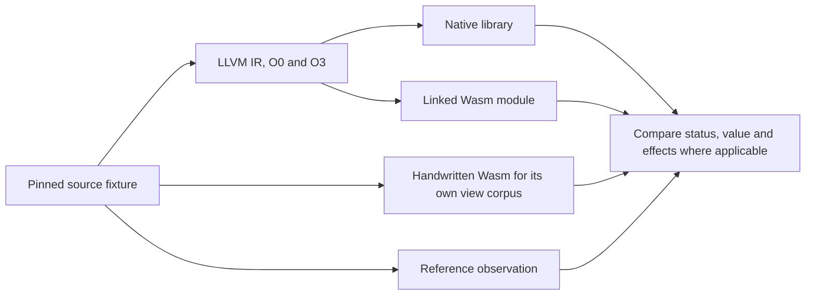

# RT-00 C — Replay native and WebAssembly preservation after relocation

**Status:** Bounded source-pinned replay complete.

**Baseline:** `6ea8f0891190b9c3029a879fd1f7fa61fb84d7b8`. The entire compiler prototype tree matches main `b62f7236038bcfa452ad603a93c816e9012c707e`.

**Evidence type:** Differential execution against fixed integer and byte-view oracles.

**Tracking:** PLAN §0.1 and RT-09/13 preservation evidence.

## Question and method

The thematic move changed the live locations of the LLVM and WebAssembly probes. We tested whether the relocated exact-source fixtures reproduce the published inputs, observable outcomes and deliberately weakened controls. The comparisons cover native x86-64 LLVM output, LLVM-generated Wasm and independently handwritten Wasm. A byte view specifies a logical region of a shared allocation. Its identity and bounds can impose restrictions stricter than the allocation or linear-memory bounds.



Each probe compares its own declared observations. The three view runs have different fixtures and acceptance surfaces, so the counts are reported separately.

## Results and comparison

| Fixture | Reproduced comparisons | What the comparison establishes |
| --- | ---: | --- |
| Native LLVM integer, Scenario 96A | 20,978 each at O0 and O3 | Status, returned value or sentinel, and ordered effects match for the recorded fragment. Dropping the overflow edge passes the LLVM structural verifier but fails the source comparison. |
| Native LLVM byte view, Scenario 96B | 9,800 each at O0 and O3 | Formation and reading match the view oracle. One-past reading and erased-origin controls fail the source comparison despite being inside the backing allocation. |
| LLVM-generated WebAssembly byte view | 16,200 per optimization level on each Node release | Both generated modules and the input IR match the published hashes. Status, address or read value, sentinel and input slab agree with the fixture. |
| Handwritten WebAssembly Memory32 view | 12,800 on each Node release | Read and replace match the oracle including slab and canaries. The two weakened guards return invalid source observations. |

The original native input IR, Wasm input IR, both generated module hashes and the handwritten WAT hash all match the prior reports. The Wasm runs used Node v22.23.5 and v24.22.3. The two logs match within each Wasm fixture. These are two releases of the same Node/V8 family, with different patch versions from the earlier Node v24.22.1 run.

An LLVM-verifier or Wasm-validator pass alone accepts the tested controls that violate source observations. This supports retaining explicit source obligations in translation validation. Native and generated Wasm remain feasible routes for the specific integer or view fragment exercised here. The handwritten WAT comparison supplies a useful target-side reference for its own corpus. The runs do not test code generation from LLMLang for that handwritten corpus or rank backends by performance.

## Reproduce

Use a clean checkout or `git archive` at the baseline. Verify the Debian amd64 LLVM, lld and WABT archives against the package entries in the [replay ledger](RT-00-C-BACKEND-PRESERVATION-REPLAY-2026-11-24.json). The local run extracted the packages, then used CPython 3.12.14, LLVM and lld 19.1.7, WABT 1.0.36, GCC 14.2.0, GNU ld 2.44 and glibc 2.41. Use absolute paths to the verified tools:

```sh
pob=research/compiler-and-translation/PROTOTYPES/LLVM-PRESERVATION-01
for probe in llvm_integer_probe.py llvm_view_probe.py; do
  python3 -B "$pob/$probe" --opt "$opt" --llc "$llc" --cc "$gcc"
done
for node_bin in "$node_22" "$node_24"; do
  python3 -B "$pob/llvm_wasm_view_probe.py" \
    --opt "$opt" --llc "$llc" --wasm-ld "$wasm_ld" --node "$node_bin"
  "$node_bin" research/compiler-and-translation/PROTOTYPES/WASM-VIEWS-01/compare.mjs "$wat2wasm"
done
```

The [ledger](RT-00-C-BACKEND-PRESERVATION-REPLAY-2026-11-24.json) preserves sources, output hashes, counts and raw stdout. The replay uses the direct probes with hash-checked extracted tools. It leaves the CI wrapper's system-package installation path to its original environment. The diagram was reviewed as Mermaid source without local rendering.

The results apply to the selected fixtures, host versions, targets and optimization levels. General provenance, shared memory, arbitrary descriptor validation, backend preservation outside the fragment and acceptance of the candidate semantics require separate evidence.
