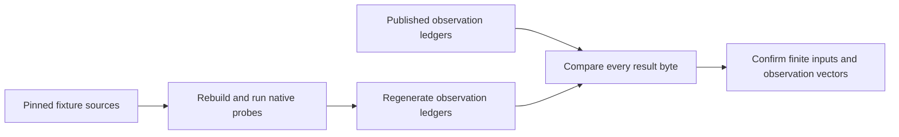

# RT-00 C — Native binary64 replay across four studies

**Scope:** PLAN §0.1 and [#284](https://github.com/aivibeflow/LLMLang/issues/284). The replay rebuilds from the `research/all` tree at `756d582cc0c8d4a084fbd9faffcaff9d9c8ece47`.

Several LLMLang candidate decisions depend on observations from binary64 literals, extrema, checked conversions and fused arithmetic. This audit tests whether the published archives can be regenerated from their tracked fixture sources and stated native toolchains. A fresh byte-identical archive corroborates the observations and recorded metadata at that scope. Historical authorship and original execution provenance require separate evidence.

## Reproduced observations

All four native ledgers matched byte for byte. The [replay manifest](BINARY64-NATIVE-REPLAY-01/evidence.json) binds each observation source to the new result by SHA-256 and records byte counts and tool versions.

| Study | Finite corpus and replayed discriminators |
| --- | --- |
| [RT-05 literal identity](../../semantic-representation/RT-05/RT-05-CROSS-RUNTIME-F64-IDENTITY-2026-11-25.md) | 210 words across five profiles. Node array storage changes the 12 signaling NaN encodings, while the exact tagged form recovers every input. Collapsing signed zeros changes the reciprocal observation. |
| [RT-05 extrema](../../semantic-representation/RT-05/RT-05-NATIVE-F64-MINMAX-2026-11-25.md) | 1,024 ordered pairs across nine configurations in five native families. Output normalization preserves the five distinct selection behaviors. The C checks confirm libm symbol use and the designated SSE2 instructions. |
| [RT-05 checked conversion](../../semantic-representation/RT-05/RT-05-F64-I64-CONVERSION-2026-11-25.md) | 216 input words across seven configurations. Checked truncation accepts 153. All configurations exhibit `INT64_MAX` rounding to `+2^63`, which is the sole false admission under the weak inclusive upper check in the corpus. |
| [RT-13 binary64 contraction](../../compiler-and-translation/RT-13/RT-13-BINARY64-CONTRACTION-2026-11-25.md) | 6,859 operand triples across six profiles. All explicit FMA outputs match the fused value oracle after NaN-output normalization. GCC contraction changes 77 outcomes from separate rounding. Raw NaN outputs differ across profiles in 114 explicitly fused cases. |



The comparison includes raw bits where the original ledger records them. Each fixture determines its own observation projection. The [binary64 relationship audit](RT-00-B-15-F64-RELATIONSHIP-REVIEW-2026-11-25.md) had already shown that a literal projection preserving sampled reciprocal observations can still change native extrema. This replay independently regenerates the archives used in that comparison. The [separate RT-32 Lean run](RT-00-C-GENERATED-SOURCE-REPLAY-2026-11-25.md#rt-32-proof-replay) checks an agreement theorem about modeled extrema and replays exact equations against their native archive. The model theorem and the native observations cover different obligations.

## Reproduction and limits

The host used Linux x86-64 6.18.57 with FMA support, CPython 3.12.14, Git 2.52.0, Debian GCC 14.2.0-19, glibc `2.41-12+deb13u4`, GNU Binutils 2.44, OpenJDK 21.0.13, Rust 1.85.1 at `4eb161250e340c8f48f66e2b929ef4a5bed7c181` with LLVM 19.1.7, and Node 22.23.5 with V8 12.4.254.21-node.57. Put those tools on `PATH`. The [wrapper](BINARY64-NATIVE-REPLAY-01/replay.py) archives the four fixtures into a temporary directory, runs their original entry points under locale `C` and Python hash seed 1, and exits on any byte mismatch.

```sh
fixture=research/research-management/RT-00/BINARY64-NATIVE-REPLAY-01
python3 -B "$fixture/replay.py" > /tmp/llmlang-binary64-native-replay.json
cmp "$fixture/evidence.json" /tmp/llmlang-binary64-native-replay.json
```

The audit exercises the named profiles only. It does not reproduce the LLVM conversion validators or run new Lean proofs. Status flags, native exception delivery, other targets, LLMLang source correspondence, independent domain review and selection of a language profile remain open. There is no new timing measurement. Mermaid syntax was inspected directly.
