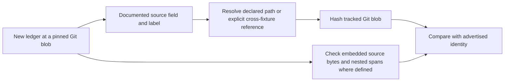

# RT-00 C — Verify new source identities in exact-name evidence ledgers

## Question and pinned population

Do the evidence ledgers added since the previous census still bind the exact source files and cross-fixture inputs they name? The [previous audit](RT-00-C-EVIDENCE-LEDGER-IDENTITIES-2026-11-25.md) checked the named fields in 138 ledgers at `d2e32df3ff25ef28dc66750b3e14e777d7cd7d35`. The new baseline is `087d2e5e952255778d76637ce5fd41b9df2d5396` on `research/all`. Its tree has 205 tracked research files named exactly `evidence.json`. It adds 67 in that filename population, and all 138 older paths retain their exact blobs. [PLAN §0.1](../../../PLAN.md#01-reconcile-the-research-corpus) · [#284](https://github.com/aivibeflow/LLMLang/issues/284)

The [auditor](EVIDENCE-IDENTITY-DELTA-01/run.py) checks the new files using the earlier map-field conventions and six additional declared source and replay maps. It also resolves four scalar fields to tracked input ledgers or a Lean model. For each field it reads the producing runner to establish whether the label is an adjacent path, a repository- or prototype-relative path, or an explicit alias to another fixture. Replay crosswalk entries identify the exact archived evidence or axiom output of the named fixture. The auditor compares SHA-256 values against the resolved Git blob. It does not search the tree for a matching digest.



## Findings

| Disposition | Count |
| --- | ---: |
| Added exact-name evidence ledgers | 67 |
| Previously present ledgers with changed or removed paths | 0 |
| Declared tracked-file identities matched | 167 |
| Declared tracked-file mismatches or unresolved paths | 0 |
| Inline input values present in named maps | 8 |
| Nested inline source digest and span records matched | 17 |
| New ledgers with no entries under the inspected identity fields | 11 |

The earlier path convention on its own resolves 71 new entries and leaves 63 path labels unresolved. These 63 resolve with the producer's repository roots, prototype roots or named aliases. The expanded fields give 33 additional tracked matches. For example, the layered cache fixture's `fixture` label identifies the original cache-index runner, and the RT-05 crosswalk fixture names files in 11 runnable studies and four Lean axiom outputs. A valid checksum must identify the intended path. A file with coincidentally equal content at another path would provide weaker provenance.

Two records use `sources` for embedded text. Ten proof-freshness checks recompute five source profiles under two Lean versions. Seven RT-02 interpretations bind three exact requirement texts. For these, the audit recomputes each domain-tagged revision and verifies its quoted span. These are checks of stored inputs and citations. The [structured ledger](EVIDENCE-IDENTITY-DELTA-01/evidence.json) records the exact path and blob, resolution rule, advertised and observed digests, and the separate inline-source records.

## Reproduce and limits

The check ran on Debian 13 x86-64 Linux 6.18.57 with CPython 3.12.14 and Git 2.56.1. From a checkout containing both pinned revisions:

```sh
fixture=research/research-management/RT-00/EVIDENCE-IDENTITY-DELTA-01
out=$(mktemp)
python3 -B "$fixture/run.py" > "$out" &&
  cmp "$fixture/evidence.json" "$out"
```

The audit uses tracked bytes and scoped named fields. It leaves differently named ledgers, other nested schemas, generated artifacts, proof binaries and original execution attestations outside this check. The 11 ledgers without named entries can carry identities under other schemas. Counts describe the enumerated tree and are presented as a table. [Runner](EVIDENCE-IDENTITY-DELTA-01/run.py)
