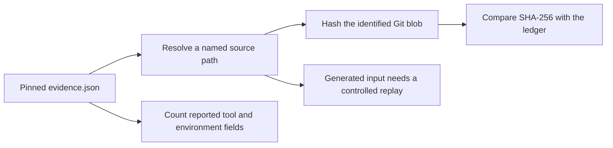

# RT-00 C — Check source identities recorded in evidence ledgers

**Scope:** PLAN §0.1 and [issue #284](https://github.com/aivibeflow/LLMLang/issues/284). Exact Git tree at `d2e32df3ff25ef28dc66750b3e14e777d7cd7d35` on `research/all`.

**Evidence:** Static verification of declared SHA-256 values against archived fixture bytes, with a metadata-presence census for these ledgers.

## Question and method

Does a research result identify the exact inputs a reader can retrieve and replay? This pass inventories every tracked file named exactly `evidence.json` under `research/`. It verifies flat, named source digests and exact runner digests using the pinned Git tree. It also counts top-level Python and environment records because byte identity cannot tell a reader which tool or host ran an experiment. The filename defines a reproducible census of one evidence convention. Results archived under another name or only in prose are outside it.

The [auditor](../../../.github/scripts/audit_research_evidence_ledger_identities.py) reads seven named fields from each ledger. A scalar `runner_sha256` declares the digest for the adjacent `run.py`. For named maps it normally resolves an entry relative to the ledger and hashes the tracked Git blob. The explicit aliases come from reading the producing runner's path construction. Generated sources are preserved as obligations for an executable replay. Nested objects and scalar source fields other than `runner_sha256` need a schema-specific check.



The exact path and Git blob identify what the static check observed. A matching digest shows that the published tree contains the named bytes. Establishing that a historical runner used those bytes requires original execution provenance or a fresh, separately identified replay.

## Results

| Census or disposition | Count |
| --- | ---: |
| Exact-name evidence ledgers | 138 |
| Ledgers with entries in the inspected identity fields | 54 |
| Source entries matching their explicitly resolved tracked bytes | 120 |
| Of those, entries requiring an explicit path alias | 7 |
| Generated source entries requiring replay | 25 |
| Nested entries outside the flat SHA-256 shape | 7 |
| Tracked-source mismatches after explicit path resolution | 0 |
| Ledgers with a non-null top-level `python` value | 114 |
| Ledgers with at least one selected top-level environment key | 10 |

The [machine-readable ledger](RT-00-C-EVIDENCE-LEDGER-IDENTITIES-2026-11-25.json) records all 138 paths and Git blob IDs, the reported Python values, the selected environment keys, and each of the 152 source dispositions. The environment count checks the literal keys `environment`, `filesystem`, `kernel`, `linux`, `os`, `platform` and `system`. Reports and nested objects can carry additional environment or tool records. Field presence does not establish whether a record contains enough detail to reproduce the experiment.

### Filename ambiguity controls

- The LLVM floating-point flags ledger's `source_sha256["run.py"]` is the digest of the imported [binary64 numeric helper](../../compiler-and-translation/RT-13/BINARY64-CONTRACTION-01/run.py). The [flag experiment runner](../../compiler-and-translation/RT-13/LLVM-FP-FLAGS-01/run.py) explicitly builds that source list. Its own bytes are pinned by this Git tree, but the original ledger's source list does not include their digest. Interpreting the key as the adjacent runner's filename would produce a false mismatch.
- The checked F64-to-I64 lowering ledger's `source_sha256["evidence.json"]` refers to the [RT-05 conversion data](../../semantic-representation/RT-05/F64-I64-CONVERSION-01/evidence.json), as resolved in the [lowering runner](../../compiler-and-translation/RT-13/LLVM-F64-I64-LOWERING-01/run.py). Treating it as a self-hash would compare the wrong bytes.
- The remaining aliases cover two source imports for generated Rust, two test imports for indexed journal recovery and the dynamic-rounding host labelled `host_c`. Each path was resolved from the producing runner. Generated inputs instead include 16 Lean replay units for the extrema guard experiment and nine generated source files from four compiler or representation fixtures.

Searching the tree for any matching digest could resolve a basename mechanically, but would accept the wrong input path whenever identical bytes existed in two scopes. The explicit path check binds the intent of the reference. Future evidence schemas can make this binding directly representable with a path relative to a pinned tree or with an explicit generated-artifact identity.

## Reproduction and remaining work

Run from a checkout containing the pinned baseline with CPython 3.12.14 and Git 2.56.1:

```sh
out=$(mktemp)
python3 -B .github/scripts/audit_research_evidence_ledger_identities.py --output "$out"
cmp "$out" research/research-management/RT-00/RT-00-C-EVIDENCE-LEDGER-IDENTITIES-2026-11-25.json
```

The machine-readable counts are exact enumerations of the named tree. Mermaid source was inspected directly. The actual experiment runners were not replayed in this audit. Full toolchain, host and command reconciliation still requires checking the linked reports and nested or differently named ledgers. The 25 generated-source entries need exact regenerations and the seven nested entries need schema-specific checks. Original execution attestations remain separate.
