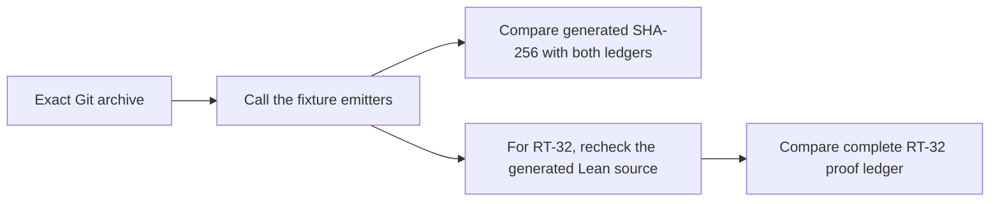

# RT-00 C — Replay the generated sources identified by evidence ledgers

**Scope:** PLAN §0.1, [issue #284](https://github.com/aivibeflow/LLMLang/issues/284). Experiment inputs from the Git archive of `research/all` at `d2e32df3ff25ef28dc66750b3e14e777d7cd7d35`.

**Evidence:** Exact generated-source SHA-256 comparison for five fixtures. A separate Lean run rechecks the archived RT-32 proof ledger.

## Question and result

The [identity audit](RT-00-C-EVIDENCE-LEDGER-IDENTITIES-2026-11-25.md) left 25 declared SHA-256 entries unresolved because they referred to generated sources. We replayed the emitters from the pinned tree and compared each output against both the fixture's published ledger and the audit register. All 25 generated byte sequences match. The [replay ledger](RT-00-C-GENERATED-SOURCE-REPLAY-2026-11-25.json) records the exact expected and observed hashes and each byte length.

| Fixture | Sources regenerated | Matched |
| --- | --- | ---: |
| [RT-32 extrema guard](../../formal-verification/RT-32/F64-EXTREMA-GUARD-01/evidence.json) | Lean proof units over 1,024 archived ordered operand pairs, in groups of 64 | 16 / 16 |
| [RT-13 dynamic rounding](../../compiler-and-translation/RT-13/LLVM-DYNAMIC-ROUNDING-01/evidence.json) | LLVM IR and C header | 2 / 2 |
| [RT-05 cross-profile cleanup](../../semantic-representation/RT-05/CROSS-PROFILE-CLEANUP-01/evidence.json) | Rust and C++ sources | 2 / 2 |
| [RT-05 named record](../../semantic-representation/RT-05/NAMED-RECORD-01/evidence.json) | Rust and Python sources | 2 / 2 |
| [RT-05 Unicode binding](../../semantic-representation/RT-05/UNICODE-BINDING-01/evidence.json) | Python, JavaScript and Rust sources | 3 / 3 |



The two comparisons answer different questions. Source regeneration checks which bytes the emitters produce for the pinned inputs. Kernel checking supplies proof evidence for the model expressed by the Lean sources. Rebuilding the native executables with pinned compilers would add evidence about lowering and execution for the other four fixtures. This replay did not exercise those compilers or their resulting binaries.

## RT-32 proof replay

The original RT-32 runner rebuilt the model and all generated proof units from the archived inputs using Lean 4.36.0 at `611c117bfaf7b7ae1cfcf246ce6fba31e8f509e9`. Its full JSON output is byte-identical to the published ledger, SHA-256 `bc2bb1bd62acfd9589dd981dd80f4b4af33ef296e7ac7042d3871512d273f342`. The checker reproduced the nine model theorem axiom lists, 1,024 archived case equalities, the 518 inputs admitted and 506 refused by the guard, and the rejection of the incorrect unguarded substitution proof. The native profiles are inputs to this replay, so their underlying native executions were not repeated.

## Reproduce

Observed on Linux 6.18.57 x86-64 with CPython 3.12.14 and Git 2.56.1. Set `LEAN` to the matching absolute Lean executable. The [replay script](../../../.github/scripts/replay_research_generated_source_identities.py) loads the pinned emitters and checks that every generated record deferred by the identity audit is covered.

```sh
set -eu
scratch=$(mktemp -d)
git archive d2e32df3ff25ef28dc66750b3e14e777d7cd7d35 research/ | tar -x -C "$scratch"
reports=research/research-management/RT-00
python3 -B .github/scripts/replay_research_generated_source_identities.py \
  --archive-dir "$scratch" \
  --audit-register "$reports/RT-00-C-EVIDENCE-LEDGER-IDENTITIES-2026-11-25.json" \
  --output "$scratch/generated-source-replay.json"
cmp "$scratch/generated-source-replay.json" \
  "$reports/RT-00-C-GENERATED-SOURCE-REPLAY-2026-11-25.json"
fixture="$scratch/research/formal-verification/RT-32/F64-EXTREMA-GUARD-01"
LC_ALL=C PYTHONHASHSEED=1 python3 -B "$fixture/run.py" --lean "$LEAN" \
  > "$scratch/extrema-replay.json"
cmp "$scratch/extrema-replay.json" "$fixture/evidence.json"
```

The exact counts cover the deferred generated-source entries from the named audit. Mermaid source was checked directly. The wider provenance gate still includes seven nested source entries, other evidence conventions, experiment environments and original-run attestations.
