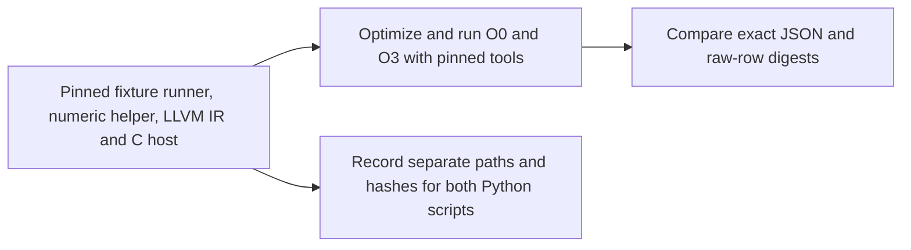

# RT-00 C — Replay the LLVM floating-point flags experiment

**Scope:** PLAN §0.1, [issue #284](https://github.com/aivibeflow/LLMLang/issues/284). Fresh native reproduction from `research/all` at `d2e32df3ff25ef28dc66750b3e14e777d7cd7d35`.

## Question and result

The [evidence-ledger identity audit](RT-00-C-EVIDENCE-LEDGER-IDENTITIES-2026-11-25.md#filename-ambiguity-controls) found that the LLVM flags ledger's `run.py` digest identifies a numeric helper from a different directory. Does the fixture's own tracked runner reproduce the published evidence when both scripts are pinned by path? We used the exact archived runner and helper, the archived IR and C host, and Debian LLVM and Clang 19.1.7 on x86-64 with FMA. The generated ledger matched the published bytes, including both raw observation-stream digests.



The [replay receipt](RT-00-C-LLVM-FP-FLAGS-REPLAY-2026-11-25.json) binds the fixture runner and helper separately by full repository path, Git blob and SHA-256. The two paths identify different inputs even though both files are named `run.py`. An identity check using only the published ledger would identify the helper but would leave the exact runner implicit. Here, the byte-identical replay adds fresh observation evidence for the two exact scripts. The historical ledger is preserved.

| Observation | O0 | O3 |
| --- | ---: | ---: |
| Operand triples | 6,859 | 6,859 |
| Exact split-expression disagreements with reference | 0 | 0 |
| Explicit FMA disagreements with reference | 0 | 0 |
| Contract-enabled results different from strict split | 0 | 77 |
| `nsz` results different from the signed-zero profile | 0 | 361 |
| NaN inputs outside the `nnan` promise | 1,083 | 1,083 |

The optimized contract-enabled route selects a fused operation, and the `nsz` route preserves a negative zero in the scoped witness where the strict expression returns positive zero. Those observations constrain which flags a source contract can authorize. The [original study and its table generator](../../compiler-and-translation/RT-13/RT-13-LLVM-FP-FLAGS-2026-11-25.md) explain the witnesses and operand model.

## Reproduce

Use CPython 3.12.14 and the Linux x86-64 FMA profile. Set `CLANG` to Debian Clang 19.1.7 from the trixie 1:19.1.7-3+b1 package and set `LLVM_AS`, `LLVM_OPT`, and `LLVM_LLC` to the matching LLVM package's executables. The replay used extracted packages with the corresponding libraries available to the loader. The receipt records package hashes and the observed system linker, libc, CPU and tool versions.

```sh
set -eu
archive=$(mktemp -d)
git archive d2e32df3ff25ef28dc66750b3e14e777d7cd7d35 \
  research/compiler-and-translation/RT-13/LLVM-FP-FLAGS-01 \
  research/compiler-and-translation/RT-13/BINARY64-CONTRACTION-01 | tar -x -C "$archive"
fixture="$archive/research/compiler-and-translation/RT-13/LLVM-FP-FLAGS-01"
LC_ALL=C PYTHONHASHSEED=1 python3 -B "$fixture/run.py" \
  --clang "$CLANG" --asm "$LLVM_AS" --opt "$LLVM_OPT" --llc "$LLVM_LLC" \
  --output "$archive/fp-flags-replay.json"
cmp "$archive/fp-flags-replay.json" "$fixture/evidence.json"
sha256sum "$archive/fp-flags-replay.json"
```

The observed ledger SHA-256 is `7fd2c17399cfa181f5139d369dce0887663b80975a2537c12eb767556691d7d6`. This covers a finite fixture in the stated rounding and hardware profile. General lowering correctness, other targets, and attestations for the original execution remain separate. Mermaid source was checked directly.
