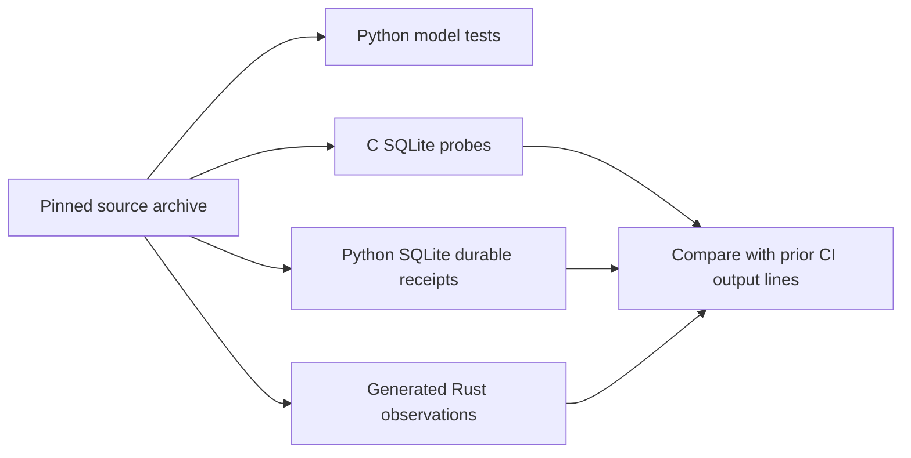

# RT-00 C — Replay native SQLite and generated-Rust lifecycle evidence

**Status:** Exact-source local replay and historical stdout comparison complete.

**Baseline:** `1c468d6f08b27887654313461a81283aeda99d88`. The RT-04-01 prototype tree matches main `46f48834abc5da1a10f1fa868e4c15c6151338c2`.

**Evidence type:** Native C-API and generated Rust observations plus executable Python model tests.

**Tracking:** PLAN §0.1 and the RT-03/04 interpretation in §1.4.1.

## Question and method

The [RT-04 reproduction protocol](../../language-design/RT-04/RT-04-NATIVE-REPRODUCTION.md) recorded eight C SQLite commands, a Python SQLite durable-receipt experiment and a generated Rust replay. We tested whether the current runner preserves the observations after changes to its invocation and reproduction metadata. We also ran the separate Python suite. The direct comparison uses the visible stdout sections of the original Actions job, with timestamp prefixes removed. [Historical run and job](https://github.com/aivibeflow/LLMLang/actions/runs/44774296240/job/136419847973)



The model suite and the three native paths exercise separate claims. Comparing C SQLite source IDs guards against interpreting a different 3.46.1 package as the original runtime profile.

## Results and alternatives

| Slice | Reproduced result | Effect on the comparison |
| --- | --- | --- |
| Python models and admission | 364 tests passed | Tests exercise the bounded type/resource models and runner checks independently from native execution. |
| Eight C SQLite commands | All eight passed with the exact recorded `alt1` source ID | The recovery matrix still compares 356 admitted traces and rejects 154 plans. A stale snapshot yields busy close, while the refreshed empty set permits close. A live backup can block close even when the statement count is zero. |
| Durable receipt process interruption | All ten observations across atomic and separate recording matched the archived log | Separate recording has an interval where the effect survives and a terminal record is absent. The tested atomic transaction closes that gap at the commit boundary. |
| Generated Rust owned-result trace | All 125,952 observations matched the reference across the tested policies at O0 and O3 | The generated candidate preserves its declared bounded outcome traces. Typed FFI and whole-language lowering remain separate dependencies. |

The **10/10** native commands passed with zero failures, zero skips and empty stderr. Their stdout matched all ten displayed historical sections line for line. The [replay ledger](RT-00-C-NATIVE-LIFECYCLE-REPLAY-2026-11-24.json) preserves current stdout, digests, tool identities, exact source blobs and the source of the historical comparison. The comparison is to the logged stdout sections. The hosted job and the local archive have separate run and environment identities.

The observations distinguish a statement count from complete dependent-resource coverage, a snapshot from its later freshness check, and a durable effect from delivery of its terminal record. They support a guarded close model with coverage evidence and an atomic receipt boundary for this SQLite fixture. Runtime alternatives with another dependency model or persistence boundary need their own counterexamples and correspondence checks. The generated Rust traces leave that broader comparison open.

## Reproduction and limits

Use a clean checkout or Git archive of the baseline, CPython 3.12.14 with SQLite 3.53.1, Rust 1.85.1, and a C SQLite 3.46.1 build matching the `alt1` source ID in the ledger. The local run selected Debian's `libsqlite3-0` version `3.46.1-7+deb13u2`. Its Python SQLite source ID matches the prior CI replay's source ID. The original pre-CI Scenario 130 report lacks that identifier, so its original build identity remains open.

```sh
baseline=1c468d6f08b27887654313461a81283aeda99d88
rt04=research/PROTOTYPES/RT-04-01
LLMLANG_SQLITE_LIBRARY=/path/to/libsqlite3.so.0 GITHUB_SHA="$baseline" \
  python3 -B "$rt04/run_native_probes.py" --suite all \
  --output-dir /tmp/llmlang-rt04-native-replay
python3 -B -m unittest discover -s "$rt04" -v
```

In a local archive the runner's `GITHUB_SHA` metadata field records the pinned source commit. Compare the output files with the ledger or the timestamp-stripped stdout sections of the prior job. The counts enumerate the checked fixtures. Mermaid source was checked without local rendering.

General ownership semantics, complete dependents in arbitrary foreign libraries, operational proof that the deployed service obeys the receipt boundary, and independent review require further evidence.
