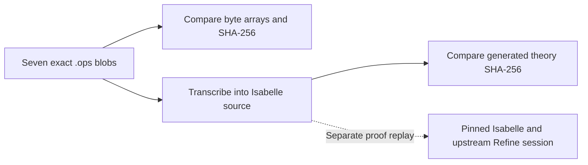

# RT-00 C — Verify the RT-38 nested source identities

**Scope:** PLAN §0.1 and [#284](https://github.com/aivibeflow/LLMLang/issues/284). Source tree archived from `research/all` at `d2e32df3ff25ef28dc66750b3e14e777d7cd7d35`.

## Question and result

The [evidence-ledger identity audit](RT-00-C-EVIDENCE-LEDGER-IDENTITIES-2026-11-25.md) deferred seven values because the RT-38 source decoder stores an object per input. Each nested value contains the literal source bytes, SHA-256 and a reported decoder disposition. We checked the two byte identities independently of that disposition. All seven tracked inputs have the exact bytes and SHA-256 the ledger declares. Four additional directly hashed inputs, the local refined wrapper and the regenerated Isabelle theory also match their published identities.

| Check against the archived ledger | Matched |
| --- | ---: |
| Source files compared to literal byte arrays and SHA-256 | 7 / 7 |
| Separately named exporter, theory template, root and replay script | 4 / 4 |
| Refined wrapper theory | 1 / 1 |
| Source theory regenerated by transcribing bytes into the template | 1 / 1 |

The seven cases include two accept and five reject dispositions from the prior study. One source contains seven bytes because it deliberately omits its final line feed. The other six contain eight bytes. Reading exact bytes preserves that mutation. The existing [source-decoder evidence ledger](../../runtime-and-systems/RT-38/SEL4-LOOKUP-SOURCE-01/evidence.json) preserves the raw byte arrays, all expected digests and the reported dispositions.



Hashing only the generated theory could show that the emitter reproduced its published output. Checking the seven inputs separately also binds the ledger's per-case identity, including the missing line feed. An independent decoder implementation could compare acceptance behavior, while the upstream Isabelle replay would check the original propositions and their premises. This pass performs byte and transcription checks. It does not attest a new Isabelle result or recheck the upstream proof heap, which requires the pinned workbench described by the [RT-38 source decoder study](../../runtime-and-systems/RT-38/RT-38-SEL4-LOOKUP-SOURCE-DECODER-2026-11-25.md).

## Reproduce

Observed with CPython 3.12.14 and Git 2.56.1 on Linux x86-64. The script exits on the first discrepancy. It uses the existing exporter on the exact archive and writes its output outside the checkout.

```sh
set -eu
scratch=$(mktemp -d)
git archive d2e32df3ff25ef28dc66750b3e14e777d7cd7d35 \
  research/runtime-and-systems/RT-38 | tar -x -C "$scratch"
fixture="$scratch/research/runtime-and-systems/RT-38/SEL4-LOOKUP-SOURCE-01"
python3 -B "$fixture/export_bytes.py" --output "$scratch/SourceLookup.thy"
python3 -B - "$fixture" "$scratch/SourceLookup.thy" <<'PY'
from hashlib import sha256
import json
from pathlib import Path
import sys

fixture, theory = map(Path, sys.argv[1:])
ledger = json.loads((fixture / "evidence.json").read_bytes())

def compare(path, expected):
    assert sha256(path.read_bytes()).hexdigest() == expected, path

sources = {path.stem: path for path in (fixture / "sources").glob("*.ops")}
assert sources.keys() == ledger["sources"].keys()
for name, path in sorted(sources.items()):
    row = ledger["sources"][name]
    assert list(path.read_bytes()) == row["bytes"], path
    compare(path, row["sha256"])
for name, expected in ledger["checked_source_input_sha256"].items():
    compare(fixture / name, expected)
compare(fixture.parent / "SEL4-REFINED-LOOKUP-01/RefinedLookup.thy",
        ledger["refined_wrapper_sha256"])
compare(theory, ledger["generated_source_theory_sha256"])
print(f"{len(sources)} nested sources, four exporter inputs, wrapper and theory match")
PY
```

The result closes the seven nested records deferred by the static audit at the source-identity level. The separate [generated-source replay](RT-00-C-GENERATED-SOURCE-REPLAY-2026-11-25.md) covers the other 25 deferred records. Mermaid source was checked directly. Full toolchain and original-run provenance across the research corpus remain open.
