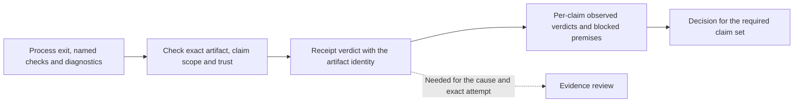

# RT-00 C — Preserve incomplete and negative proof outcomes

**Scope:** PLAN §0.2, [#285](https://github.com/aivibeflow/LLMLang/issues/285), with evidence from RT-07 and the RT-33 composition prototype. Input archive from `research/all` at `49f6d1a4328bf7d083ac44ff91ac587c02075276`.

## Question

Which distinctions survive when a proof tool result is reduced to a process status, a receipt verdict, or a claim decision? LLMLang uses those layers for different purposes. A process status reports how a tool invocation ended. A receipt associates an exact artifact with one claim and premise closure. A claim decision tells a caller whether the available evidence discharges the claim.



The coarse decision supports automation that just needs to know whether to proceed. Diagnosing an incomplete result or reproducing a negative finding requires the evidence at the preceding layers.

## Archived diagnostic contrasts

The [Dafny modular closure study](../../formal-verification/RT-07/RT-07-DAFNY-MODULAR-PROOF-CLOSURE-2026-11-25.md) preserves the exact prover observations. The same contrast appears with both bundled Z3 versions.

| Coarse label | Distinct archived outcomes | Meaning for evidence |
| --- | --- | --- |
| Dafny exit 4 | One verification error for the incorrect provider and zero exhausted batches, or zero ordinary errors and one exhausted batch | The first invocation reports failure of a named obligation. The second leaves its obligation undecided. The exit code cannot establish the reason. |
| Dafny exit 0 | Caller proof with its provider premise open, or successful caller and provider obligations | Closing the claim requires evidence for the exact required provider. |
| cvc5 `unsat` | Logos rejects the coarse certificate containing 35 trust commands and accepts the fine-grained certificate with zero | Checker admission and solver output are separate observations. Rejected evidence does not establish the opposite solver result. |
| Incomplete | Reported solver resource exhaustion, or host termination before a result | Preserve the diagnostic source. The latter fixture injects a delay to test the deadline path. |
| Certificate binding failure | The original valid certificate is rejected against changed assumptions | This is a receipt scope failure. A checked query result or independently checked counterexample for the revised claim remains distinct. |

This is an internal check of the archived contrasts. The [separate RT-07 replay](RT-00-C-DAFNY-MODULAR-PROOF-REPLAY-2026-11-25.md) reruns the tools. We did not feed Dafny or Logos outputs into a production adapter.

## Composition experiment

The [RT-33 prototype](../../formal-verification/PROOF-OBLIGATION-BENCHMARK/EVIDENCE-COMPOSITION.md) accepts five verdicts in an authorized receipt. We exercised every subset of the five verdicts under two premise states and two authorization states, for 128 deterministic configurations of one finite claim. The independent expectation table asserts the permitted decision and observed verdicts for each case. The 11 existing composition tests also passed.

| Decision | Configurations |
| --- | ---: |
| Insufficient | 80 |
| Conditional | 16 |
| Conflict | 16 |
| Bounded agreement | 8 |
| Refuted | 8 |

Unknown, timeout and unsupported observations remained visible per claim when submitted as authorized receipts. None discharged the claim. The aggregate `insufficient` covers no evidence, unauthorized attempts, and authorized incomplete evidence. Two authorized `unknown` receipts under different artifact identities also produced the same returned projection as one alone. The input receipts are distinct. The projection keeps the set of verdict labels and cannot reconstruct which artifact supplied each occurrence.

For review, preserve the exact admitted receipts and source diagnostics alongside the aggregate decision. Applying a result-only or return-code-only mapping to the archived contrasts would discard a distinction required for diagnosing failures or judging scope. An adapter that treats an unsupported certificate or an incomplete verifier attempt as a semantic counterexample would need a separately checked witness for the exact claim. This is a candidate evidence-handling rule. It leaves production adapter validity, semantic correspondence, policy adoption, and independent review open.

## Reproduce

Run with CPython 3.12.14 and Git 2.56.1. The [script](PROOF-RECEIPT-STATUS-01/audit.py) compares the archived contrasts and runs the finite matrix. The [machine-readable evidence](PROOF-RECEIPT-STATUS-01/evidence.json) records the source digests and all case outputs.

```sh
set -eu
archive=$(mktemp -d)
git archive 49f6d1a4328bf7d083ac44ff91ac587c02075276 \
  research/formal-verification | tar -x -C "$archive"
fixture=research/research-management/RT-00/PROOF-RECEIPT-STATUS-01
python3 -B "$fixture/audit.py" --archive-dir "$archive" --output "$archive/proof-receipt-audit.json"
cmp "$archive/proof-receipt-audit.json" "$fixture/evidence.json"
python3 -B "$archive/research/formal-verification/PROOF-OBLIGATION-BENCHMARK/evidence/test_composition.py"
```

The decision counts cover every case in the specified matrix and carry no sampling error estimate. Mermaid source was checked directly.
