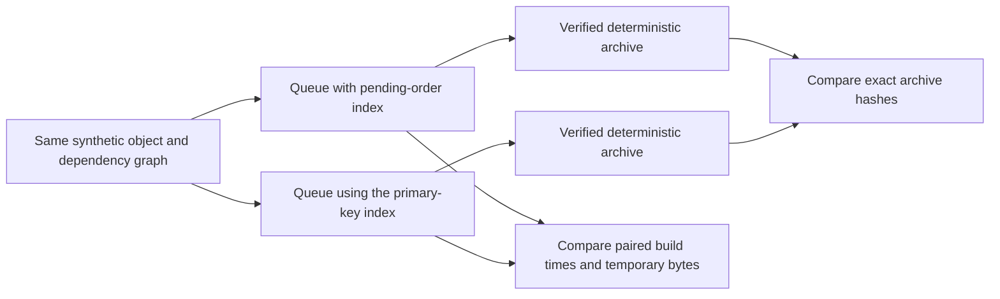
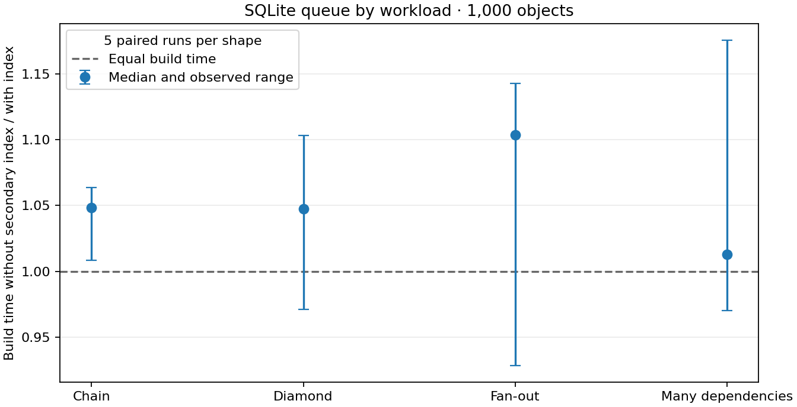

# RT-00 C — Recheck the Package Provider's indexed pending queue

**Status:** Bounded paired local benchmark and archive-identity checks.

**Baseline:** `5d0d474848bee4b0c4f103af06dd3cfb5f7c6612`. Both package prototype trees and the workspace prototype match main `8fb06122ca7309414a473fdaec741cc023148f4d`.

**Evidence type:** Exact-source test replay, paired synthetic measurements and SQLite query plans.

**Tracking:** PLAN §0.1 and the package comparison in §7.2.

## Question and alternatives

The [package study](../../packages-and-ecosystem/RT-12/PACKAGE-SYSTEM.md) reported that adding a SQLite secondary index to the disk-backed pending queue accelerated Provider builds. We tested whether the relocated prototype has the same effect at 1,000 objects, and whether either queue changes deterministic archive bytes. We compared the present covering index on `(processed, hash)` with the same Provider using only the existing hash primary-key index. Both run the same ordered pending lookup, archive builder and verifier.



The graph isolates the queue schema choice. The observed archive identity and performance consequences are measured separately.

## Method

The [replay driver](package_provider_queue_replay.py) extracts the two pinned package prototype families from Git and makes two scratch copies. It removes only the statement creating the secondary index in the comparison copy. Both copies log the SHA-256 of the completed archive after the benchmark has timed build and verification. The same 1,024-record sort cap and 4,096 KiB SQLite cache setting apply in both. The existing benchmark verifies each archive before recording its digest.

There are five paired trials for each of four deterministic graph shapes. Each variant runs in a separate process and a fresh temporary build directory. The driver rotates shape order and alternates variant order within each shape. Host resources are shared and OS cache state is uncontrolled. Timings are exploratory. The chart shows the paired time ratio as a median and observed range, with five pairs per shape. An initial run exposed a fixed variant order within each shape and was interrupted. The published run uses the corrected alternation.

## Results

| Shape | Edges | Build with index, median seconds | Build without index, median seconds | Paired time ratio, median [min, max] |
| --- | ---: | ---: | ---: | ---: |
| Chain | 999 | 0.719 | 0.749 | 1.048 [1.008, 1.064] |
| Diamond | 1,249 | 0.799 | 0.816 | 1.047 [0.971, 1.103] |
| Fan-out | 999 | 0.695 | 0.751 | 1.104 [0.928, 1.143] |
| Many dependencies | 15,864 | 5.912 | 5.934 | 1.013 [0.970, 1.176] |

The indexed variant has a lower median in all four shapes. Three paired ranges cross parity. The median observed temporary-directory sizes were 92 KiB higher for chain and 96 KiB higher for the other shapes with the index. The benchmark samples temporary directory size at cleanup. The modest median improvement and the spread matter when choosing whether to trade temporary disk for faster queue selection.



The SQLite plan searches the covering index by `processed` in the indexed variant and scans the primary-key index in key order in the comparison variant. All 20 pairs produced valid archives with equal SHA-256 across variants. For each shape, the archive SHA-256 was also identical across its repeated runs. The [observations](provider-queue-replay-2026-11-24.json) retain dependency counts, timings, temporary bytes, traced Python memory, process peak RSS and archive identities.

The exact-tree correctness suites also passed 40 package-identity tests, 81 package-index and Provider tests, and 9 workspace tests on CPython 3.12.14. In particular, the Provider's SQLite snapshot test exercises an already-open read transaction across a concurrent commit. That evidence pertains to the standalone Content Store. A persistent Toolchain Server adapter and source-derived SPG dependency extraction remain separate gates.

## Reproduction and limits

From the repository root with CPython 3.12.14, SQLite 3.53.1 and Git 2.56.1:

```sh
driver=research/research-management/RT-00/package_provider_queue_replay.py
python3 -B "$driver" measure \
  --baseline 5d0d474848bee4b0c4f103af06dd3cfb5f7c6612 \
  --size 1000 --repetitions 5 --output /tmp/provider-queue-replay.json
MPLBACKEND=Agg python3 -B "$driver" plot \
  --input research/research-management/RT-00/provider-queue-replay-2026-11-24.json \
  --output /tmp/provider-queue-replay.png
```

The chart was generated with Matplotlib 3.10.8 from the recorded data. To repeat the correctness suites at the baseline, run `python3 -B -m unittest discover -v` in [Package Identity](../../packages-and-ecosystem/PROTOTYPES/PACKAGE-IDENTITY-01/), `PYTHONPATH=../PACKAGE-IDENTITY-01 python3 -B run_tests_with_timings.py` in [Package Index](../../packages-and-ecosystem/PROTOTYPES/PACKAGE-INDEX-01/), and `python3 -B -m unittest discover -s . -p 'test_toolchain.py' -v` in [Toolchain Server](../../toolchain-and-collaboration/PROTOTYPES/TOOLCHAIN-SERVER-01/). Mermaid source was checked without rendering it locally.

The shared x86-64 host reported an Intel Xeon Platinum 8573C, five logical CPUs and Linux 6.18.57. The measurement is limited to one synthetic size, a fixed local cache setting and one host. It supports keeping the indexed queue in the existing prototype while distinguishing queue layout from the choice of persistent Provider, wire format or cache policy. The historical improvements at 5,000 objects were larger. Comparing production implementations still needs controlled hardware, representative dependency topology, persistent snapshots and measured cold/warm behavior. No specification or performance threshold is implied.
