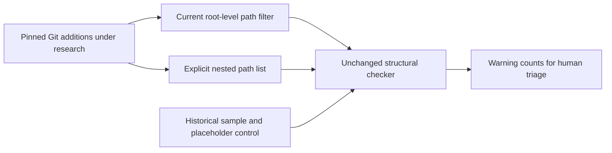

# RT-00 C — Structural warning coverage after research relocation

## Question and method

Does the report structure pilot still inspect newly added reports after they move under thematic directories? Can its warning count identify which reports contain supporting evidence? I compared the existing automatic path selector and explicit nested-path selection for the same set of added reports. I also repeated the archived ten-report sample, checked the existing adjudication register and ran one deliberately empty report through the unchanged checker. [Pilot workflow](../../../.github/workflows/research-quality-pilot.yml) · [Checker](../../../.github/scripts/check_research_quality.py) · [Earlier warning adjudication](RT-00-QUALITY-RULES-ADJUDICATION-2026-11-23.md)

The fixed diff is from `2bd6f37b4b10f92434fbdfa9ca7233ccd6166041` to `bf4308bd7519859f82e1a520aa2cef2c19295c7d` on `research/all`. The candidate nested paths use the existing report filename prefixes and suffixes, allowing additional directory components. This lexical rule approximates the report role for this cohort. Broad deployment would require agreeing on exclusions and how to handle reports with other naming patterns.



The selection step controls which reports reach the checker. The placeholder control tests what the checker can infer after a report is selected.

## Results

| Run | Reports checked | Warnings | Observed boundary |
|---|---:|---:|---|
| Current automatic selection on the pinned diff | 0 | 0 | All 18 added Markdown reports are nested. |
| Explicit selection of the same 18 paths | 18 | 152 | Every report produced a warning. The hypotheses/alternatives and draft impact/traceability heading rules each failed to match all 18 reports. |
| Frozen historical sample | 10 | 62 | All blobs and warning lists match the archive. |
| Placeholder report with empty sections and metadata placeholders | 1 | 0 | The checker recognized headings, labels and a shell fence without any experimental evidence. |

The current selector requires exactly two path components, including the leading `research` component. All 18 named reports in the diff reach the checker through the alternative selection. In the [published modular proof comparison](../../formal-verification/RT-07/RT-07-DAFNY-MODULAR-PROOF-CLOSURE-2026-11-25.md), the checker reported ten warnings when the path was supplied explicitly. Its command, tool inputs, structured evidence and results remain discoverable under the report's descriptive headings. The separate ten-report legacy review classified 16 of its 33 outstanding warnings as layout-only and 17 as documentation gaps. These categories require contextual review.

The placeholder control shows that satisfying the structural patterns does not establish evidence presence. The 152 warnings on the nested cohort measure checker output. Claim validity, the evidence class under each heading and the meaning of missing fields require manual review. The findings support preserving warning-only behavior during any expansion of the selector. Maintainer approval, independent review and a broader content-annotated cohort remain pending. This study proposes no changes to the candidate specification. [Stage 0.2 issue](https://github.com/aivibeflow/LLMLang/issues/285)

## Reproduction

CPython 3.12.14 and Git 2.56.1 were used. The three existing checker, replay and adjudication suites passed 7, 4 and 7 tests respectively. The historical citation validator reports 33 rows, with 16 layout-only and 17 documentation gaps. The [replay script](QUALITY-WARNING-COVERAGE-01/audit.py) preserves the exact control text and compares the selected paths without checking out another branch. It uses the unchanged checker pinned in the [ledger](QUALITY-WARNING-COVERAGE-01/evidence.json). The table is a summary of that ledger. The Mermaid source was checked without local rendering.

```bash
fixture=research/research-management/RT-00/QUALITY-WARNING-COVERAGE-01
python3 -B "$fixture/audit.py" 2bd6f37 bf4308b --output /tmp/llmlang-quality-warning-coverage.json
cmp "$fixture/evidence.json" /tmp/llmlang-quality-warning-coverage.json
python3 -B .github/scripts/validate_research_quality_adjudication.py --root .
```
