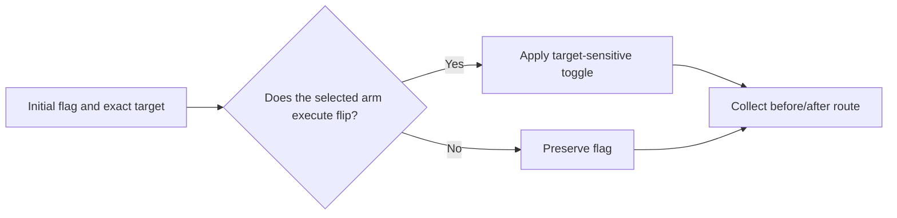

# RT-00 C — RT-06 path analysis replay and conditional-call boundary

**Scope:** PLAN §0.1 and [#284](https://github.com/aivibeflow/LLMLang/issues/284). The checker runs against the exact `research/all` tree at `873556ad43892c7c2ffcae602881ffd544020eca`.

The RT-06 studies build up from structural branch coverage to feasibility checking and source-derived alias summaries. A *route* in the final fixtures is the pair of observed Boolean values before and after executing the caller. A result is sound for conservative reachability when it includes every feasible route. It is exact when it also excludes infeasible routes.

The original suites test guarded reference selection followed by an unconditional call. This audit replays those tests and asks whether the joined alias model still has conservative coverage if the call itself can be skipped. A single call expression in the AST can execute zero times on a particular path. A precise summary of its targets does not show that it executes.

## Replay at the pinned tree

All 55 tests completed with zero skips. The suite names, counts and full comparison rows are in the [machine-readable ledger](RT06-PATH-REPLAY-01/evidence.json).

| Scenarios | Tested property and evidence boundary | Passed |
| --- | --- | ---: |
| [98](../../semantic-representation/RT-06/RESEARCH-SCENARIO-98-FINITE-AST-PATH-COVERAGE.md) and [99](../../semantic-representation/RT-06/RESEARCH-SCENARIO-99-REPEATED-PATH-PREDICATES.md) | Finite structural paths and consistent choices for repeated immutable markers in hand-built ASTs | 13 |
| [100](../../semantic-representation/RT-06/RESEARCH-SCENARIO-100-FINITE-BOOLEAN-PATH-FEASIBILITY.md) | Boolean truth-table routes and concrete evaluator traces | 3 |
| [101](../../semantic-representation/RT-06/RESEARCH-SCENARIO-101-SOLVER-VS-TRUTH-TABLE-PATHS.md) and [102](../../semantic-representation/RT-06/RESEARCH-SCENARIO-102-SOLVER-UNKNOWN-AND-SOUND-PATH-PRUNING.md) | DPLL route agreement, replayed witnesses and result admission, including 128 seeded formulas in the current suite | 11 |
| [103](../../semantic-representation/RT-06/RESEARCH-SCENARIO-103-REAL-SOLVER-TIMEOUT-ISOLATION.md) | Worker SAT, untrusted UNSAT, protocol refusal and an actual externally timed hard query | 5 |
| [104](../../semantic-representation/RT-06/RESEARCH-SCENARIO-104-MUTABLE-PREDICATE-IDENTITY.md) and [105](../../semantic-representation/RT-06/RESEARCH-SCENARIO-105-CALL-MUTATION-SUMMARIES.md) | Versioned Boolean reads and explicit summaries for pure, mutating and unknown calls | 8 |
| [106](../../semantic-representation/RT-06/RESEARCH-SCENARIO-106-CALL-ALIAS-SETS-AND-FIELD-SENSITIVE-PATHS.md), [107](../../semantic-representation/RT-06/RESEARCH-SCENARIO-107-SOURCE-DERIVED-CALL-ALIASES.md) and [108](../../semantic-representation/RT-06/RESEARCH-SCENARIO-108-PATH-SENSITIVE-ALIAS-PRECISION.md) | Finite points-to sets, AST extraction and path-sensitive execution in the fixture grammar | 15 |

This is a new run of the present suites. It preserves the older reports' counts and leaves their historical provenance and performance observations at their published scope. The existing result-policy adapter still requires an accepted evidence basis to prune on UNSAT. This replay did not introduce one. [Scenario 102 historical count reconciliation](RT-00-C-SCENARIO-102-RESULT-POLICY-REPRO-2026-11-23.md)

## New finite controls

The Boolean flags `flag`, `other` and `choose` are independent. The call always targets a known field, either `flag` or `other`. Each target has one unconditional fixture and six guarded fixtures: run the call on a true or false result for each guard variable. Every fixture has eight input assignments, for 112 input/program pairs. There are no unknown references. The independent oracle uses the finite rule

```text
flag_after = flag_before XOR (call_executes AND target_is_flag)
```

The oracle computes whether the guard allows the call directly from the supplied case and the Boolean assignment. It uses no AST parser, alias extractor, evaluator or fixture summary. The runner sends the generated source text to the fixture's concrete executor and both analysis strategies.



The current joined model computes only the upper call-effect branch. In the guarded cases that can affect the observed field, this eliminates the route from the skipped branch. The path-sensitive explorer takes the actual arm under each valuation. A candidate joined variant adds the identity relation wherever the call may be skipped.

| Strategy | Fixtures with a missing feasible route | Fixtures with an extra infeasible route |
| --- | ---: | ---: |
| Current joined alias summary | 6 / 14 | 2 / 14 |
| Joined alias summary plus possible skip | 0 / 14 | 2 / 14 |
| Existing path-sensitive explorer | 0 / 14 | 0 / 14 |

For example, with `target = ref(flag)` and `if flag: flip(target)`, the oracle gives `FF` and `TF`, where the first letter represents the original flag and the second its final value. The joined result gives `FT` and `TF`. It loses `FF` because the single syntactic call is treated as unconditional. Retaining the skip path recovers `FF` and carries extra routes because the guard still constrains which branch executes.

## Implication and limits

The existing Scenario 107 and 108 observations remain valid for their fixtures. The stronger claim that the current joined analyzer always overapproximates every caller it admits is false on the bounded examples above. A sound source-path pipeline needs evidence that an effect occurs on a path, in addition to evidence about the effect and its possible targets. For a profile that requires an unconditional call, explicit rejection of guarded calls would preserve the narrower boundary. A may-skip summary can keep more programs conservatively at the cost of precision. A guarded relation can retain precision, with greater obligations for extracting guard semantics and tracking state.

The candidate may-skip rule was evaluated only as a relation in this audit. It has no new extractor or general soundness proof. The checked grammar contains only one direct call and one optional Boolean guard in the new corpus. Source extraction for LLMLang, loops, arbitrary conditions and alias paths, fault and effect composition, backend correspondence, scaling and independent review remain open. The audit makes no architecture selection. Mermaid syntax was inspected directly.

## Reproduce

Use CPython 3.12.14, SymPy 1.14.0 and Git 2.52.0. The run used x86-64 Linux 6.18.57. The [replay script](RT06-PATH-REPLAY-01/replay.py) unpacks only the pinned fixture tree to a disposable directory, executes nine test modules, and writes the cases and route differences as JSON. It omits elapsed times because the replay tests outcomes rather than performance.

```sh
fixture=research/research-management/RT-00/RT06-PATH-REPLAY-01
LC_ALL=C PYTHONHASHSEED=1 python3 -B "$fixture/replay.py" > /tmp/llmlang-rt06-path-replay.json
cmp "$fixture/evidence.json" /tmp/llmlang-rt06-path-replay.json
```
