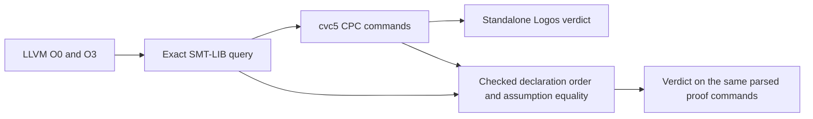

# RT-00 C — RT-13 checked-add CPC binding replay

## Question and baseline

Can a fresh cvc5 and Logos run reproduce the two checked-add certificates and distinguish proof validity from binding to the claimed LLVM observation formula? This audit covers §0.1 and [#284](https://github.com/aivibeflow/LLMLang/issues/284). The [RT-13 publication](../../compiler-and-translation/RT-13/RT-13-LLVM-CHECKED-ADD-CPC-BINDING-2026-11-24.md) supplies the O0 and O3 predicates. Each describes a mismatch in returned status, output stores or ordered callbacks between the source and the preserving LLVM variant.

The immutable LLMLang baseline was `54ddc67b29eb3531d69fa7612eabf8dde64c7f7c` on `research/all`. The archived ledger, runner and bound-checker source have Git blob IDs `5be86af1b626c00e0b7ff2ae410763c86ff74e34`, `293adda9936d2e219d9821c8a19e32e9f542a2ba` and `9b7c790590d70a06457b61aafba804358af4b1d1`. For this run the host was Debian 13 Linux x86-64, kernel 6.18.57, glibc 2.41. The pinned tools were CPython 3.12.14, Debian LLVM 19.1.7, cvc5 1.4.2 at `282d5e0c84baf49c780704c532f87ba66d8b513d`, Lean/Lake 4.34.0 at `293d5d0c0c3f3dded4688b3ccd6a33939ac5102b` and a clean Logos checkout at `cf18742973861b3718d04c5f25775448098ff474`.

## Method

The [archived runner](../../compiler-and-translation/PROTOTYPES/LLVM-PRESERVATION-01/checked_add_certificate_replay.py) builds Logos, regenerates the exact LLVM modules and SMT-LIB queries, produces cvc5 CPC refutations and checks the commands in compiled Logos and the Lean binding checker. The extra declaration controls alter the query or proof separately after checking the regenerated O0 artifact hashes. The bound checker validates declarations and compares parsed assumptions before invoking the verdict.



## Archived replay

The complete [publication ledger](../../compiler-and-translation/PROTOTYPES/LLVM-PRESERVATION-01/checked-add-certificate-results.json) matched byte for byte, SHA-256 `286f8032f4b46cd8fbedb7ed7f14c14830fa62f962fe3f15e1874f58c09bf111`. Compiled Logos and the bound checker both accepted the exact O0 and O3 proofs, with 1,286 and 1,269 steps respectively. Exchanging the two proofs preserved each standalone verdict but failed query binding in both directions. The coordinated proof-side input rename passed standalone Logos and failed declaration binding. The altered final conclusion failed both checkers. The fresh compiled Logos executable had SHA-256 `41fcf0290357b49c96cb07991e63ad9f944596b7895c810d49611013c5cedd90`.

## Additional declaration controls

| O0 change | Bound checker outcome |
| --- | --- |
| Reverse the three source declarations without changing their names, sorts or the assertion | `correct` |
| Widen the source declaration for `a` to 33 bits | `invalid-source-declarations` |
| Widen the proof declaration for `a` to 33 bits | `declarations-mismatch` |
| Add a fourth declaration to the proof header | `declarations-mismatch` |
| Append the same extra declaration after the proof | `unsupported-proof-command` |

The positive control tests compatibility with a source declaration permutation. The negative controls locate rejection at the source, proof header and command admission checks. The [new runner](RT13-CPC-REPLAY-01/run.py) and [ledger](RT13-CPC-REPLAY-01/evidence.json) preserve the generated input hashes and exact process outcomes. Categorical verdicts are presented in the table.

## Scope

The observations apply to the fixed declaration and command profiles and exact reconstructed O0 and O3 predicates. They preserve the distinction between a valid proof for its own assumptions and a proof bound to a particular query. They do not establish general SMT-LIB conversion, source-to-LLVM correspondence, or a checked proof of the upstream Logos rule implementation. This adds a new execution record for Stage 0.1 without adopting a solver or certificate policy.

## Reproduce

With the listed tool versions on PATH and an unmodified `LOGOS_CHECKOUT` at the pinned upstream revision, run from the LLMLang root:

```sh
export LC_ALL=C PYTHONHASHSEED=1
fixture=research/compiler-and-translation/PROTOTYPES/LLVM-PRESERVATION-01
controls=research/research-management/RT-00/RT13-CPC-REPLAY-01
replay=$(mktemp)
declarations=$(mktemp)
python3 -B "$fixture/checked_add_certificate_replay.py" --checkout "$LOGOS_CHECKOUT" --output "$replay" &&
  cmp "$fixture/checked-add-certificate-results.json" "$replay" &&
  python3 -B "$controls/run.py" --checkout "$LOGOS_CHECKOUT" > "$declarations" &&
  cmp "$controls/evidence.json" "$declarations"
```
