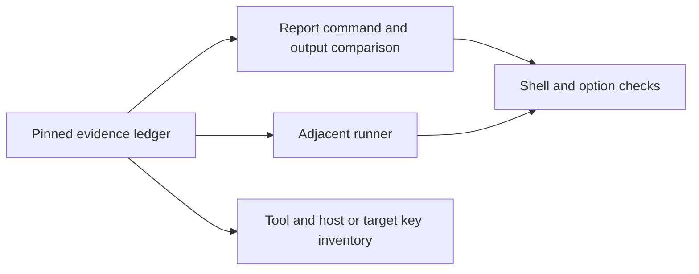

# RT-00 C — Audit replay metadata for RT-13 evidence ledgers

## Question and scope

Which RT-13 experiments in the exact-name evidence cohort have usable replay entry points, and what do their tool records establish about execution? This extends the [source identity audit](RT-00-C-EVIDENCE-LEDGER-IDENTITIES-2026-11-25.md) for Stage 0.1 and [#284](https://github.com/aivibeflow/LLMLang/issues/284). The cohort is every immediate fixture directory with a tracked `evidence.json` under [RT-13](../../compiler-and-translation/RT-13) at `037723fc4a4d23c4b0e30e31aefea11e7a13382f` on `research/all`. Separately named ledgers and reports outside that directory are outside the census.

## Method

The [auditor](RT13-REPLAY-METADATA-01/run.py) extracts the pinned Git tree and joins each ledger to its adjacent runner and the shell snippets that run it and compare the result with that ledger. It checks snippet syntax with Bash and compares documented long options with the pinned runner's help when the command uses options. It records Git blob IDs for the ledger, runner and documentation and inventories selected top-level metadata keys. This complements content hashing with an explicit route to exercise the archived fixture.



## Findings

| Observation | Pinned cohort result |
| --- | ---: |
| Evidence ledgers with an adjacent runner and a documented command that compares its output with the ledger | 19/19 |
| Documented replay routes with valid shell syntax and advertised long options where supplied | 20/20 |
| Ledgers with a selected top-level tool key | 19/19 |
| Ledgers with a selected top-level host or target key | 5/19 |

The [audit ledger](RT13-REPLAY-METADATA-01/evidence.json) gives the exact command and report line for each route. The two routes for the validator fixture build Alive2 differently but compare with the same tracked packaged-LLVM ledger. The stock build report also compares a separate upstream-LLVM profile against `stock-eh-evidence.json`, beyond the exact-name census. [Patched build report](../../compiler-and-translation/RT-13/RT-13-ALIVE2-VELLVM-COVERAGE-2026-11-24.md) · [Stock build report](../../compiler-and-translation/RT-13/RT-13-STOCK-ALIVE2-LLVM-EH-2026-11-24.md)

Tool and target fields do not, by themselves, identify which binaries a run actually invoked. The owned-provider and native-owned ABI reports name GNU `nm`, but their runners invoke it from PATH and neither ledger records its version. The Go integer report names GNU `readelf` and LLVM 19.1.7 symbol tools, while the ledger records Go and GCC versions and an archive digest without a `readelf` version. The C++ and Rust integer ledgers store `llvm-nm, compatible with GNU nm`, a banner without the exact version. The C++ report names LLVM 19.1.7, but the observed symbol-tool banner alone does not bind the exact binary. [Owned providers](../../compiler-and-translation/RT-13/RT-13-BOUND-OWNED-PROVIDERS-2026-11-25.md) · [Native ABI](../../compiler-and-translation/RT-13/RT-13-NATIVE-OWNED-ABI-2026-11-24.md) · [Go integer](../../compiler-and-translation/RT-13/RT-13-GENERATED-GO-INTEGER-LOWERING-2026-11-24.md) · [C++ integer](../../compiler-and-translation/RT-13/RT-13-GENERATED-CPP-INTEGER-LOWERING-2026-11-24.md) · [Rust integer](../../compiler-and-translation/RT-13/RT-13-GENERATED-RUST-INTEGER-LOWERING-2026-11-24.md)

The [offline LRAT runner](../../compiler-and-translation/RT-13/LLVM-CHECKED-ADD-LEAN-01/run.py) copies its `tools` map from the earlier native and solver ledger. A fresh control used an unavailable PATH and passed only absolute Lean and LLVM optimizer paths. The complete result still matched the published ledger byte for byte, SHA-256 `d7df42154b25ed2f99ad389f5f3b5c2e202831950263fb7426d46e660bf8244a`. In this mode the `llc`, C compiler, Z3 and cvc5 entries describe earlier evidence. Their invocation belongs to the optional `--cross-check` mode. A provenance record can make that distinction explicit by recording invoked binaries separately from tools inherited via an input ledger. The five host-or-target keys observed elsewhere are CPU or target fields, and some reports name Linux x86-64 in prose. Those target declarations do not give exact execution host identities.

## Reproduce and limits

The audit ran under CPython 3.12.14, GNU Bash 5.2.37 and Git 2.56.1 on Debian 13 x86-64. From a checkout containing the pinned commit:

```sh
audit=research/research-management/RT-00/RT13-REPLAY-METADATA-01
out=$(mktemp)
python3 -B "$audit/run.py" > "$out" &&
  cmp "$audit/evidence.json" "$out"
```

For the offline control, set `LEAN_436` and `OPT_19` to absolute paths for Lean 4.36.0 (`611c117bfaf7b7ae1cfcf246ce6fba31e8f509e9`) and Debian LLVM 19.1.7. The replay host ran Linux 6.18.57 with glibc 2.41.

```sh
fixture=research/compiler-and-translation/RT-13/LLVM-CHECKED-ADD-LEAN-01
out=$(mktemp)
python_bin=$(command -v python3)
PATH=/llmlang-fixture-no-tools "$python_bin" -B "$fixture/run.py" \
  --lean "$LEAN_436" --opt "$OPT_19" > "$out" &&
  cmp "$fixture/evidence.json" "$out"
```

The route census checks documentation, shell syntax and option names. It leaves tool availability, report placeholders, full fixture runs and original execution provenance open. The one offline control validates a concrete metadata distinction. The counts describe the exact cohort, so the table and structured ledger carry the evidence without a measurement chart.
