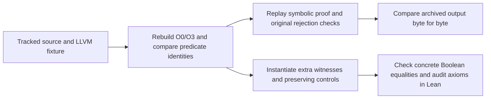

# RT-00 C — RT-13 symbolic checked-add replay

## Question and baseline

Does the symbolic checked-add study reproduce from tracked files, and can Lean check additional counterexamples to preservation using concrete inputs? This is a Stage 0.1 reproducibility result for [#284](https://github.com/aivibeflow/LLMLang/issues/284). The [RT-13 proof](../../compiler-and-translation/RT-13/RT-13-LLVM-CHECKED-ADD-SYMBOLIC-2026-11-25.md) replaces the fixture's LRAT-based proof steps with symbolic arithmetic. It checks signed 32-bit addition, the returned status, output-slot stores and ordered callback payloads in the admitted LLVM path model.

The replay ran from `9196d810463a4f978c327c1065a81a3db9c9ecf9` on `research/all`, on Linux 6.18.57 x86-64 with CPython 3.12.14, Debian LLVM 19.1.7 and Lean 4.36.0 at revision `611c117bfaf7b7ae1cfcf246ce6fba31e8f509e9`. The tracked [symbolic ledger](../../compiler-and-translation/RT-13/LLVM-CHECKED-ADD-SYMBOLIC-01/evidence.json), runner and arithmetic model have Git blob IDs `d0dd8baec4213972e8d0e3129b82fbe7523b5f28`, `f954b5b7a45c065610845bff7480e1602e14799e` and `ef026bbe1e392d678ecb1ce26a64100d12284884`, respectively.

## Method and results



Both checks reuse the pinned LLVM path-to-predicate model. The second check chooses fresh inputs and proves each instantiated Boolean equality with Lean's `decide`. Matching preserving controls give each new mutant observation a baseline under the same input and optimizer configuration.

| Check | Outcome |
| --- | --- |
| Published symbolic proof | The fresh ledger matched byte for byte, SHA-256 `7cbab41fe9ab36ccc201d618e70edf8d065d465fc97a6eb0af72410adfdeadcb`. It records 12 symbolic theorems, eight normalization theorems and three arithmetic lemmas. |
| Original false-goal controls | Lean refused all three O0 whole-domain preservation claims for the altered fixtures. The runner also checked that the model rejected the out-of-profile `add nsw` input. |
| Additional concrete proofs | Each of the three altered fixtures disagreed with the source at both O0 and O3. The preserving variant agreed at the same inputs and levels. All 12 proof dependencies were limited to `propext`, `Classical.choice` and `Quot.sound`. |

The new drop-overflow and store-on-error witnesses use `INT32_MIN + (-1)` with enable value 7. The event-order witness disables arithmetic and uses distinct payloads 9 and 4. Each differs from its fixture's archived witness. The [new control ledger](RT13-SYMBOLIC-REPLAY-01/evidence.json) records each input as unsigned 32-bit words, the proved value of the complete mismatch predicate and the actual axiom list.

The fresh witnesses establish falsehood of the three universal preservation claims within the model at both levels. The earlier tactic failures alone established refusal. The bounded result supports symbolic proof of this lowering and retaining concrete witnesses for regressions. It leaves the frontend, the model-to-LLVM semantics link, native execution for the new inputs, other operations and the general LRAT trust boundary open. It does not adopt an LLMLang language rule.

## Reproduce

From the repository root with the versions above on PATH:

```sh
symbolic=research/compiler-and-translation/RT-13/LLVM-CHECKED-ADD-SYMBOLIC-01
controls=research/research-management/RT-00/RT13-SYMBOLIC-REPLAY-01
lean_bin=$(command -v lean)
opt_bin=$(command -v opt-19 || command -v opt)
symbolic_output=$(mktemp)
control_output=$(mktemp)
python3 -B "$symbolic/run.py" --lean "$lean_bin" --opt "$opt_bin" > "$symbolic_output" &&
  cmp "$symbolic/evidence.json" "$symbolic_output" &&
  python3 -B "$controls/run.py" --lean "$lean_bin" --opt "$opt_bin" > "$control_output" &&
  cmp "$controls/evidence.json" "$control_output"
```

The [control runner](RT13-SYMBOLIC-REPLAY-01/run.py) reconstructs the original predicates before checking the extra inputs. The evidence is categorical, so the results table and ledger provide the comparison without a measurement chart.
