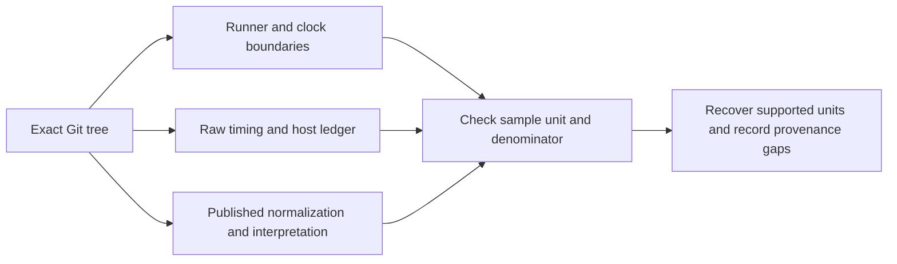

# RT-00 C timing units and provenance across six studies

Can a reader recover the timed operation, normalization denominator and environment from the runner and the archived samples? This supplementary Stage 0.1 check uses six purposively selected fixtures on `research/all` at `f02265dd33de654ebeca57e57646ad267f0bd2f5`. They exercise object-normalized batches, phase timings, inherited build timings, native call batches, concurrent throughput and cached search. A shared `elapsed_ns` suffix alone does not specify comparable units. This audit checks the original ledgers and recalculates reported summaries from their inputs without collecting new timings.



## Results

| Fixture | Archive rows | Checked meaning | Environment evidence |
|---|---:|---|---|
| RT-05 canonical hash | 60 | Wall time for 64 object invocations per phase, divided by 64 before summarizing | CPython 3.12.14, Linux 6.18.57, logical CPU 4 and zero cgroup throttles |
| RT-06 impact planning | 60 | Wall time per separate discovery, audit, binding or planner phase, without dividing by caller count | CPython 3.12.14, Linux 6.18.57, logical CPU 4 and zero cgroup throttles |
| RT-11 paired build cache | 105 | 35 groups of three serial build observations. The same-block ratio divides elapsed nanoseconds by elapsed nanoseconds | Inherits native tool identities and host from pinned raw C++ timings. Five CPUs reported by Python, affinity 0–4 and one build job |
| RT-13 native dispatch | 70 | Timed loop with 524,288 calls per sample after a separate 16,384-call warmup. Plot divides by timed calls | Four native compiler versions, x86-64 Linux 6.18.57, logical CPU 0 and `CLOCK_MONOTONIC_RAW` |
| RT-25 concurrent allocator | 100 | End-to-end interval for 1,024 or 4,096 packets. Per-packet time describes aggregate throughput | Rust 1.85.1, CPython 3.12.14, Linux 6.18.57, affinity 3–4 and zero cgroup churn throttles |
| RT-35 search channels | 200 | 100 intervals for 36-query batches and 100 averages of 200 in-memory row replacements. Those series have different denominators | CPython 3.12.14, Linux 6.18.57 and logical CPU 3. No archived cgroup throttle count |

The 595 records are a bookkeeping total across heterogeneous observation units. The audit matches 22 recorded SHA-256 values for tracked sources or inputs. It also matches the CSV digests embedded in the RT-05 and RT-06 summaries, 94 distribution summaries across four timing families, and both derived ratios in all 35 RT-11 pairs. RT-13 checks both fixture-specific timed checksum values and each row's denominator. The dispatch CSV digest is recorded by this audit, because the dispatch receipt carries input-vector digests and source hashes but does not carry the CSV digest. The pinned runner confirms its clock directly in C. The dispatch Python version, `taskset` version and plot dependency in the replay instructions remain distinct from execution metadata observed in the receipt.

The legacy RT-11 host field `logical_cpu: 5` is emitted from `os.cpu_count()`. Its value counts logical CPUs and does not identify a pinned CPU. The raw timing runner records the allowed CPU list and does not pin itself. The paired calculation correctly inherits the raw metadata. Its separate top-level Python version identifies the derivation environment. The paired report now disambiguates this historical field without editing either ledger.

RT-35 divides the row update interval by 200 while leaving retrieval time as a full 36-query interval. Its encoded feature table bytes are a third quantity. These boundaries matter when selecting a measurement for a performance model. Even after normalizing the time units, concurrent allocator throughput and single-call dispatch cost answer different questions.

## Replay and scope

The [runner](TIMING-PROVENANCE-01/check.py) reads Git blobs from the pinned revision and from the older exact source recorded by RT-11. The [ledger](TIMING-PROVENANCE-01/evidence.json) records the selected counts, host fields and result dispositions. The source audit used CPython 3.12.14 and Git 2.56.1. Hash seeds 37 and 71 produced identical ledgers.

```bash
fixture=research/research-management/RT-00/TIMING-PROVENANCE-01
LC_ALL=C PYTHONHASHSEED=37 python3 -B "$fixture/check.py" > /tmp/llmlang-timing-provenance.json
cmp "$fixture/evidence.json" /tmp/llmlang-timing-provenance.json
```

This is six-fixture source and arithmetic verification. Original-run attestation, hardware telemetry beyond the recorded fields, reconstructed native tool bytes and other research ledgers remain open. The table compares metadata and counts, which do not require a new timing plot.
