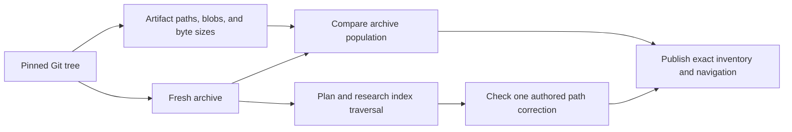

# Research corpus synthesis on the shared branch

**Scope.** PLAN §0.1 and [#284](https://github.com/aivibeflow/LLMLang/issues/284) at research/all `877db318a2c63f51116b63714001b3e96640a4a9`. This synthesis connects the current exact artifact inventory with the relationship, reproducibility and provenance checks published for their own pinned populations.

## Discoverability and exact identity

Extract the pinned tree, compare its path and size inventory to Git, and use the tracked navigation scanner from the same revision. Repeat navigation in the same archive after fixing the only current first-party unresolved path. The TSV records exact blob and size at the original pin and records navigation after the verified citation repair.



| Observation | Result |
| --- | ---: |
| Artifacts in identical Git and archive populations | 4,116 |
| Artifacts with document-link navigation | 3,111 |
| Artifacts discoverable with linked directory browsing | 4,116 |
| Markdown/MDX documents with document-link navigation | 1,203 of 1,210 |
| First-party unresolved relative paths | 1 before repair, 0 after |
| Unresolved relative path occurrences in copied references | 38 |

The only authored correction changes the relative target from the nonexistent POSIX-prefixed filename to the existing [ppoll FFI report](../../runtime-and-systems/RT-10/RT-10-PPOLL-FFI-BOUNDARY-2026-11-25.md). The linked [syscall study](../../runtime-and-systems/RT-10/RT-10-LINUX-SYSCALL-ABI-ISOLATION-2026-11-25.md) applies the same repair in the branch. The seven documents requiring directory navigation are named upstream copies, with independent link/snapshot reconciliation tracked in the plan.

## Evidence crosswalk

| Requirement | Verified disposition | Evidence boundary |
| --- | --- | --- |
| Prototype tests and generated results | 836 tests in both shared prototype families pass. The cross-stage cohort compares 26 receipts and three figures. Additional audits check exact FFI, solver, native Git, bootstrap and RV64 receipts. | Each execution is bounded to the named fixture, tools and oracle. The specifically held Dafny concurrency/history replay remains in its own plan row. [Shared suites](RT-00-SHARED-PROTOTYPE-ARCHIVE-2026-11-25.md) · [Cross-stage archive replay](RT-00-TRACKED-ARCHIVE-REPLAY-2026-11-25.md) · [Native Git and bootstrap](RT-00-GIT-ARCHIVE-REPLAY-2026-11-25.md) |
| Duplicate, orphan, supersession and conflict controls | The 1,208-document screen finds no whole-document normalized match and one same-title dated sequence. It classifies 566 candidates by prior review, new review or cue. Six scoped supersessions and one execution-status update retain historical reports. | Cue and normalization coverage is bounded by the extractor, and documentation with no recognized shared cue can still make competing claims. [Relationship coverage](RT-00-RELATIONSHIP-COVERAGE-2026-11-25.md) |
| Exact archive identity and execution provenance | The separate format census preserves all 894 artifacts on its pin and matches 702 named source inputs. The observation census separates original runner fields from compilation targets and checks 24 historical queue blobs. | Archive identity, producer mapping, fresh execution and original execution provenance are distinct. Record unresolved producer labels or historical context without guessing. [Structured census](RT-00-STRUCTURED-PROVENANCE-CENSUS-2026-11-25.md) · [Observation provenance](RT-00-OBSERVATION-PROVENANCE-2026-11-25.md) |

The separate reviewed populations can change independently. A later addition to the exact inventory does not become a replayed experiment. Independent attestations and quality or architecture decisions remain on their respective human gates.

## Reproduce

Run with CPython 3.12.14, Git 2.56.1 and GNU tar 1.35 on Linux x86-64. Both identical runs read a fresh archive and use the pinned repository scanner. The [inventory](CORPUS-SYNTHESIS-01/artifacts.tsv) and [navigation summary](CORPUS-SYNTHESIS-01/summary.json) are machine-readable. This is a relative-path and directory navigation check. Fragment validation and external URL availability remain outside this check.

```sh
study=research/research-management/RT-00/CORPUS-SYNTHESIS-01
out=$(mktemp -d)
PYTHONHASHSEED=41 python3 -B "$study/check.py" --out "$out" &&
  cmp "$study/summary.json" "$out/summary.json" &&
  cmp "$study/artifacts.tsv" "$out/artifacts.tsv"
```
