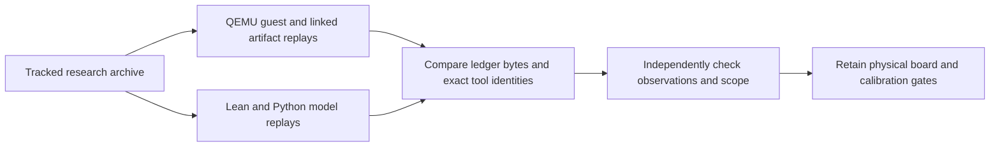

# Exact Cortex-M3 firmware and embedded-model replay

**Date** 2026-11-25 · **Plan** §0.1 and §5.4 · **Issue** [#284](https://github.com/aivibeflow/LLMLang/issues/284)

Twelve RT-37 ledgers reproduce byte-for-byte from the tracked research archive at `9a18919e11b22f47be0a83e0795569c61bb10228`. The replay covers Cortex-M3 guest behavior, linked interrupt call graphs, a Lean DMA lease model, and abstract device-admission and deadline checks. Each supplies evidence for its own observation boundary.

## Method

The harness extracts only tracked research files from the selected commit. It runs each producer with its original interface, which emits either standard output or a specified result file. It compares the complete ledger and records the exact inputs and artifact digests available from the archived fixture. Additional checks derive pending-bit outcomes, distinguish emitted instructions from LLVM IR, reconcile event order with stack measurements, and count model transitions.



## Results

| Archived evidence | Rechecked boundary |
|---|---|
| Startup retention and nested stack | Four startup variants share section intervals and yield four distinct UART streams. Two IRQ masking variants share a UART sequence while using 32 and 64 bytes of exception stack. [Startup retention](../../runtime-and-systems/RT-37/RT-37-CORTEX-M3-STARTUP-RETENTION-2026-11-25.md) · [Nested stack](../../runtime-and-systems/RT-37/RT-37-CORTEX-M3-NESTED-EXCEPTION-STACK-2026-11-25.md) |
| NVIC pending clear and read-to-clear preservation | Independent bit-mask calculation matches eight pending-bit observations. Across seven volatile fixture images, ordinary LLVM O0 retains two loads in IR and executes one linked load. The three preserving LLVM/Rust routes keep two linked loads and observe `10`. [Pending clear](../../runtime-and-systems/RT-37/RT-37-CORTEX-M3-NVIC-PENDING-CLEAR-2026-11-25.md) · [Volatile COUNTFLAG](../../runtime-and-systems/RT-37/RT-37-CORTEX-M3-VOLATILE-COUNTFLAG-2026-11-24.md) |
| Stack, timer and startup closure | Twelve fixed-stack profiles, four timer profiles and their controls, and five booted closure images reproduce the recorded outputs. These results apply to the exact declared layout, control and target assumptions. [Stack](../../runtime-and-systems/RT-37/RT-37-CORTEX-M3-STACK-BOUND-2026-11-24.md) · [Timer](../../runtime-and-systems/RT-37/RT-37-CORTEX-M3-SYSTICK-GPIO-2026-11-24.md) · [Closure](../../runtime-and-systems/RT-37/RT-37-CORTEX-M3-FREESTANDING-CLOSURE-2026-11-24.md) |
| Linked ISR effects and fixed/linear allocation | Linked ISR admission is accepted twice, rejected three times and inconclusive twice. The two allocation strategies replay 2,704 requests. Four 16-byte slots and 16 contiguous four-byte reservations independently account for small-packing capacity in the shared 64-byte arena. [ISR effects](../../runtime-and-systems/RT-37/RT-37-CORTEX-M3-TRANSITIVE-ISR-EFFECTS-2026-11-24.md) · [Allocator](../../runtime-and-systems/RT-37/RT-37-CORTEX-M3-BOUNDED-ALLOCATOR-2026-11-24.md) |
| DMA lease, device admission and deadline models | The Lean/Python lease replay covers 5,628 transitions and retains 12 exact axiom-audit lines. The composed device checker evaluates 2,304 inputs. The deadline model covers 1,200 scenarios and 19,200 threshold checks with declared synthetic costs. [DMA lease](../../runtime-and-systems/RT-37/RT-37-DMA-LEASE-OWNERSHIP-2026-11-24.md) · [Device boundary](../../runtime-and-systems/RT-37/RT-37-COMPOSED-DEVICE-BOUNDARY-2026-11-25.md) · [Resource and deadline](../../runtime-and-systems/RT-37/RT-37-RESOURCE-AND-DEADLINE-BOUNDS-2026-11-25.md) |

The equal-marker stack pair and the LLVM load-count mismatch are two distinguishers for downstream verification. A receipt for a UART outcome cannot establish a stack bound on its own. A volatility or effect check at one IR stage cannot establish linked access count without the lowering correspondence. The ISR artifact evidence and abstract device admission supply separate premises for DEP-017, DEP-019 and DEP-024.

## Reproduce and scope

Use CPython 3.12.14, Clang 23.1.1, Debian LLVM/LLD 19.1.7, Rust 1.85.1 with its Thumb target, QEMU 10.0.13, and the installed Lean 4.36.0 toolchain. The DMA runner invokes the Elan toolchain selector `+leanprover/lean4:v4.36.0`. Put the Elan launcher on PATH for that invocation. The standalone compiler binary does not interpret the launcher selector. The audit records launcher and compiler digests. This replay used Linux x86-64 6.18.57. Two independent complete audit executions produce the same ledger bytes.

```sh
fixture=research/research-management/RT-00/CORTEX-COHORT-REPLAY-01
python "$fixture/audit.py" --clang /path/to/clang --qemu /path/to/qemu-system-arm \
  --out /tmp/llmlang-cortex-cohort.json
cmp "$fixture/evidence.json" /tmp/llmlang-cortex-cohort.json
```

[Archive replay and cross-checks](CORTEX-COHORT-REPLAY-01/audit.py) · [Exact results and tool records](CORTEX-COHORT-REPLAY-01/evidence.json)

The tested Cortex-M3 board model is `lm3s6965evb`. The reviewed runtime evidence leaves physical boards, target register and DMA-controller correspondence, calibration of deadlines, and complete runtime coverage open. The logical model requires external quiescence and synchronization premises. The linked fixture demonstrates target-specific effects for the selected files and toolchain. [Dependency map](../RESEARCH-DEPENDENCY-MAP.md)
