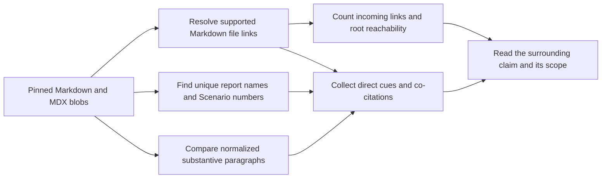

# Research corpus links, shared paragraphs and scoped relationships

[PLAN §0.1](../../../PLAN.md#01-reconcile-the-research-corpus) · [Corpus reconciliation issue #284](https://github.com/aivibeflow/LLMLang/issues/284)

This study screens the exact `research/all` tree at `9847850c12cda140e0bdb396d611c2ec96b85c33`. Earlier scans established exact blob identity, text-overlap candidates and cues on direct Markdown links. The current review adds cues obtained through third-party reports, paragraphs shared by a small number of documents, and a distinction between no incoming link and no path from a selected document index. It adjudicates the known control pairs, both paragraph-sharing pairs, two additional co-citation examples, and every document outside the recognized root traversal. Other candidate relationships remain open. [Earlier direct-link screen](RT-00-B-16-EXPLICIT-RELATIONSHIP-SCREEN-2026-11-25.md) · [Known control review](RT-00-B-13-KNOWN-RELATIONSHIP-CONTROLS-2026-11-25.md)



The [scanner](CURRENT-CORPUS-RELATIONSHIPS-01/audit.py) reads 1,207 tracked Markdown and MDX blobs, including 1,187 research documents. Its link subset covers ordinary inline links, angle-bracket destinations, and explicit or collapsed reference links. It ignores fenced code and historical GitHub branch links when computing this branch's Markdown graph. Root reachability starts at the repository README, PLAN, TODO and research index. A directory URL does not count as a direct file link. This produces interpretable candidates while leaving other Markdown forms and completeness outside the extractor.

A cue is a word or phrase indicating possible supersession, translation, historical context or contradiction. A cue can nominate a directly linked pair, a small set of reports cited in one block, or up to four uniquely identified filenames or numbered scenarios named in that block. Reciprocal `.ru.md` navigation adds a language-companion signal. The separate paragraph check requires at least 24 words after normalization and considers a paragraph shared by two to six documents. These methods locate candidate relationships with different types of source evidence.

## Observations

| Measurement | Count |
| --- | ---: |
| Research Markdown and MDX documents | 1,187 |
| Distinct research Markdown and MDX blobs | 1,187 |
| Distinct pairs selected by any signal | 535 |
| Direct link cue | 380 |
| Shared hyperlink block with cue | 129 |
| Shared literal references with cue | 151 |
| Reciprocal language navigation | 2 |
| Shared long normalized paragraph | 2 |
| Research documents with no recognized incoming Markdown link | 5 |
| Research documents outside the recognized root traversal | 7 |

These signal counts overlap. The four known relation-control pairs retain their exact prior blob identities. The two directly linked controls are the scoped Git report replacement and the formal-verification language companions. The two other controls are the Scenario 31/32 transition and the initial/deep related-project comparison. Their signals come from report names or scenario numbers in prior research-management material. Both disappear when screening excludes that material. Recovering all four from the full corpus demonstrates retrieval of existing adjudications. It does not measure recall for previously unknown relationships.

| Read at the pinned revision | Bounded disposition |
| --- | --- |
| Scenario 28 prototype result and research report | Both contain the same Scenario 27 protocol correction. The prototype result preserves its 22-test baseline and notes that its original environment did not run the two later tests. The separate report records a subsequent 24-test isolated harness. These claims are time- and harness-specific. Keep the historical result and use the newer record for the isolated replay claim. [Prototype result](../../PROTOTYPES/DEPENDENCY-GRAPH-01/PROTOTYPE-28-RESULTS.md#scenario-27-protocol-correction) · [Research report](../../formal-verification/RT-07/RESEARCH-SCENARIO-28-TYPED-IR-AND-PROOF-BOUNDARY.md#6-tests-and-validation-scope) |
| English and Russian LLMLang concept | Nine normalized paragraphs occur in both. The Russian companion retains the English content-identity section and English research status note alongside Russian text. Both documents have reciprocal navigation. The shared passages identify a specific translation coverage gap and do not establish parity of the rest. [English concept](../../language-design/RT-01/LLMLang-CONCEPT.md#34-content-addressed-identity-and-immutable-states) · [Russian concept](../../language-design/RT-01/LLMLang-CONCEPT.ru.md#34-content-addressed-identity-and-immutable-states) |
| SCW-04 audit and SCW-05 declaration breakdown | The same index sentence describes SCW-04 as a historical module-boundary audit with an addendum and SCW-05 as a current decomposition with seven completed tasks. It includes a third report for the overall source-to-query boundary. The co-citation assigns different roles and supplies no whole-document replacement. [Evidence index](../../PROTOTYPES/DEPENDENCY-GRAPH-01/README.md#source-to-query-semantic-correspondence-scenario-34) |
| Shared LLVM validator and checked conversion reports | A retrospective explicitly compares both. The former studies validator coverage across examples, while the latter checks the checked conversion and poison controls. The retrospective checks how respective claims and unsupported outcomes coexist. Presence in one cue block establishes context for comparison. [LLVM validator reconciliation](../../compiler-and-translation/RT-13/RT-13-LLVM-VALIDATOR-CHOICE-SCOPE-2026-11-25.md) |

Every recognized root-traversal gap belongs to the MCP or OCI reference snapshot catalog. The catalog explicitly names all seven documents. Five have no recognized incoming Markdown link and each has a unique literal filename mention in the catalog. The OCI descriptor and manifest also receive links within their snapshot from the image-layout document, which is outside this traversal. The selected roots therefore miss a local file-link path for these materials even though the reports have explicit snapshot roles. The observation concerns discoverability, independent of completeness or accuracy of the upstream snapshots. [Reference catalog](../../references/README.md) · [Earlier zero-inbound review](RT-00-B-08-ZERO-INBOUND-CANDIDATE-REVIEW-2026-11-23.md)

## Reproduce

Use Git 2.56.1 and CPython 3.12.14 in the branch checkout. The [ledger](CURRENT-CORPUS-RELATIONSHIPS-01/evidence.json) includes all candidate pairs, triggering files and line numbers, paragraph digests, exact source blobs and traversal results. The focused manual dispositions above remain tied to the same revision. A different extractor can change the graph and candidate population. Claim-level reading and unrecognized candidate families remain open.

```sh
study=research/research-management/RT-00/CURRENT-CORPUS-RELATIONSHIPS-01
PYTHONHASHSEED=1 python3 -B "$study/audit.py" --out /tmp/rt00-corpus-relationships.json
cmp "$study/evidence.json" /tmp/rt00-corpus-relationships.json
```
