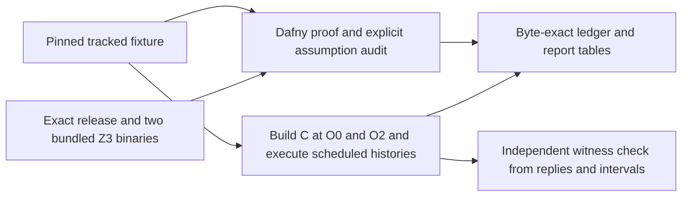

# Pinned replay of Dafny concurrent frames and native counter histories

**Date** 2026-11-25 · **Plan** §0.1 · **Issue** [#284](https://github.com/aivibeflow/LLMLang/issues/284)

The complete Dafny concurrent-frame ledger reproduces byte-for-byte from the tracked archive at `32bf8da9b5b5e9794abd6077e4d253ba1c2be3a5`. Both bundled solver versions reproduce the same four rejected frame obligations and all nine positive obligations. The explicit shared-frame assumption remains visible in the audit. An independent interval check confirms the sequential witnesses for all 960 distinct route and schedule observations.

## Exact inputs and checks

The replay extracts only the tracked fixture from the pinned Git archive. The Dafny 4.11.0 Linux release archive matches the original recorded SHA-256. The harness also compares the installed Dafny launcher and both Z3 executables with the entries in that archive. It records the exact GCC executable, CPython version, host and fixture inputs. It reruns the original producer, compares the complete ledger byte-for-byte, regenerates both report tables and checks both headers and the eight data rows against the pinned published report. [Original frame experiment](../../formal-verification/RT-07/RT-07-DAFNY-CONCURRENT-FRAME-HISTORY-2026-11-25.md) · [Upstream Dafny 4.11.0 release](https://github.com/dafny-lang/dafny/releases/tag/v4.11.0)



| Observation | Reproduced result |
|---|---|
| Dafny 4.11.0 with Z3 4.12.1 and 4.14.1 | Both prove nine positive units and reject four frame obligations in the controls. The two accepted `assume_concurrent` uses remain explicit reads and modifies findings. |
| Split atomic load/store | 40 of 480 histories per optimization have a sequential witness. Each of the other 440 has an incorrect final value. |
| Atomic fetch-add | All 480 histories per optimization have a witness. |
| Report table and compiler replay | Two builds per route reproduce 1,920 native executions. Eight published data rows reproduce exactly. |

Each nonoverflowing increment return determines a unique rank in a sequential history. The audit compares the observed rank set and every completed-before-started pair with the archived witness. It also checks the separately observed prior values. This independent checker avoids searching candidate orders. For each participant count, a combinatorial count confirms the total schedules from the two-step precedence constraints. The follow-up four-participant run uses the same argument on a distinct expanded workload. [Four-participant history follow-up](../../formal-verification/RT-07/RT-07-FOUR-COUNTER-HISTORIES-2026-11-25.md)

## Reproduce and scope

The recorded host uses x86-64 Linux 6.18.57 and glibc 2.41. Use CPython 3.12.14, GCC 14.2.0 and the exact Ubuntu 22.04 x86-64 Dafny 4.11.0 release. Run from the repository root with the pinned commit reachable.

```sh
fixture=research/research-management/RT-00/DAFNY-FRAME-REPLAY-01
python "$fixture/audit.py" --dafny /path/to/dafny --archive /path/to/dafny-release.zip \
  --out /tmp/llmlang-dafny-proof-replay.json
cmp "$fixture/evidence.json" /tmp/llmlang-dafny-proof-replay.json
```

The result distinguishes sequential correctness, explicit isolation assumptions and complete-history observations for two and three participants. The controlled scheduler guarantees the observed step order for the tested threads. It supplies no general weak-memory, fairness, source-to-native or whole-language concurrency proof. The checked evidence refines DEP-007, DEP-014 and DEP-019. [Dependency map](../RESEARCH-DEPENDENCY-MAP.md) · [Audit code](DAFNY-FRAME-REPLAY-01/audit.py) · [Exact replay ledger](DAFNY-FRAME-REPLAY-01/evidence.json)
