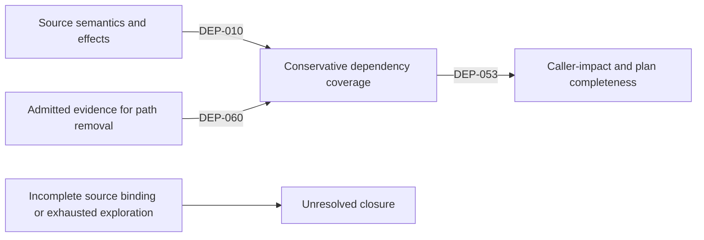

# RT-00 — Research register structure and dependency path evidence

**Scope:** PLAN §0.3 and [#286](https://github.com/aivibeflow/LLMLang/issues/286), at `research/all` baseline `2c0ce76a1eecc1aee9a6557db451b70afd4b869a`. Structural audit of the live registers and scoped evidence review of DEP-010, DEP-053 and DEP-060.

The dependency map schedules research and records how choices in one aspect affect another. PLAN §0.3 still described its initial topology as the current count. This audit checks membership, relation labels, repeated endpoints and feedback paths. It also asks what new RT-06 path experiments establish for a downstream caller-impact analysis.

## The live register

The [taxonomy](../RESEARCH-TAXONOMY.md) contains 38 unique numbered aspect rows, RT-01 through RT-38. RT-00 coordination sits outside that inventory. The [dependency register](../RESEARCH-DEPENDENCY-MAP.md) contains 264 unique rows, DEP-001 through DEP-264. All endpoints resolve to registered aspects. There are no self-edges or missing edge numbers. The machine-readable snapshot records exact Git blob IDs and components.

| Structural check | Observation at the baseline |
| --- | --- |
| Distinct ordered endpoint pairs | 255 across 264 rows |
| Pairs with a repeated relation label | Seven groups. Multiple statements can support distinct obligations in the same direction. For example, DEP-179 binds translation and source correspondence, while DEP-188 binds proof-graph call-site and contract identities. |
| Relation labels | 96 Requires, 89 Influences, 64 Constrains, 14 Enables and one Refines |
| Undocumented label | DEP-074 alone uses Refines. The public repository contract narrows the admissible File View architecture. The corresponding row uses the existing Constrains relation after this audit. |
| Taxonomy presentation | A blank line after RT-21 breaks the Markdown table. The separator is removed so RT-22–RT-38 appear in the same rendered table. |

The seven repeated-label groups are listed in the [audit ledger](DEPENDENCY-REGISTER-01/evidence.json). The grouping flags where a reviewer should compare scope. It does not infer semantic duplication. For example, DEP-021 and DEP-040 both concern identity at the package boundary but phrase it at the general artifact and exact index-resolution levels. Comparison of all repeated relationships remains open.

The all-direction projection contains one strongly connected component of 32 aspects and six singleton components. A strongly connected component is a set of nodes mutually reachable by following directed edges. The structural projection includes every directed research relation and would omit symmetric conflict records. The historical 26-area/108-edge check in [PLAN](../../../PLAN.md) identified two smaller nontrivial components in its earlier snapshot. The larger current component includes iterations through hypotheses and constraints as well as prerequisites. It offers no basis for a total execution order or for assuming that proofs, artifact hashes or runtime objects can have circular justifications.

## What the RT-06 evidence constrains

| Edge | What the evidence supports | What remains open |
| --- | --- | --- |
| DEP-010, RT-03 → RT-06 | The [conditional-closure experiment](../../semantic-representation/RT-06/RT-06-CONDITIONAL-DEPENDENCY-CLOSURE-2026-11-25.md) needs to revisit a location after a Boolean state change. A location-only traversal omits targets in 3,408 of 16,384 queries. The [conditional-call study](RT-00-C-RT06-PATH-COMPLETENESS-REPLAY-2026-11-25.md) finds another loss mode when an extracted call may be skipped and the joined alias summary assumes it runs. | Exact source extraction for the candidate LLMLang grammar, complete guard and effect semantics, and source-bound transition evidence. |
| DEP-053, RT-06 → RT-20 | An impact planner that consumes a provider or reverse-reference set can omit a caller obligation if its upstream reachability set silently drops a feasible target. The conditional-closure fixture exhibits an omitted provider. This demonstrates a necessary input property for a downstream impact claim. | Exact indexing of reverse references and end-to-end application in a publication gate. The fixture produces forward provider sets in an explicit control graph. |
| DEP-060, RT-07 → RT-06 | The [current path suite replay](RT-00-C-RT06-PATH-COMPLETENESS-REPLAY-2026-11-25.md) preserves possible paths on timed-out or untrusted responses and requires scoped evidence to prune on UNSAT. The closure fixture's finite state cap produces `UNKNOWN` without emitting a partial may-set. | Exact source-to-formula correspondence and a proof or explicitly accepted trust basis for production UNSAT results. The result adapter and bounded worklist independently address different uncertainty sources. |



The diagram relates three evidence obligations. Sound solver evidence only justifies pruning the bound formula. A missing skip transition can cause an omitted path before any solver runs. Conversely, complete candidate transitions can still yield an unresolved dependency query when the analysis cannot justify a pruning decision or reach a sound bound. Downstream use therefore needs both transition coverage and sound pruning or a conservative fallback.

The conditional-closure ledger replayed byte for byte using its existing runner. Its exact SHA-256 was `0524aebd97888a98e1cc4b8e03556750435b03d8ba9dc0ff1dae48314fc6dbbe`. This audit uses the separately recorded 55-test path replay, including the 14 conditional-call controls. No dependency edge is promoted to general architectural proof. The updated rows and their links preserve the bounds on all three claims.

## Reproduce

Use CPython 3.12.14, Git 2.52.0 and Linux x86-64. The [structure scanner](DEPENDENCY-REGISTER-01/audit.py) reads the historical Git blobs and computes reachability for each registered aspect. It treats matching endpoint and relation cells as structural candidates and does not infer authority from prose. Mermaid syntax was inspected directly. The register comparison is structural, apart from the scoped manual review and fixture results stated above.

```sh
audit=research/research-management/RT-00/DEPENDENCY-REGISTER-01
python3 -B "$audit/audit.py" > /tmp/llmlang-dependency-register.json
cmp "$audit/evidence.json" /tmp/llmlang-dependency-register.json

fixture=research/semantic-representation/RT-06/CONDITIONAL-DEPENDENCY-01
python3 -B "$fixture/run.py" --output /tmp/llmlang-conditional-dependency.json
cmp "$fixture/evidence.json" /tmp/llmlang-conditional-dependency.json
```
