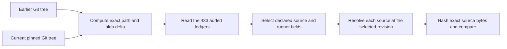

# RT-00 exact-name evidence ledger provenance refresh

This audit compares the 205-ledger baseline `087d2e5e952255778d76637ce5fd41b9df2d5396` with `7d407636c4a06d1b601376bc66ea96d5a26e0b8f` on `research/all`. Both recursive Git tree responses are complete. All 205 earlier `evidence.json` paths retain their Git blobs, and all 433 additions below `research/` were read from their pinned blobs. The [audit ledger](EXACT-LEDGER-REFRESH-01/evidence.json) records each new path, blob, checked source field and resolved revision. [#284](https://github.com/aivibeflow/LLMLang/issues/284)



| Observation | Count |
| --- | ---: |
| Earlier ledger paths retained byte for byte | 205 |
| Added exact-name ledgers | 433 |
| Declared SHA-256 identities checked at explicit tracked paths | 714 |
| Distinct source path and revision pairs checked | 568 |
| Checked identities resolved at baselines earlier than the pinned tree | 13 |
| Checked SHA-256 fields with a mismatch or unresolved path | 0 |
| Selected map entries with inline data or another schema | 36 |
| Added ledgers without a flat matched field in this check | 207 |

The resolver uses explicit repository, research-stage and fixture paths, producer-defined aliases and archived revisions. It does not discover a binding by finding matching bytes elsewhere in the tree. Two scalar runner encodings advertise the digest differently. The optional-action cache uses a `sha256:` prefix, and the contributor-merge runner names its own `run.py` through its fixture directory. The merge-driver replay ledger cites the original fixture and its historical tree. The protocol study similarly identifies the historical revision used for its draft and research inputs. Resolving these references avoids reporting false provenance gaps.

The audit read UTF-8 Git blobs through GitHub's Git data API after the shell environment disconnected. Each hashed source had the exact byte length reported by Git, and the SHA-256 implementation matched standard test vectors. Reversing the order of the collected records produced an identical result. The accompanying local reproduction command uses Git and Node.js built-ins. A subsequent local invocation with Node.js 24.22.3 and Git 2.56.1 on Linux 6.18.57 x86-64 reproduced the committed JSON byte for byte. The counts apply to the selected flat fields and named scalar inputs. They leave nested data, tool binaries, external environments and claims of original execution outside the checked scope.

```sh
fixture=research/research-management/RT-00/EXACT-LEDGER-REFRESH-01
out=$(mktemp)
node "$fixture/run.mjs" > "$out" && cmp "$fixture/evidence.json" "$out"
```
