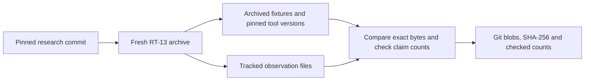

# RT-00 FFI evidence replay from a pinned archive

This replay checks eight RT-13 experiment ledgers against commit `3281d6863c2abd2f8eb3bdb05982bd3439d3c481` on `research/all` for [#284](https://github.com/aivibeflow/LLMLang/issues/284). Each run extracts the tracked RT-13 subtree into a new temporary directory, reruns the archived fixtures, and compares regenerated observations byte for byte with the files in that archive. The [ledger](FFI-ARCHIVE-REPLAY-01/evidence.json) records each runner and observation Git blob, the regenerated SHA-256, and counters recomputed from the observations. The two archive runs produced identical audit ledgers.



| Fixture | Checked result | Evidence scope |
| --- | --- | --- |
| Loader scope | 126 processes, with 28 observations matching the expected behavior while binding a different provider | Native Linux ELF with glibc and fixture providers |
| Header import | 19 imported declarations, 16 observed differences between equal-signature pairs, and three explicit import refusals | Clang AST plus native POSIX, SQLite, and OpenSSL behavior |
| Callback lifetime | 504 C, CPython and Rust upcalls, including 72 typed errors | Native worker and runtime fixture |
| Managed callbacks | 672 Go and JVM upcalls, including 96 typed errors. The Go subprocess without a native stdout flush exited with zero output bytes | Native cgo and Java FFM preview |
| Fixed aggregate ABI | 288 correct calls spanning independent handwritten assembly and compiled C. Every profile exposed 24 wrong mixed-field placements | Linux AArch64 and RV64 LP64/LP64D in QEMU user mode |
| Variadic ABI | 240 wrong floating-argument placements and 90 divergences from bypassing source `float` conversion | Native x86-64 SysV and Microsoft calling-convention fixture plus QEMU AArch64 and RV64 |
| Cross-build cache | 12 exact rebuilt packages and six exact reconnect hits. Host-only keys had five false hits, and triple-only keys had two | Fixture build and emulated execution on Linux targets |
| Conditional receipts | 1,440 native observations and 15 controls reproduced. The archived runner also reran the embedded Lean checks | Six-language Linux x86-64 fixture plus formal checks of the encoded receipt conditions |

The host was Linux 6.18.57 x86-64 with glibc 2.41. The archive and runners used Git 2.56.1, CPython 3.12.14, GCC 14.2.0, and GNU binutils 2.44. External inputs were Clang and LLD 19.1.7, Debian SQLite 3.46.1 (`3.46.1-7+deb13u2`) headers and runtime, OpenSSL 3.5.7, Rust 1.85.1, Go 1.27.4, OpenJDK 21.0.13, Lean 4.36.0, and QEMU user 10.0.13. The experiments retain their own provider assumptions and target limitations. The cross-target executions cover QEMU user mode. The conditional-receipt proofs check conditions in the Lean model and take the recorded external provider observations as inputs. This technical replay covers the eight listed artifacts under §0.1. The separate §0.2 human review remains pending.

Run [the replay](FFI-ARCHIVE-REPLAY-01/replay.py) from the repository root with the baseline commit present and `gcc`, `git`, `java`, and GNU binutils on `PATH`. Supply paths to the tool versions above and their development libraries. `--go-cache` can point to a reusable cache. With that flag omitted, the runner creates an empty cache in the archive's temporary directory.

```bash
python3 -B research/research-management/RT-00/FFI-ARCHIVE-REPLAY-01/replay.py \
  --rustc "$RUSTC" --lean "$LEAN" --clang "$CLANG" --clang-libdir "$CLANG_LIBDIR" \
  --sqlite-include "$SQLITE_INCLUDE" --sqlite-library "$SQLITE_LIBRARY" \
  --crypto-library "$CRYPTO_LIBRARY" --libc-library "$LIBC_LIBRARY" --lld "$LLD" \
  --qemu-aarch64 "$QEMU_AARCH64" --qemu-riscv64 "$QEMU_RISCV64" --go "$GO" \
  --out /tmp/ffi-archive-replay.json
cmp /tmp/ffi-archive-replay.json \
  research/research-management/RT-00/FFI-ARCHIVE-REPLAY-01/evidence.json
```
