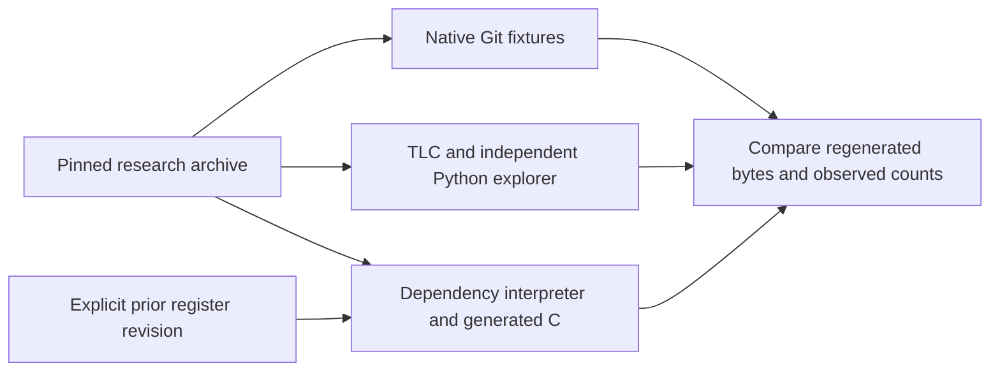

# RT-00 archive replay of Git publication, recovery and dependency bootstrap

This replay checks five tracked studies from `839fe94a6a915f5045b70859e89a8f55bcb852b0` on `research/all`. The [runner](GIT-ARCHIVE-REPLAY-01/run.py) extracts the exact fixture paths with `git archive` into a fresh directory and compares every regenerated observation ledger with the archived bytes. The [audit ledger](GIT-ARCHIVE-REPLAY-01/evidence.json) records SHA-256 for each fixture file and recomputes the counts below. The bootstrap also reads the archived dependency register named in its runner by explicit Git revision. Both replay passes produced identical audit ledgers. [#284](https://github.com/aivibeflow/LLMLang/issues/284)



| Study | Verified scope |
| --- | --- |
| [Coherent multiref reads](../../toolchain-and-collaboration/RT-19/RT-19-COHERENT-MULTIREF-READS-2026-11-25.md) | 308 schedules across four object/ref storage profiles. All 96 pinned reads returned the exact pair. Forty-four had been superseded at the freshness recheck. |
| [Native ref faults](../../toolchain-and-collaboration/RT-19/RT-19-GIT-REF-FAULTS-2026-11-25.md) | The 13 selected faults had exit 128. Exact ref observations showed nine old/old, one new/old and three new/new vectors. |
| [Two-repository publication](../../toolchain-and-collaboration/RT-19/RT-19-TWO-REMOTE-PUBLICATION-2026-11-25.md) | Twenty-four native local-repository schedules and eight explicit process exits reproduced the delivery and retry outcomes. |
| [Publication recovery contract](../../toolchain-and-collaboration/RT-19/RT-19-PUBLICATION-RECOVERY-CONTRACT-2026-11-25.md) | TLC and the independent Python explorer agreed on 4,032 distinct states, 77,401 generated states, depth 13 and seven counterexample traces in the finite model. |
| [Structured dependency bootstrap](../../toolchain-and-collaboration/RT-21/RT-21-STRUCTURED-DEPENDENCY-BOOTSTRAP-2026-11-25.md) | Both native C optimization profiles matched the bounded interpreter and graph oracle over 16,468 cases each, including 12 projected from the pinned register. Eight refusal controls reproduced. |

The native studies ran on Linux 6.18.57 x86-64 with overlayfs, Git 2.56.1, glibc 2.41, GCC 14.2.0 and CPython 3.12.14 with SQLite 3.53.1. The finite model used OpenJDK 21.0.13 and TLC `2026.11.19.180144` at `bc1b506bdcad80bb518bf3776a9161c34ff0fc4c`. The required JAR SHA-256 is `fdffef247f563ef6edbfd44958d2a82db79e7564e07cb673262d896353fa6713`. The native Git rows cover local repositories and selected process and library-call cut points on that filesystem. Physical power loss, production remote authentication and general language/bootstrap correctness remain outside this cohort.

Run from the repository root with both named Git revisions available. Scratch repositories and builds are confined to temporary directories.

```sh
fixture=research/research-management/RT-00/GIT-ARCHIVE-REPLAY-01
out=$(mktemp)
python3 -B "$fixture/run.py" --tlc "$TLC_JAR" --out "$out" &&
  cmp "$fixture/evidence.json" "$out"
```
