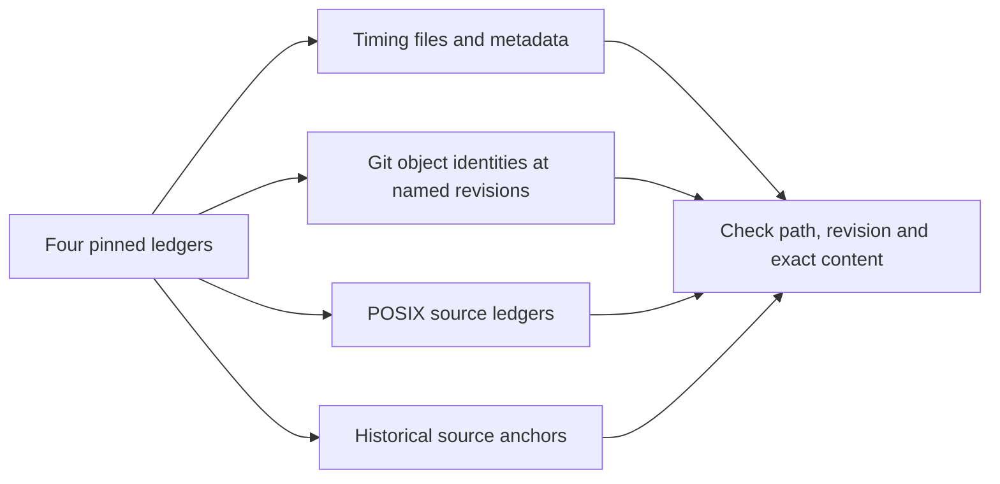

# RT-00 nested evidence provenance checks

The [exact-name ledger refresh](RT-00-EXACT-LEDGER-REFRESH-2026-11-25.md) left 36 source entries under nested schemas in four ledgers. This study verifies those entries from the same pinned `research/all` revision, `7d407636c4a06d1b601376bc66ea96d5a26e0b8f`. It resolves the declared paths and revisions with the corresponding producer's rules. The [audit ledger](NESTED-LEDGER-REFRESH-01/evidence.json) records all identities, anchors and dispositions. [#284](https://github.com/aivibeflow/LLMLang/issues/284)



| Producer | Scoped validation |
| --- | --- |
| RT-00 scalability metrics | 24 SHA-256 checks across eight timing sets. The 454 CSV rows and their summary links, configured trials, kernel and CPU model agree with the provenance records. |
| Integrated concurrent release | 15 Git blob IDs match their declared paths. The original provider probe pins 13 inherited sources to `685c3a13`. The concurrent-release runner pins the two prior study files at its own `c92e9e3c` baseline. |
| RT-10 POSIX profile reconciliation | Both source ledger SHA-256 values match their exact RT-10 paths. |
| RT-14 source inventory | Eleven paths match both their Git blob and SHA-256 at the archived snapshot. Each cited anchor occurs once at its published line. The snapshot resolves to the advertised Git tree. |

All 52 path and revision bindings matched. The checks covered 37 SHA-256 values, 26 Git blob IDs and 11 unique line anchors. Two controls rejected a changed SHA-256 input and a substituted Git blob ID. Reversing the input ledger order preserved the result. The external-reference entry binds the tracked citation and its exact anchor. The external document itself and the original executions remain outside this study.

The verification ran against byte-length-checked GitHub Git data responses while the shell was offline. The [local reproduction runner](NESTED-LEDGER-REFRESH-01/run.mjs) uses the same comparison logic and Git and Node.js built-ins. A subsequent local invocation with Node.js 24.22.3 and Git 2.56.1 on Linux 6.18.57 x86-64 reproduced the committed JSON byte for byte.

```sh
fixture=research/research-management/RT-00/NESTED-LEDGER-REFRESH-01
out=$(mktemp)
node "$fixture/run.mjs" > "$out" && cmp "$fixture/evidence.json" "$out"
```
