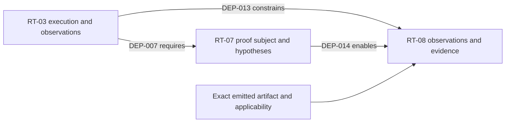

# Observation requirements for proofs and evidence

## Replay cohort

This recheck compares DEP-007, DEP-013 and DEP-014 against five reports from the exact `research/all` tree `3eb5482a04232a129e6f71496587e2dd3cf7872d`. It asks what an upstream observation boundary supplies to formal rules and test evidence. The runner exports the five fixtures and their shared interpreters from that tree, replays them in a fresh directory, and compares every output ledger byte for byte. Two standalone Lean axiom ledgers match, and the ordered-write-swap runner reproduces the Lean output embedded in its evidence. This is a repeat of published experiments and a review of the claims the results can support. [Dependency map](../RESEARCH-DEPENDENCY-MAP.md)



## Edge findings

| Edge | Verified discriminator | Remaining boundary |
| --- | --- | --- |
| DEP-007, RT-03 → RT-07 | The exact dead-store guard accounts for visibility and an intervening alias read. Final-cell equality admits 297 mismatching profiles. For output coalescing, Lean proves preservation of accepted bytes and status within the sink model, and the 996 native split comparisons change the adapter-call trace. A proof claim must bind its particular observation. | Complete LLMLang source observation semantics, production alias facts, and correspondence to compiler output remain open. [Dead-store boundary](../../formal-verification/RT-07/RT-07-DEAD-STORE-ALIAS-BOUNDARY-2026-11-25.md) · [Partial output](../../formal-verification/RT-07/RT-07-PARTIAL-OUTPUT-OBSERVATIONS-2026-11-25.md) |
| DEP-013, RT-03 → RT-08 | The executable reference agrees with both operational interpreters on 8,210 observations. Using that reference, result and final cell miss all 240 exhaustive drop-write mismatches. Even retaining event multiplicity misses 16 order mismatches. A success-only input generator also misses both error-propagation mutations. | The characterizations apply to the admitted grammar, named projections and chosen corpora. Production inputs, dynamic effects and general backend coverage remain open. [Executable entry](../../formal-verification/RT-07/RT-07-STATE-RESULT-REFERENCE-ENTRY-2026-11-25.md) · [Mutation coverage](../../compiler-and-translation/RT-13/RT-13-STATE-RESULT-MUTATION-COVERAGE-2026-11-25.md) |
| DEP-014, RT-07 → RT-08 | The Lean rule characterizes a write swap over the modeled heap whenever both guard conditions hold. The finite validator admits eight false swaps when it checks only final heap. Its control supplies a valid guarded swap and an invalid emitted target with a different receipt key. | General proof reuse needs exact application and observation scope, checked side conditions and source/target correspondence. Testing actual emission and proving a general model rule support different claims. [Ordered-write rule and validator](../../compiler-and-translation/RT-13/RT-13-RULE-PROOF-AND-TRANSLATION-VALIDATION-2026-11-25.md) |

The map retains the three directions and adds the replay paths. The new RT-08 citations record the observation and input-space limits of testing and the applicability limit of a reusable rule proof. A replay of an exact published fixture establishes reproducibility under its stated tools. Production correspondence and independent review remain separate.

## Reproduction

Use Git 2.52.0, CPython 3.12.14, GCC Debian 14.2.0-19 on x86-64 Linux and Lean 4.36.0 revision `611c117bfaf7b7ae1cfcf246ce6fba31e8f509e9`. The named historical commit must be available in the current repository. The [replay driver](OBSERVATION-EDGE-REPLAY-01/run.py) regenerates the [evidence ledger](OBSERVATION-EDGE-REPLAY-01/evidence.json), including the exact output digests and the source field used for each comparison count.

```sh
set -eu
fixture=research/research-management/RT-00/OBSERVATION-EDGE-REPLAY-01
out=$(mktemp)
trap 'rm -f "$out"' EXIT
python3 -B "$fixture/run.py" > "$out"
cmp "$fixture/evidence.json" "$out"
```

[PLAN §0.3](../../../PLAN.md#03-research-taxonomy-and-cross-aspect-dependency-map) · [Issue #286](https://github.com/aivibeflow/LLMLang/issues/286)
