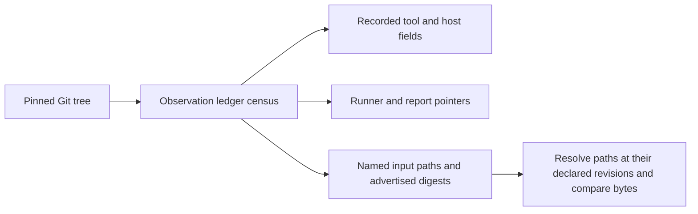

# RT-00 provenance of experiment observation ledgers

The earlier [exact-name census](RT-00-C-EVIDENCE-LEDGER-IDENTITIES-2026-11-25.md) and [delta](RT-00-C-EVIDENCE-IDENTITY-DELTA-2026-11-25.md) covered files named `evidence.json`. This audit covers the 20 tracked `observations.json` and `*-observations.json` files below `research/` at `356ddee8964a8b0bb49457e5252fdec7e8b12f83` on `research/all`. The [ledger](OBSERVATION-PROVENANCE-01/evidence.json) records the exact Git blobs, selected tool and host fields by producer schema, direct tracked-file bindings and report pointers. [#284](https://github.com/aivibeflow/LLMLang/issues/284)



| Check | Result |
| --- | ---: |
| Ledgers with a recorded tool version, revision or fingerprint field | 18 of 20 |
| Ledgers with a dedicated executing host architecture, kernel or runner field | 4 of 20 |
| Inputs matched against a specific tracked file and revision | 14 fields |
| Historical census queue paths matched against their archived Git blobs | 24 |
| Distinct commits named by the historical rerun and present in repository history | 5 |
| Ledgers with an adjacent `run.py` at the pinned tree | 16 |
| Ledgers with a corresponding study report identified by its path references | 17 |

The four direct host fields cover the two FFI architecture records, the TCP kernel release and the historical CI runner label. The historical Lean artifact names a toolchain target. That field describes the executable target. The temporal adapter ledger has no standalone tool version or executable digest field, but the archived companion report identifies TLC and Apalache by exact artifact hashes and records Java and gRPC versions. The historical root census ledger identifies its archived tree and CI run and job. It has no tool or host field in the ledger itself. Report pointers preserve the location of the recorded context without treating an unrecorded kernel or machine as known. [Temporal adapter report](../../formal-verification/RT-33/RT-33-TEMPORAL-ADAPTERS-2026-11-25.md) · [Historical census ledger](../../quality-audit/2026-11-23-root-census-observations.json)

The compared bindings include the Go/JVM callback study's earlier callback ledger, the release requirement and Lean formalization, the publication model and the dependency bootstrap's prior register revision. The historical Lean record resolves both the reviewed source and its toolchain configuration at the named historical commit. Controls using the correct digest with the wrong path, and a digest recalculated after changing the source bytes, both failed the binding check. The historic queue checks verify a reproducible set of 24 documents. Reviewer dispositions remain a separate §0.2 activity.

The scope of this check is the archived Git tree and the declared fields in the runner. External binary, system-header and runtime hashes are recorded as field locations here. Model-generated inputs and original execution attestations require additional evidence. The [separate FFI archive replay](RT-00-FFI-ARCHIVE-REPLAY-2026-11-25.md) covers execution for eight FFI fixtures.

Two runs produced identical audit ledgers on Linux 6.18.57 x86-64 with Git 2.56.1 and CPython 3.12.14. Run from the repository root with the named commits available locally.

```sh
fixture=research/research-management/RT-00/OBSERVATION-PROVENANCE-01
out=$(mktemp)
python3 -B "$fixture/run.py" > "$out" && cmp "$fixture/evidence.json" "$out"
```
