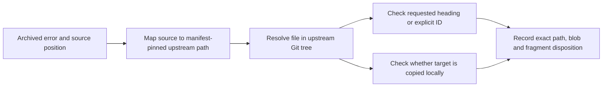

# Paths and fragments behind copied reference link failures

**Scope.** PLAN §0.1 and [#284](https://github.com/aivibeflow/LLMLang/issues/284). This check takes the 82 recorded errors from the pinned [offline link scan](RT-00-B-18-NAVIGATION-DELTA-2026-11-25.md) and resolves them against the manifest from research/all `877db318a2c63f51116b63714001b3e96640a4a9`.

## Method and result

The [reference manifest](../../references/SNAPSHOT-MANIFEST.json) binds upstream commits, tree identities and copied source files. Load the three relevant upstream trees at the exact commits. Compare all 11 copied files in those manifest groups to their upstream blobs. Interpret OCI and Alive2 link paths relative to each original source. For MCP, resolve root-absolute site routes through the upstream `docs/` tree to an exact path, a `.mdx` page or an `index.mdx` in the route directory. Inspect the source document's explicit IDs and normalized headings when a fragment is present.



| Snapshot | Error occurrences | Distinct upstream files | Checked requested fragments | Fragment unverified |
| --- | ---: | ---: | ---: | ---: |
| MCP | 44 | 17 | 21 | 1 |
| OCI | 32 | 7 | 18 | 0 |
| Alive2 | 6 | 6 | 0 | 0 |
| Total | 82 | 30 | 39 | 1 |

Every target file exists at the exact upstream revision. The 42 occurrences without a fragment have a verified path. Eighty occurrences target content omitted locally. Two MCP site routes lead to files already copied under local names, namely the authorization and basic index pages. They still refer to site-root addresses in the unchanged source. The Git and source-blob checks confirm copied file integrity. The counts describe the pinned partial snapshots.

The sole unresolved fragment is the MCP transport page's `/specification/2026-07-28/basic/index#meta`. The exact basic-index source has the heading `_meta`. Heading normalization in this check preserves the leading underscore, and the source has no explicit `meta` ID. The archived claim is therefore file-path verification with an unverified renderer-specific fragment. The parser tests the heading form used by the affected documents and does not render the hosted MCP site.

## Reproduce

Use Git 2.56.1 and CPython 3.12.14 on Linux x86-64. Fetch the three immutable trees into separate bare repositories or supply existing repositories with the pinned objects. The runner verifies the tree hashes before reading files. All 82 source entries, links, destination paths and blob IDs are in the [evidence ledger](SNAPSHOT-ROUTES-01/evidence.json). Two seeds produced identical receipts. No upstream documents or assets were added.

```sh
study=research/research-management/RT-00/SNAPSHOT-ROUTES-01
upstream=$(mktemp -d)
while read -r key repository revision; do
  git init --quiet --bare "$upstream/$key" || exit 1
  git -C "$upstream/$key" fetch --quiet --depth=1 --no-tags \
    "https://github.com/$repository.git" "$revision" || exit 1
done <<'SOURCES'
mcp modelcontextprotocol/modelcontextprotocol 5f5440bb26a62e2cf3440b92da5a667efa03b267
oci opencontainers/image-spec 4feed4a6674e59d301b9294f187ac46acb2de99f
alive2 AliveToolkit/alive2 3bdd4f5e1cefa47057e93110e707acd11cfe08e4
SOURCES
PYTHONHASHSEED=11 python3 -B "$study/check.py" \
  --mcp "$upstream/mcp" --oci "$upstream/oci" --alive2 "$upstream/alive2" \
  > "$upstream/evidence.json" &&
  cmp "$study/evidence.json" "$upstream/evidence.json"
```
