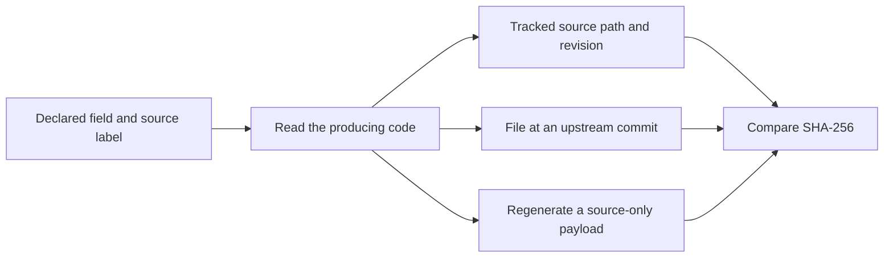

# Producer-specific source bindings outside exact-name ledgers

**Scope.** PLAN §0.1 and [#284](https://github.com/aivibeflow/LLMLang/issues/284) at research/all `93aa2261b387cc2f05763a84e1f86255991ef2a8`. This follows the [structured census](RT-00-STRUCTURED-PROVENANCE-CENSUS-2026-11-25.md), using each producer to resolve the 100 labels in its unbound set whose file is named differently from `evidence.json`.



| Verified binding | Labels | Matching SHA-256 |
| --- | ---: | ---: |
| Tracked source at the pinned or explicitly recorded revision | 88 | 88 |
| Upstream source at an immutable revision | 8 | 8 |
| Regenerated source payload | 4 | 4 |
| Total | 100 | 100 |

The local bindings include JIT benchmark configuration, RT-02's synthetic review packet, cross-fixture Cortex-M3/RV64 files, graph benchmarks and both Scenario 133 studies. Scenario 133's hosted replay maps to its recorded CI checkout `d75fd5474950944a2a101bc419316603abb1fb78`. The source label `base-run.py` resolves to different producers for the RV64 trap/frame and IPC experiments. The two JIT receipts bind the same named source closure from different benchmark run directories. Exact hashes are compared at their resolved paths.

The upstream bindings cover the eight inputs in the [MMIO metadata report](../../runtime-and-systems/RT-37/RT-37-MMIO-METADATA-AND-CAPABILITIES-2026-11-24.md). The CMSIS 5.9.0 annotated tag object cannot serve as a raw file revision. Git resolves it to commit `2b7495b8535bdcb306dac29b9ded4cfb679d7e5c`. All three CMSIS files match their published digests at that commit. The upstream table now links directly to the peeled commit.

The four generated inputs are the Cranelift checked-add fixture with the producer's named operation substitution and three TLA+ modules produced from the pinned transition-model input. The digest checks regenerate those inputs in a tracked export. They use the original ledger for execution observations.

The [evidence](PRODUCER-ALIAS-PROVENANCE-01/evidence.json) records each label, its source and exact revision or URL, both digests and the disposition. The 109 residual labels from exact-name files remain in the separate provenance review. These comparisons identify byte inputs. Host and tool claims continue to use their own receipts and recorded limits.

## Reproduce

Use CPython 3.12.14, Git 2.56.1 and GNU tar 1.35 on Linux x86-64. The URLs use immutable upstream commit IDs and require network read access. No external binaries or checked-out vendor scripts are executed. Two seeds produce the same JSON.

```sh
study=research/research-management/RT-00/PRODUCER-ALIAS-PROVENANCE-01
out=$(mktemp)
PYTHONHASHSEED=53 python3 -B "$study/check.py" > "$out" &&
  cmp "$study/evidence.json" "$out"
```
