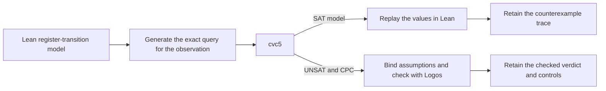

# RT-00 — Reproduce the RT-33 symbolic verification evidence chain

**Status:** Exact-source local replay complete.

**Baseline:** `e01fe48de50d22fa374ab614675a8c3f03f0cc59`.

**Evidence type:** Executable replay, Lean kernel check, source-bound CPC checking and negative controls.

**Tracking:** PLAN §0.2, [RT-33](../../formal-verification/RT-33/RT-33-PROOF-BACKEND-SELECTION-AND-ORCHESTRATION.md) and [issue #285](https://github.com/aivibeflow/LLMLang/issues/285).

## Question and alternatives

Can an implementation selection review reproduce the difference between an all-boundary state claim and a final-only claim from the recorded RT-33 artifacts? We compared three evidence packages for the same small register-transition model. A solver verdict records what the configured solver reported. A satisfiable model replay exhibits a violation in the executable Lean model. A CPC refutation with an exact source-assertion binding checks the two unsatisfiable solver queries against their original assumptions. CPC is cvc5's proof calculus. An action boundary is the state observed after each action of the two-action sequence.

A weaker selection procedure could accept the final-state verdict for the whole action trace. Another could accept a standalone CPC checker verdict with whichever assumptions the certificate supplies. These alternatives predict that the negative controls will pass. The pinned experiment lets us test that prediction.

## Method and results



The two paths produce different evidence. Model replay is a counterexample check within the executable model. The refutation path compares the certificate assumptions with the exact source query, then checks the CPC commands.

The local run started from a Git archive. It rebuilt the LLMLang Logos binding with pinned Lean and used the already compiled pinned upstream Logos dependency. The [symbolic SMT driver](../../formal-verification/PROOF-OBLIGATION-BENCHMARK/generative/transition/symbolic_dual_check.py) regenerated all three queries. The [CPC driver](../../formal-verification/PROOF-OBLIGATION-BENCHMARK/generative/transition/symbolic_cpc_check.py) then consumed the freshly generated UNSAT inputs. All nine archived SMT outputs and all seven archived CPC outputs matched byte for byte. The focused tests passed 3/3 for symbolic replay and 11/11 for evidence-composition controls.

| Claim about the second register | Scope | Reproduced evidence |
| --- | --- | --- |
| Absolute value followed by reset | Each action boundary | `unsat` for a mismatch, source-bound CPC accepted |
| Zero throughout | Each action boundary | `sat`, replayed input `[-1, 0]` yields second-register observations `[1, 0]` instead of `[0, 0]` |
| Zero at completion | Final action boundary | `unsat` for a mismatch, source-bound CPC accepted |

The final-boundary certificate failed when used for the all-boundary absolute-value query. A bare `sat` reply failed certificate intake. A source assertion using the omitted second declaration failed before certificate admission. The Lean audit matched the archived axiom lists `propext`, `Classical.choice` and `Quot.sound` for both the query correspondence theorem and the certificate-binding theorem.

The checked inputs support keeping the observation scope in verification identity and binding the backend result to the exact obligation. The witness demonstrates that the final-only and all-boundary zero claims are observably different. The cross-query control demonstrates that a valid proof for one bounded profile cannot stand in for another. The observed scope supports reviewing the evidence packages separately when comparing LLMLang verifier implementations.

## Reproduction and limits

Use CPython 3.12.14, Git 2.56.1, Lean 4.36.0 at commit `611c117bfaf7b7ae1cfcf246ce6fba31e8f509e9`, Lake 5.0.0, and cvc5 1.4.2 at `282d5e0`. The [replay ledger](RT-00-QUALITY-RULES-PROOF-CHAIN-REPLAY-2026-11-24.json) contains the source blob IDs, artifact digests and exact execution environment. From an exact checkout of the baseline, make the pinned Logos dependency available as documented in the [CPC study](../../formal-verification/PROOF-OBLIGATION-BENCHMARK/SYMBOLIC-CPC-CERTIFICATES.md#reproduce), then run:

```sh
set -eu
(
  cd research/PROTOTYPES/DEPENDENCY-GRAPH-01/logos_binding
  lake build --fail-fast LLMLangLogosBinding
)
pob=research/formal-verification/PROOF-OBLIGATION-BENCHMARK
scratch=$(mktemp -d)
python3 -B "$pob/generative/transition/test_symbolic_dual_check.py"
python3 -B "$pob/evidence/test_composition.py"
python3 -B "$pob/generative/transition/symbolic_dual_check.py" \
  --lean "$(command -v lean)" --cvc5 "$(command -v cvc5)" --output "$scratch/smt"
python3 -B "$pob/generative/transition/symbolic_cpc_check.py" \
  --lake "$(command -v lake)" --cvc5 "$(command -v cvc5)" \
  --queries "$scratch/smt" --output "$scratch/cpc"
for kind in smt cpc; do
  for file in "$pob"/symbolic-"$kind"-results/*; do
    cmp "$file" "$scratch/$kind/${file##*/}"
  done
done
```

The counts are complete for this replay and carry no sampling interval. The run did not measure speed, perform a clean build of upstream Logos rule proofs, or replay the three backend artifact inputs of the larger composition experiment. The Lean model and two-query CPC profile delimit the checked claims. General SMT-LIB parser and printer semantics, source or SPG lowering, backend preservation, and independent scientific review remain open. Mermaid source was checked without locally rendering it. No draft change or policy adoption follows.
