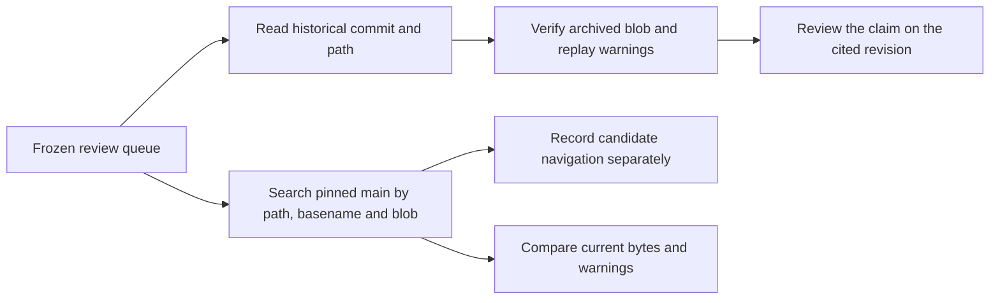

# RT-00 — Preserve source-bound quality review after moving research reports

**Status:** Bounded reproduction complete. Independent review and policy adoption pending.  
**Baseline:** Historical census `627c70878863b519a358815f8a96ddbae1303136`, pre-migration `d37245f80ade33b2d4d5d0186381beadb75620df`, post-#444 main `fe229c3215c42d8bded531d77bbef47761ac5770`.  
**Evidence type:** Exact Git-object comparison and executable structural heuristic.  
**Tracking:** PLAN §0.2 and [issue #285](https://github.com/aivibeflow/LLMLang/issues/285).

## Problem and hypotheses

The [historical quality census](RT-00-QUALITY-RULES-ROOT-CORPUS-CENSUS-2026-11-23.md) fixed its population and review queue using report paths and Git blobs. [PR #444](https://github.com/aivibeflow/LLMLang/pull/444) subsequently moved reports into research-direction directories and repaired links. A reviewer needs both the exact bytes sampled for the original audit and a way to find the current report. A new root-only census could appear to show improved documentation simply because it now measures a different population.

We tested whether the archived census still reproduces, how often path-based and content-based lookup recover its queue from the pinned post-#444 tree, and whether structural warning agreement detects changed inputs. A Git blob identifies a byte sequence. Its appearance at a different path can recover those bytes, while a changed blob requires a new evidence binding before a claim review can be attributed to that revision.

## Method and controls

The script replays the existing census over the historical commit and requires exact agreement with the published summary and all queue records. It enumerates tracked Markdown and MDX blobs under `research/` at all three commits. For each of the 24 archived queue records it records the same-path lookup, all exact blob matches and all basename matches on the pinned post-#444 tree. Navigation uses the old path when it exists and the unique basename otherwise. A duplicate basename with no old path leaves navigation unresolved. The warning comparison uses the same checker on both snapshots. The experiment counts every documentation result within this fixed queue. It makes no population estimate from the queue.



The subsequent [thematic move in PR #446](https://github.com/aivibeflow/LLMLang/pull/446) changes live paths again. The navigation paths in the observation data retain their original tree pin.

The historical lookup supplies the review input. The current-main lookup supplies candidate links and a comparison of the current bytes and warnings.

## Observations and alternatives

| Tree | Root research Markdown/MDX | Recursive research Markdown/MDX |
| --- | ---: | ---: |
| Historical census | 309 | 351 |
| Immediately before PR #444 | 329 | 398 |
| Immediately after PR #444 | 16 | 399 |

| Lookup or comparison | Result on the fixed queue of 24 | Use |
| --- | ---: | --- |
| Replay frozen census and queue | 24 exact queue records, all census summary fields equal | Retains the original review population and evidence |
| Read the original path on the pinned post-#444 tree | 5 found, 4 with the original bytes | Existing links alone lose reports and can silently resolve changed bytes |
| Search the pinned post-#444 tree for exact historical Git blob | 13 unique matches | Recovers exact text when available, including 9 relocations |
| Navigate by original path or unique basename | 24 candidates | Finds current reports for follow-up. 11 candidates have revised bytes versus the original queue |
| Compare warning lists | 1 changed, 23 equal | Structural agreement missed 10 of the 11 changed inputs |

Eleven of the current navigation blobs also differ from their pre-migration blob. Files can acquire new blob IDs through link repairs alone. The audited comparisons classify bytes, paths and warning strings. They do not classify whether those edits change a scientific claim.

The stale same-path record and the ten changed blobs with unchanged warnings falsify two shortcuts for reusing review evidence. A new recursive census could describe current coverage, at the cost of discarding comparability if it replaced the historical queue. A Git-blob lookup can supplement navigation. A basename match requires treating the destination as a navigation candidate, with the archive retained as the claim review's input. The existing warning-only policy remains the sound use of this heuristic.

## Reproduction and limits

From the repository root in a full checkout that contains all three commits, run:

```sh
python3 -B -m unittest discover -s .github/scripts -p 'test_research_quality_corpus_census.py' -v
python3 -B .github/scripts/research_quality_queue_relocation.py \
  --output /tmp/llmlang-queue-relocation.json
```

The [reproduction script](../../../.github/scripts/research_quality_queue_relocation.py) and [observation data](RT-00-QUALITY-RULES-QUEUE-RELOCATION-2026-11-24.json) preserve the 24 source identities, alternatives, full warning lists, tool versions and checker blob. Expected output is 24 archival matches, 4 current exact path/blob matches, 13 current unique exact blob matches and 24 navigation candidates. The versioned measurement is a complete enumeration of this queue, so there is no sampling interval for these counts. Mermaid was checked as source text and was not rendered locally.

## Decision and draft impact

For #285, preserve the original queue and provide current paths as navigation. A reviewer who wants conclusions to apply to a revised report must inspect the revised source and identify the revision. This study contributes zero independent human reviews. The 24-document queue, separate eight-claim handoff, historical execution attestations, broad representative claim verification and maintainer approval remain open. The study informs evidence hygiene for comparing LLMLang implementation options. It does not select language semantics or amend `draft/`.
