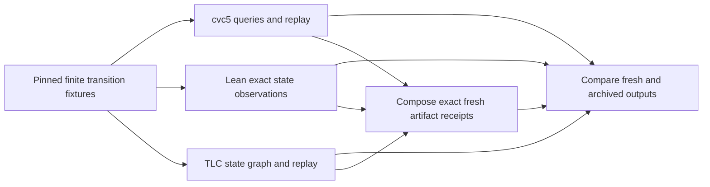

# RT-00 — Replay RT-33 composition with fresh cvc5, Lean and TLC evidence

**Status:** Exact-source local replay complete.

**Baseline:** `b62f7236038bcfa452ad603a93c816e9012c707e`. The proof-benchmark tree matches main `c6be8eb36ae8cb072ac1099bd00ca1f5e8a6aaaa`.

**Evidence type:** Three executable backend adapters, Lean kernel checks for fixed cases, and exact evidence composition.

**Tracking:** PLAN §0.2 and [issue #285](https://github.com/aivibeflow/LLMLang/issues/285).

## Question and alternatives

The [RT-33 composition study](../../formal-verification/PROOF-OBLIGATION-BENCHMARK/EVIDENCE-COMPOSITION.md) records agreement and counterexamples on 798 fixed register-transition claims. Its composition fixture can replay archived outputs. We tested whether those outputs can be rebuilt from the pinned sources and tools, and whether the composition result is identical when it reads newly generated backend artifacts. This extends the earlier two-query [symbolic proof evidence replay](RT-00-QUALITY-RULES-PROOF-CHAIN-REPLAY-2026-11-24.md) to the separate finite three-backend corpus.

An archived receipt identifies its source outputs. Re-reading it tests the composition input boundary. Re-executing the adapters additionally tests that the source corpus, backend tools and observation projections produce those bytes on the recorded environment. A final-state-only comparison discards intermediate observations and can disagree with the required all-boundary claim. The existing negative controls distinguish that scope change.

## Method and results



The three adapters consume related fixture inputs, with separate engines and observation checks. The composer binds the fresh per-adapter artifacts to the exact case identities and aggregates the results.

| Observation | Result |
| --- | ---: |
| Fixed cases | 798 |
| Bounded agreement across adapters | 712 |
| Refuted by a replayed mismatch | 86 |
| TLC distinct enumerated prefix states | 2,778 |
| Accepted exact bounded receipts | 2,394 |
| Adapter and composition unit tests | 24 passed |
| Archived artifacts matched byte for byte | 8 |

The cvc5 adapter replayed its satisfiable counterexamples. Lean rejected the deliberately false claim and matched the cvc5 case observations. TLC completed the declared prefix graph and reproduced both the full-claim counterexample and the weakened final-state result. The state-count denominator applies to the fixed TLC graph, while the result counts apply to the 798 exact case claims. The composition summary regenerated from the fresh outputs matches the archived summary and its per-case digest. The corpus conjunction is refuted because the corpus includes the 86 counterexamples.

The matched outputs include the SMT summary and transcript, both Lean and TLC summaries and case tables, the TLC counterexample, and the composition summary. Tool-specific details and all compared output hashes are in the [replay ledger](RT-00-QUALITY-RULES-THREE-BACKEND-REPLAY-2026-11-24.json).

## Reproduction and limits

Use CPython 3.12.14, Lean 4.36.0 at commit `611c117bfaf7b7ae1cfcf246ce6fba31e8f509e9`, cvc5 1.4.2 at `282d5e0`, OpenJDK 21.0.13, and TLC v1.8.0. Verify the TLC JAR SHA-256 from the ledger. From a clean checkout of the baseline:

```sh
set -eu
pob=research/formal-verification/PROOF-OBLIGATION-BENCHMARK
bench="$pob/generative/transition"
scratch=$(mktemp -d)
for adapter in smt lean tlc; do
  python3 -B "$bench/test_${adapter}_adapter.py"
done
python3 -B "$pob/evidence/test_composition.py"
python3 -B "$bench/smt_adapter.py" --cvc5 "$cvc5" --output "$scratch/smt"
python3 -B "$bench/lean_adapter.py" --lean "$lean" --output "$scratch/lean" \
  --smt-observations "$scratch/smt/observations.jsonl"
python3 -B "$bench/tlc_adapter.py" --jar "$tlc_jar" --output "$scratch/tlc" \
  --smt-observations "$scratch/smt/observations.jsonl" \
  --lean-observations "$scratch/lean/observations.jsonl"
python3 -B "$pob/evidence/transition_experiment.py" \
  --smt "$scratch/smt/observations.jsonl" --lean "$scratch/lean/observations.jsonl" \
  --tlc "$scratch/tlc" > "$scratch/composition.json"
cmp "$pob/evidence/transition-result.json" "$scratch/composition.json"
```

The present comparison checked the eight listed stable artifacts. TLC raw logs can contain process-specific values. The counts enumerate complete fixture results and have no sampling interval. Mermaid source was checked without local rendering.

The observations support retaining exact backend, artifact and claim identities when composing selected verification evidence. The shared generator and scope model leave common translation faults possible. The replay does not validate unbounded claims, source-to-benchmark correspondence, backend independence, liveness or runtime integration. Independent scientific review and adoption of the quality rules remain open.
