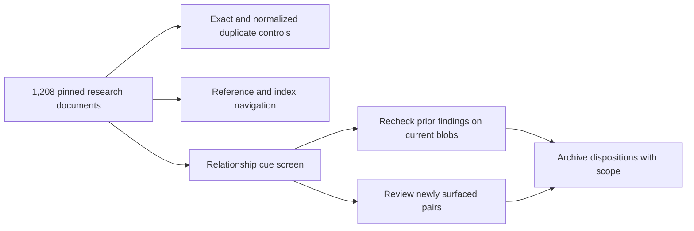

# Current corpus relationship coverage and dispositions

**Scope.** PLAN §0.1 and [issue #284](https://github.com/aivibeflow/LLMLang/issues/284), on research/all at `5f1d60b9daa25805dc008d1afeb0cf9efe4a9f91`. Refresh the [prior screen](RT-00-CURRENT-CORPUS-RELATIONSHIPS-2026-11-25.md) and preserve scoped treatment of duplicates, historical versions, navigation and conflict cues.



## Corpus controls

There are no exact Markdown/MDX duplicates. The word-sequence check strips case differences and word separators before comparing full documents of at least 40 words. All 1,207 eligible bodies are distinct. There is one title collision. The [November 22 inventory report](RT-00-A-CURRENT-MAIN-INVENTORY-FRESHNESS-RECONCILIATION-2026-11-22.md) describes drift against the original inventory at an older source revision. The [November 23 report](RT-00-A-CURRENT-MAIN-INVENTORY-FRESHNESS-RECONCILIATION-2026-11-23.md) audits a successor tree and reports refreshed coverage. The reports record different observations and both keep their original baselines.

Seven documents fall outside Markdown link-only traversal from the four recognized roots. All seven are known copied reference documents and each filename occurs in the [reference catalog](../../references/README.md). The prior [branch navigation check](RT-00-B-18-NAVIGATION-DELTA-2026-11-25.md) gives the separate directory-browsing result. Exact upstream snapshot link completeness is tracked independently in PLAN.

## Candidate coverage

| Prior or new candidate treatment | Pairs |
| --- | ---: |
| Previously reviewed replacement and conflict cues, rechecked at current blob or unchanged cue | 95 |
| Shared paragraph or reciprocal language companion without a previously reviewed replacement/conflict cue | 3 |
| Other direct context signal without such a cue | 319 |
| Other shared context signal without such a cue | 118 |
| Newly surfaced pairs read for historical scope or new execution evidence | 14 |
| Newly surfaced pairs read for downstream composition or differing profiles | 7 |
| Newly surfaced pairs read as navigation or crosswalk | 10 |
| Current candidates | 566 |

The [95-pair review](RT-00-REPLACEMENT-AND-CONFLICT-CUE-REVIEW-2026-11-25.md) records six scoped supersessions and one execution-status update. Its exact two document identities are unchanged on 86 pairs. For the other nine, one side has changed in the dependency map, taxonomy or option matrix. Each exact triggering line survives once in the current archive and the other endpoint is unchanged. Reading the changed documents preserves the prior context or scope treatment for these nine. The visible cue in DEP-019 concerns scope of hardware observations and synchronization, independent of any new replay of the archived Dafny fixture.

The 437 citation-context candidates have a source that references a report or a shared context. These are signals rather than adjudications about all claims in both documents. The prior report already identifies the copied Scenario 28 protocol note and the English/Russian concept overlap. Versions remain linked where their historical or semantic boundaries differ.

Among the 31 new pairs, the RT-33 SMT and Why3/Boogie comparisons test different certificate routes. A checker can admit the tested standalone SMT certificate while detecting holes in a proof emitted through a different VC translation route. The integrated release fixture consumes a scoped property demonstrated by the original C/Rust provider report and adds separate admission, authorization and rollback checks. The CPU timer and disk accounting studies exercise separate resource dimensions cited by DEP-102. Scenario 102's fresh run records eight current executions and preserves the historical report's separately scoped seven-test claim.

## Reproduce and limits

The [machine ledger](RELATIONSHIP-COVERAGE-01/evidence.jsonl) records current path pairs and blobs, their signal classes, and the rechecked historical labels. The screen's four known semantic controls remain discoverable despite their distinct retrieval paths. Normalization and cue review can expose duplicates, temporal conflict, misleading headings and obvious supersession. Their coverage leaves semantically equivalent paraphrases and contradictory claims with no recognized cue possible. No whole report was marked superseded based on output of the screen. No historical evidence was rewritten.

Use CPython 3.12.14, Git 2.56.1 and Linux x86-64 6.18.57. Two hash seeds produce identical receipts.

```sh
study=research/research-management/RT-00/RELATIONSHIP-COVERAGE-01
out=$(mktemp)
PYTHONHASHSEED=71 python3 -B "$study/check.py" > "$out" &&
  cmp "$study/evidence.jsonl" "$out"
```
