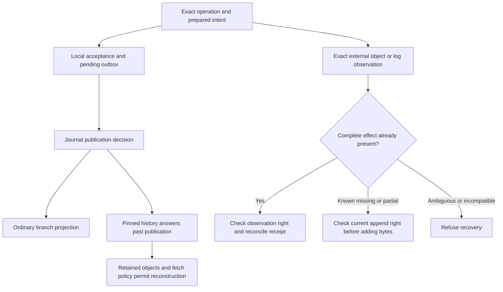

# RT-00 — RT-19 and RT-23 recovery evidence and claim lineage

**Scope:** PLAN §0.1 and [#284](https://github.com/aivibeflow/LLMLang/issues/284), pinned to `research/all` at `c03e64fcc3a3b195ae0922a678b6aa39743b552e`. Manual comparison of eight reports and fresh replay of seven native studies.

LLMLang's Toolchain Server needs to recover an interrupted operation and explain what a returned receipt establishes. The word *recovery* covers several questions in RT-19 and RT-23. This audit looks for duplicate results, supersession, apparent contradictions and orphaned reports. It distinguishes local acceptance, an already executed effect, a Git publication decision, the currently selected branch, present access to data, and permission to take a new action.

## Which durable record answers each question?

| Study | Claim and working assumptions |
| --- | --- |
| [RT-19 transaction protocol comparison](../../toolchain-and-collaboration/RT-19/RT-19-TRANSACTION-RECOVERY-PROTOCOL-COMPARISON-2026-11-24.md) | Compares local atomic acceptance with publish-as-acceptance. The recommendation is a local coordinator with a durable outbox, meaning a record of pending publication committed together with the accepted workspace. The analysis identifies candidate crash cuts. The component tests exercise separate in-memory workspace and SQLite object-store contracts. |
| [RT-19 SQLite/Git process recovery](../../toolchain-and-collaboration/RT-19/RT-19-SQLITE-GIT-PROCESS-RECOVERY-2026-11-24.md) | Reopens the SQLite workspace after eight process exits and recovers the exact Git publication by operation receipt after branch divergence. The branch and receipt ref update is bracketed by process exits. The source importer is a closed profile. |
| [RT-19 immutable external effect](../../toolchain-and-collaboration/RT-19/RT-19-EXTERNAL-RECEIPT-RECOVERY-2026-11-25.md) | An exact prepared intent and immutable object bytes justify reconstructing an observed receipt. The trusted reconciler reads an already visible object and inserts the missing receipt. Its policy does not issue another external write. |
| [RT-19 mutable log](../../toolchain-and-collaboration/RT-19/RT-19-MUTABLE-LOG-RECOVERY-2026-11-25.md) | The current log may differ from a past receipt. The fixture rechecks operation identity, ordered canonical frames and file identity. With cooperating writers, it may finish an identified prefix or append to a clean log. Its success claim includes a complete current log. |
| [RT-19 recovery authority](../../toolchain-and-collaboration/RT-19/RT-19-RECOVERY-AUTHORITY-2026-11-25.md) | Reuses the framed-log runner and adds an authority dimension. One can reconcile a complete effect with observation permission. Writing new bytes also requires append permission. A writer fence ties the local result to the authority revision when every revoker uses the same SQLite database. |
| [RT-23 single journal ref](../../toolchain-and-collaboration/RT-23/RT-23-SINGLE-JOURNAL-REF-2026-11-24.md) | Stops native Git inside the tested ref backend. One protected journal ref records an exact publication; advancing the ordinary branch is a separate projection. A reader of multiple loose refs can observe only one side of a paired update in the process-stop fixture. |
| [RT-23 indexed journal](../../toolchain-and-collaboration/RT-23/RT-23-INDEXED-JOURNAL-RECOVERY-2026-11-25.md) | Extends journal lookup with a cumulative index in the same commit tree. Full scan and indexed lookup agree on 11 queries per backend. An absent entry has meaning only at a pinned head with a complete retained index. The bounded scanner explicitly reports exhausted history. |
| [RT-23 pinned retention](../../toolchain-and-collaboration/RT-23/RT-23-PINNED-GIT-RETENTION-2026-11-25.md) | The object ID identifies a snapshot. Availability through Git collection and clone depends on reachability and fetch policy. Reader refs and journal ancestry retain objects in the tested maintenance schedule. |

The diagram maps the candidate publication flow and annotates the separate questions a retry must resolve. A publication receipt and branch projection can agree at one generation and then diverge. External recovery follows a separate path and consults the authority appropriate to its result.



The first three publication nodes describe separate evidence boundaries across the studies. They do not assert a tested implementation combining SQLite, the single journal ref and a native authority fence.

## Disposition of overlapping claims

**Git transaction scope.** RT-19's recoveries show stable observations before or after the ordinary branch and receipt transaction in that fixture. RT-23 pauses *inside* the files backend and observes the branch already moved while the receipt is absent. These tests use different schedules. The later result limits any extrapolation to atomic visibility during that backend's multi-ref write. It also refines the early protocol's current-tree retry sketch. Recovery for a particular operation should consult its exact retained decision, since querying the current branch loses the previous publication after divergence.

**Past effect and current effect.** The immutable-object fixture can reconstruct a receipt after publication permission is revoked because its trusted observation operation is separate and it writes no external bytes. The mutable-log fixture asks whether the expected record is still present in a complete current log, so it refuses when state has been replaced or truncated. The authority follow-up clarifies the premise behind the first result. Current observation permission can justify reconciliation after append revocation, while the actual append and logical result need the tested serialization with revocation. These claims have different meanings and coexist. A result about the current file is not justified by a historical receipt alone.

**Lookup and retention.** RT-23's index reduces the oldest request's receipt examinations from 65 to one on the tested history and adds 131 retained Git tree objects. The study counts logical receipt loads and tree objects, not end-to-end latency. The retention result explains why exact lookup and reconstruction additionally need reachable objects and explicit fetch of the protected ref. An eight-entry lookup that cannot reach the request must abstain. Neither shortening the search nor recording an exact OID restores missing history or authorizes a write.

All eight reports are linked from [PLAN.md](../../../PLAN.md). Keep the protocol comparison as the origin of the alternative designs and keep the bounded experiments beside it. No whole report duplicates or supersedes another in this set. Updating the comparison's current-tree retry sketch would require choosing a coherent publication and retention profile. This audit records the scope refinement while preserving the historical proposal.

## Reproduction and limits

From the repository root, run the wrapper with CPython 3.12.14, SQLite 3.53.1, Git 2.52.0 and Debian GCC 14.2.0-19 on x86-64 Linux 6.18.57 with overlayfs temporary storage. The wrapper verifies the seven runner and archive files against the pinned Git tree, runs the fixtures in their normal entry points under locale `C` and Python hash seed 1, and compares every generated ledger byte to its archive. All seven matched. The [replay ledger](RECOVERY-RELATIONSHIPS-01/replay.json) records exact SHA-256 values and the measured environment. The wrapper leaves dependencies to the source checks in the original runners.

```sh
audit=research/research-management/RT-00/RECOVERY-RELATIONSHIPS-01
python3 -B "$audit/replay.py" > /tmp/llmlang-recovery-relationships.json
cmp "$audit/replay.json" /tmp/llmlang-recovery-relationships.json
```

The reproduction covers the published local process schedules. It leaves power-loss durability, remote delivery, cross-provider authorization, production Git/filesystem behavior and independent domain review open. It makes no performance measurement. Mermaid syntax was inspected and the underlying claims are also stated in the table and prose. [Replay wrapper](RECOVERY-RELATIONSHIPS-01/replay.py)
