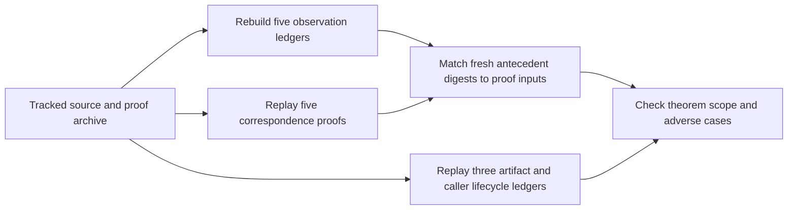

# Tracked replay of RT-32 source observations and proof lifetime

**Date** 2026-11-25 · **Plan** §0.1 and §2 · **Issue** [#284](https://github.com/aivibeflow/LLMLang/issues/284)

Thirteen ledgers reproduce byte-for-byte from the tracked research archive at `55d54059aa8ba1c18e047f491843e1e7d278d25d`. Five pairs connect a concrete source or execution ledger with the corresponding RT-32 proof ledger. The other three cover Lean artifact reuse, persistent proof-cache behavior and caller evidence states. This replay separately checks every supported link between a proof and its concrete antecedent.

## Method and executable evidence

The audit extracts the selected commit's research tree and replays its producer scripts. It compares each generated ledger to the archived bytes and verifies that the five correspondence proofs name the digests of the five newly reproduced antecedents. The caller-evidence fixture separately verifies its earlier Git-pinned compiled admission receipt. This gives exact execution and input traceability for the checked cohort. The Linux host and all tools used for the new replay are recorded.



| Fixture | Reproduced claim and its exact observation scope |
|---|---|
| Source cleanup graphs | 128 finite source-derived Python executions. Lean checks eight agreement and eight resource completion results and four mutation inequalities for the admitted graph grammar. [Source cleanup](../../formal-verification/RT-32/RT-32-SOURCE-CLEANUP-KERNEL-2026-11-25.md) |
| Worker cancellation | Eight guarded schedules, 56 guarded steps and two per-schedule terminal outcomes. A proposed proof that neglects late cancellation is refused. The preceding native ledger covers its own tested Python/Rust implementations. [Worker cancellation](../../formal-verification/RT-32/RT-32-WORKER-CANCEL-KERNEL-2026-11-25.md) |
| Partial record ownership | The Lean archive has 72 source cases and 2,304 oracle vectors. The pinned upstream ledger includes 4,608 observations across two Rust settings. Wrong owner and moved-slot proof applications fail. [Record ownership](../../formal-verification/RT-32/RT-32-RECORD-OWNERSHIP-PROOF-2026-11-25.md) |
| Stateful method probes and mutable renaming | The scoped method family has 108 distinct full signatures and 99 with its shortened probe set. The JavaScript topology producer supplies separate renaming observations, and the incorrect split-preservation proof is refused. [Method observations](../../formal-verification/RT-32/RT-32-BOUND-METHOD-OBSERVATION-COMPLETENESS-2026-11-25.md) · [Mutable renaming](../../formal-verification/RT-32/RT-32-MUTABLE-RENAMING-KERNEL-2026-11-25.md) |
| Lean artifact identity and SQLite proof-cache lifetime | A comment changes the dependency source digest while preserving module bytes. A changed dependency meaning still imports with the stricter kernel setting and refuses the old proof term. The persistent prototype distinguishes four closed proof keys across dependency, artifact and trust changes, and recovers a deliberately interrupted local publication. [Artifact replay](../../formal-verification/RT-32/RT-32-LEAN-ARTIFACT-REPLAY-2026-11-25.md) · [Persistent cache](../../formal-verification/RT-32/RT-32-PERSISTENT-PROOF-CACHE-2026-11-25.md) |
| Caller evidence states | The separate finite checker considers 5,040 publication orders and 35,280 prefixes. A scope-free policy reports 4,704 premature closures. Mutating subject, version, contract, theorem, imports, toolchain or issuer authorization preserves conditional rather than closed status. [Caller evidence](../../formal-verification/RT-32/RT-32-CALLER-EVIDENCE-STATES-2026-11-25.md) |

The antecedent match matters because an old claim can remain checkable against its archived model while a new tool, action or binding produces different evidence. The proof-cache results preserve the distinction between a reusable modular obligation and a closed claim about the exact provider and current trust. Full source-to-native correspondence and acceptance of a production proof or publication policy remain separate gates. This cohort rechecks selected conditions on DEP-007, DEP-012 and DEP-054. [Dependency map](../RESEARCH-DEPENDENCY-MAP.md)

## Reproduce

Use CPython 3.12.14, Lean 4.36.0, GCC 14.2.0, Rust 1.85.1, Node 22.23.5 and SQLite 3.53.1 as recorded in the ledger. Run from the repository root with the cited branch commits available to Git. Pass the direct Lean compiler path to the audit. The five executable antecedent fixtures run alongside the proof comparison rather than depending only on the originally published evidence.

```sh
fixture=research/research-management/RT-00/RT32-LIFETIME-REPLAY-01
python "$fixture/audit.py" --lean /path/to/lean --out /tmp/llmlang-rt32-lifetime.json
cmp "$fixture/evidence.json" /tmp/llmlang-rt32-lifetime.json
```

[Reproduction harness](RT32-LIFETIME-REPLAY-01/audit.py) · [Ledger with exact antecedents and tool identities](RT32-LIFETIME-REPLAY-01/evidence.json)
