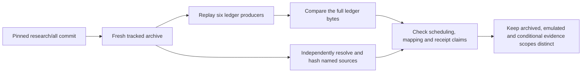

# Exact archive replay of the RV64 emulator and reuse cohort

**Date** 2026-11-25 · **Plan** §0.1 · **Issue** [#284](https://github.com/aivibeflow/LLMLang/issues/284)

Six RT-38 ledgers reproduce byte-for-byte from the tracked `research/all` tree at `ccb5f3102dc8e8e64c1042582955d8319d32005b`. The replay executes 25 QEMU guest configurations and checks 11 Lean theorem outputs. The profile ledger also rechecks previously archived observations for 33 distinct RV64 image digests across seven source ledgers. This study replays those archives' inventory and scope controls. The fresh guest executions are the four selected QEMU studies below.

## Experiment and identity

The audit extracts the research tree from `git archive` into a fresh temporary directory. Each archived runner writes a result outside the extracted tree. Byte comparison includes diagnostics, proof reports, object and source digests, scope labels and native traces recorded by each fixture. A second step resolves all 33 archived source-digest references in the selected guest and logical ledgers and checks 23 distinct source paths. The ledger records the tool identities used in this replay. The four guest runners all report the same exact QEMU executable hash and the recorded no-firmware, 64 MiB, single-hart RV64 virt machine with a fixed virtual instruction clock.



## Reproduced claims

| Ledger | Fresh replay | Independent check |
|---|---|---|
| Freestanding profile | Seven archived ledgers, 33 image digests, ten scope controls | Physical and QEMU SMP IPC, and general source-to-linked refinement remain outside the profile. |
| HAL | Six guest runs | Assembly and LLVM O0/O2/O3 produce equal leaf words, load-region descriptions and UART traces. Replacing the translation instruction with a data fence or changing the stack position changes the trace. |
| Timer preemption | Ten guest runs and four Lean theorem outputs | An independent queue model generates all eight preserving traces from the task credits and scheduler policy. Saved-register and wrong-continuation controls finish with distinct signals. |
| Preemptive IPC | Five guest runs | Linked page-root symbols are distinct and linked stack ranges are disjoint in the two preserving images. UART distinguishes delivery, stale-generation handling, blocked execution and the aliased-stack control. |
| Live frame replacement | Four guest runs | The physical frame addresses in the guest are distinct and page-aligned. Linkage and UART distinguish the ordered sanitized replacement from dirty, previous-frame and early-wake controls. |
| Scoped SMP/DMA reuse | 5,184 receipt combinations, 10,080 histories and seven axiom-free Lean theorem outputs | A combinatorial calculation recovers 37 admissible receipt combinations, 795 false admissions for a frame-number-only guard and 480 reassignments across histories. The two CPU-only receipts are enough only under the specified CPU-only assumptions. |

For the receipt calculation, each channel has six possible variants. A CPU-only reuse leaves both device channels unconstrained, giving $6^2$ admitted combinations. The device-visible profile adds one fully exact combination. A frame-only check sees four variants as equal at each required channel. This gives $4^2\cdot 6^2 + 4^4 - 37 = 795$ false admissions. For the history count, a valid remote-epoch case permits $k!\,(k+2)$ relative orders where a detach precedes all $k$ required acknowledgments and one reuse follows them. Accounting for unrestricted other events yields 336 CPU-only and 144 device-visible reassignments. A mismatched remote epoch yields none. This calculation checks the modeled ledger counts independently of its history enumerator.

[Profile](../../runtime-and-systems/RT-38/RT-38-RV64-FREESTANDING-PROFILE-2026-11-25.md) · [HAL](../../runtime-and-systems/RT-38/RT-38-RV64-HAL-QEMU-2026-11-25.md) · [Timer](../../runtime-and-systems/RT-38/RT-38-RV64-TIMER-PREEMPTION-2026-11-25.md) · [IPC](../../runtime-and-systems/RT-38/RT-38-RV64-PREEMPTIVE-IPC-2026-11-25.md) · [Live frame](../../runtime-and-systems/RT-38/RT-38-RV64-LIVE-FRAME-IPC-2026-11-25.md) · [Conditional reuse](../../runtime-and-systems/RT-38/RT-38-SCOPED-SMP-DMA-REUSE-2026-11-25.md)

## Reproduction and remaining scope

Use the repository with the pinned commit available, CPython 3.12.14, Debian LLVM and LLD 19.1.7 tools on PATH, Lean 4.36.0 and the recorded Debian QEMU 10.0.13 build. The audit observed a Linux x86-64 host, kernel 6.18.57 and glibc 2.41. Two executions of the audit ledger match byte-for-byte.

```sh
fixture=research/research-management/RT-00/RV64-COHORT-REPLAY-01
python "$fixture/audit.py" --qemu /path/to/qemu-system-riscv64 \
  --qemu-data /path/to/share/qemu --out /tmp/llmlang-rv64-cohort.json
cmp "$fixture/evidence.json" /tmp/llmlang-rv64-cohort.json
```

[Audit runner](RV64-COHORT-REPLAY-01/audit.py) · [Exact tool, source and result ledger](RV64-COHORT-REPLAY-01/evidence.json)

Whole-ledger equality makes source and tool drift visible for these fixtures, and leaves the producer's exact observation contract intact. Independent checks cover selected ordering, identity and arithmetic claims. The virtual clock provides deterministic event order in the guest. Physical timing, multicore shootdown, DMA drain and cache/IOMMU visibility need separate native observations and a declared hardware contract. General LLMLang source correspondence, production kernel verification and the rest of the research corpus remain separate work.
