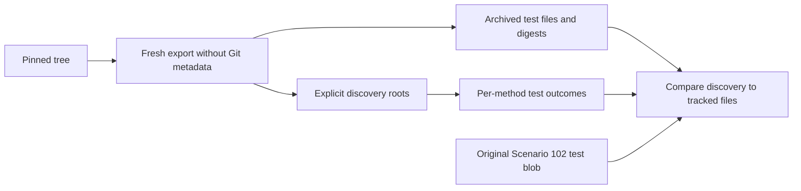

# Shared Python prototype discovery and evidence replay

**Scope.** PLAN §0.1 and [issue #284](https://github.com/aivibeflow/LLMLang/issues/284) on research/all at `1521400115a540d3e79083df03e9ab55f6c339bd`. This check tests what the tracked Python suites select and whether the selected oracles pass in a fresh exported tree.

The current corpus has two shared families under `research/PROTOTYPES/`. The 2026-11-21 [unified register](RT-00-B-06-UNIFIED-CONTRADICTIONS-AND-UNRESOLVED-REGISTER-2026-11-21.md) distinguishes eight declared Scenario 102 methods from the report's older seven-test result. It also distinguishes code-level test declarations from the subset selected by individual jobs. Both boundaries matter when interpreting any recorded test count.



| Suite | Discovery root relative to the family | Files represented in the discovered suite | Passed | Skipped |
| --- | --- | ---: | ---: | ---: |
| RT-04-01 | Repository-family root | 45 | 365 | 0 |
| DEPENDENCY-GRAPH-01 | `tests/` | 47 | 471 | 0 |

Unittest discovery from the dependency-graph family root exited 5 and reported zero tests. Explicit `tests/` discovery provides the verified route for that family. The ledger records each outcome separately from its source file's declaration count and digest. A change in either input collection or selected results changes the receipt.

All eight Scenario 102 result-policy methods passed. The tracked test blob `7f18c604051076b86974adfd96ed79ea718075d4` is identical at the research/all pin and at `08c8490e92b472f99abf3117e82bc7b11643fe0d`, the commit that added the tests. Eight declarations therefore existed at that commit. [Scenario 102](../../semantic-representation/RT-06/RESEARCH-SCENARIO-102-SOLVER-UNKNOWN-AND-SOUND-PATH-PRUNING.md#5-bounded-experiment) separately records a historical focused run of seven. The source establishes the eight declarations and this replay establishes eight current passes. The historical command and full receipt were unavailable from the report, so the two counts do not resolve which original tests ran. The unit test that injects timeout covers the result policy, while an observed backend timeout is a distinct experiment.

## Reproduction and limits

Use CPython 3.12.14, SymPy 1.14.0, SQLite 3.53.1, and the [recorded tools](SHARED-PROTOTYPE-ARCHIVE-01/evidence.json) on Linux x86-64 6.18.57. The ledger captures the fresh discoveries under two Python hash seeds. The fixture does not select other independently housed research runners, prove correspondence or completeness of the oracles, or attest to any original historical run.

```sh
study=research/research-management/RT-00/SHARED-PROTOTYPE-ARCHIVE-01
for seed in 37 71; do
  observed=$(mktemp)
  PYTHONHASHSEED="$seed" python3 -B "$study/run.py" > "$observed" || exit 1
  cmp "$study/evidence.json" "$observed" || exit 1
  rm "$observed"
done
```
