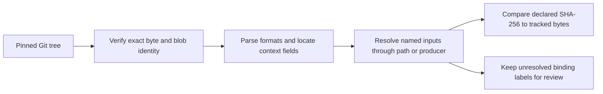

# Structured research artifact provenance on the shared branch

**Scope.** PLAN §0.1 and [issue #284](https://github.com/aivibeflow/LLMLang/issues/284), pinned to research/all `93aa2261b387cc2f05763a84e1f86255991ef2a8`. The audit identifies all tracked research JSON, JSON Lines, CSV and TSV files, records the context fields they carry, and decodes selected source bindings where their path is known.

The earlier [exact-name delta](RT-00-C-EVIDENCE-IDENTITY-DELTA-2026-11-25.md) reviewed fields in 205 exact-name ledgers. The [observation ledger audit](RT-00-OBSERVATION-PROVENANCE-2026-11-25.md) examined a further 20 observation-suffixed documents on its pin. The live branch now also carries many differently named results, benchmark samples, checked fixtures and manifests. This format-based population includes fixtures and inputs as well as result receipts. It supports enumeration and flags weakly recorded context without treating every file as a record of an experiment.



| Observation | Count |
| --- | ---: |
| Tracked and parsed structured artifacts | 894 |
| JSON / CSV / JSON Lines | 870 / 23 / 1 |
| Artifacts with a recognized tool field | 598 |
| Artifacts with a recognized revision field | 182 |
| Artifacts with a recognized host or platform field | 109 |
| Declared named digests checked against a tracked file at its resolved revision | 702 |
| Matching digests | 702 |
| Declared digest labels with no unique directly resolved path under this method | 209 |

A field count means that a recognized field occurs in the top-level record or in a named one-level metadata container. For CSV it means the header has a recognized column. A platform field may name a compilation target. A tool field may describe the virtual environment available to the harness. The [census](STRUCTURED-PROVENANCE-01/census.jsonl) preserves exact archive path, Git blob, content SHA-256, size, parsed shape and the context field locations. For a bound source entry it records both SHA-256 values, the path and the resolved commit. For an unresolved map label it preserves the field name, label and advertised digest.

The path-first version of the check produced four false mismatches. Reading the producing sources resolved them to three cross-fixture paths and one historic fixture snapshot, and resolved four additional alias entries.

| Example | Binding rule |
| --- | --- |
| LLVM checked F64→I64 | The input evidence names the RT-05 conversion ledger. [Producer](../../compiler-and-translation/RT-13/LLVM-F64-I64-LOWERING-01/run.py#L14) |
| LLVM floating-point flags | The basename `run.py` names the earlier binary64 contraction helper. [Producer](../../compiler-and-translation/RT-13/LLVM-FP-FLAGS-01/run.py#L125) |
| Cortex-M3 timer | `run.py` names the closure helper. `timer-run.py` names the timer runner itself. [Producer](../../runtime-and-systems/RT-37/cortex-m3-timer/run.py#L136) |
| Native semantic merge driver replay | Four names resolve under the source fixture at recorded commit `09bb147f0d8cfd054956dd385889e7853e2011c0`. The replay receipt and its source evidence have separate paths. [Replay report](../../toolchain-and-collaboration/RT-24/RT-24-NATIVE-MERGE-DRIVER-REPLAY-2026-11-25.md) |

The inventory now supports exact retrieval of the tested formats and explicitly exposes residual unresolved producer labels. A complete original-run claim still needs its own command, observed tools, host scope and receipt. Source labels may identify standalone generated inputs, unnamed artifact classes, or an external archive. Their dispositions require producer-specific reading. Textual proof logs, source, and binary artifacts are outside this format census. The [shared prototype replay](RT-00-SHARED-PROTOTYPE-ARCHIVE-2026-11-25.md) documents why current execution and original-run evidence require separate records.

## Reproduce

Use CPython 3.12.14 and Git 2.56.1 on Linux 6.18.57 x86-64. Both runs reproduced the same census bytes.

```sh
study=research/research-management/RT-00/STRUCTURED-PROVENANCE-01
for seed in 11 53; do
  out=$(mktemp)
  PYTHONHASHSEED="$seed" python3 -B "$study/check.py" > "$out" || exit 1
  cmp "$study/census.jsonl" "$out" || exit 1
  rm "$out"
done
```
