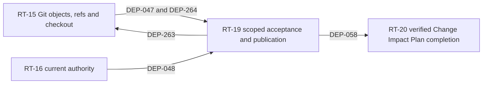

# Toolchain publication dependencies across authority, Git and verified commit

[PLAN §0.3](../../../PLAN.md#03-research-taxonomy-and-cross-aspect-dependency-map) · [Tracking issue #286](https://github.com/aivibeflow/LLMLang/issues/286) · [Dependency register](../RESEARCH-DEPENDENCY-MAP.md)

This review revises five dependency rows against the exact `research/all` tree at `2805481d1f9fb9d013c464070359c62513be3b5d`. It asks which upstream facts a Toolchain publication or verified commit can rely on and which remain scoped hypotheses. Seven pinned ledgers were replayed from a fresh archive and matched the recorded bytes. One ledger rechecks three archived substudies by digest. The native suites and TLC fixture run independently. The review is a technical replay, with Stage 0.2 independent human dispositions pending separately.



The two arrows between Git and Toolchain carry different facts. Git constrains observable checkout and publication behavior. The Toolchain supplies exact pending-intent, receipt and reconstruction requirements that a Git integration must support.

| Edge | Checked dependency | Scope boundary |
| --- | --- | --- |
| DEP-047, RT-15 → RT-19 | A leased generation returns all 21 exact reads in the archived interchange ledger. The checkout ledger has 18 edits missed by size and modification time, and Git canonicalization identifies a different category of changes. A path on disk, canonical tree and selected logical generation require their own observations. | Native platform portability, arbitrary editor concurrency and deployment retention are open. [Interchange](../../toolchain-and-collaboration/RT-19/RT-19-INTERCHANGE-AND-PUBLICATION-BOUNDARY-2026-11-25.md) |
| DEP-048, RT-16 → RT-19 | The 48-case authority ledger records two unauthorized effects and one disclosure when fresh decisions lack a fence. The fenced split has zero of either in that fixture. The TLC controls also reproduce writes and logical sealing after the respective rights are revoked. | The local fence and model atomic transitions do not implement rights propagation to a remote deployment. [Recovery authority](../../toolchain-and-collaboration/RT-19/RT-19-RECOVERY-AUTHORITY-2026-11-25.md) · [Publication contract](../../toolchain-and-collaboration/RT-19/RT-19-PUBLICATION-RECOVERY-CONTRACT-2026-11-25.md) |
| DEP-058, RT-19 → RT-20 | Six interrupted runs and one ordinary Change Impact Plan completion retain one exact Git receipt and export generation. Branch advancement cannot change the older accepted export selected by its persisted receipt. | The application fixture uses one local recovery worker. Multi-client authorization and remote release remain open. [Completion outbox](../../toolchain-and-collaboration/RT-20/RT-20-COMPLETION-OUTBOX-2026-11-25.md) |
| DEP-263, RT-19 → RT-15 | Native local crash and recovery evidence supersedes the earlier untested note. The 24 two-repository trials show why the Git boundary must expose pending delivery and a recoverable logical receipt. Physical refs stay independently observable after publication. | Receiver authenticity, production fencing and power-loss persistence remain open. [Two-repository publication](../../toolchain-and-collaboration/RT-19/RT-19-TWO-REMOTE-PUBLICATION-2026-11-25.md) |
| DEP-264, RT-15 → RT-19 | The 308 coherent-read schedules and 13 native fault trials require a distinction between exact receipt, physical ref vector, and command status. A nonzero status covers old, mixed and already visible new vectors. | The injected process outcomes leave power-loss and other filesystems open. [Coherent reads](../../toolchain-and-collaboration/RT-19/RT-19-COHERENT-MULTIREF-READS-2026-11-25.md) · [Ref filesystem faults](../../toolchain-and-collaboration/RT-19/RT-19-GIT-REF-FAULTS-2026-11-25.md) |

The revised confidence labels describe scoped support and retain every direction and relation type. The cross-check links physical observation, acceptance state, verified Change Impact Plan execution and logical release without inferring broader source semantics, remote production reliability or accepted Toolchain architecture.

## Reproduce

Linux x86-64, Git 2.56.1, CPython 3.12.14, SQLite 3.53.1, GCC 14.2.0 with glibc 2.41 and OpenJDK 21.0.13. The TLC fixture requires the [pinned JAR](../../toolchain-and-collaboration/RT-19/RT-19-PUBLICATION-RECOVERY-CONTRACT-2026-11-25.md#reproduce). The runner archives the pinned revision into a fresh directory, reruns each entry point, compares bytes and verifies that the reported counts and fault categories agree. The [ledger](TOOLCHAIN-DEPENDENCY-01/evidence.json) stores each runner and expected Git blob, matching SHA-256, original register rows and derived counts. The table reports categorical evidence without an aggregate performance metric.

```sh
study=research/research-management/RT-00/TOOLCHAIN-DEPENDENCY-01
python3 -B "$study/replay.py" --tlc "$TLC_JAR" --out /tmp/rt00-toolchain-edges.json
cmp "$study/evidence.json" /tmp/rt00-toolchain-edges.json
```
