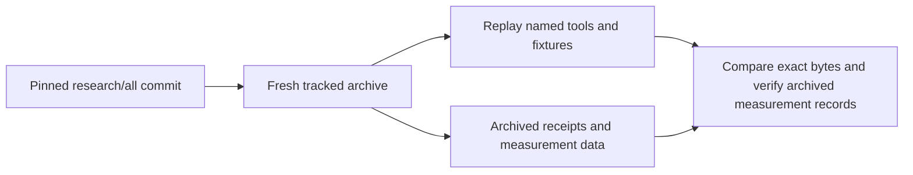

# RT-00 — Cross-stage reproducibility from a tracked archive

- **Date** — 2026-11-25
- **Tracking** — [PLAN §0.1](../../../PLAN.md#01-reconcile-the-research-corpus) · [#284](https://github.com/aivibeflow/LLMLang/issues/284)
- **Archive** — [`efbcf8e`](https://github.com/aivibeflow/LLMLang/commit/efbcf8ef1ba71e8c4d8d219654ea8ab38ab9040d), tree `2af775e171361b78fa3ba1c2a6c471d07846ff34`
- **Status** — Exact replay of a prespecified sample from the tracked research tree

## Scope and method

The runner exports the pinned `research/` tree with `git archive`, extracts it into a new directory and runs only the declared replay routes. No project VCS metadata or existing checkout outputs are present in the archive. Pinned external compilers, Lean, dependency caches and the musl development sysroot are explicit prerequisites. The runner compares complete evidence files byte for byte, and records the archived runner and evidence digests. It regenerates the selected figures from archived inputs.

The sample exercises recent native type and POSIX fixtures, Lean fallback and revocation, source and target translation, context and telemetry models, package closure and index representations, and signed build evidence. It covers the 26 declared replay routes. [Replay runner](TRACKED-ARCHIVE-REPLAY-01/run.py) · [Machine receipt](TRACKED-ARCHIVE-REPLAY-01/evidence.json)



## Results

| Check | Reproduced or checked |
|---|---:|
| Full evidence receipts | 26 |
| Regenerated SVG figures | 3 |
| Archived native dispatch intervals with checked calls and checksums | 70 |
| Archived compression timing intervals with checked read volumes | 140 |
| Archived compression allocation traces with checked read volumes | 20 |

The first archive run exposed implicit VCS stamping in the Go package-identity helper build. The Go command attempted to query Git state from the exported location and yielded an error before comparing manifests. The builder now disables automatic VCS stamping. The repaired replay preserves the package comparison's 41 agreements and five admission differences. [Build correction #333](https://github.com/aivibeflow/LLMLang/commit/efbcf8ef1ba71e8c4d8d219654ea8ab38ab9040d)

Timing samples vary by run. The audit rechecks invariant receipt bytes and checks the already archived sample identities, call counts, result checksums or read volumes, and positive durations. It runs one fresh dispatch interval per profile and workload and regenerates the archived plot from the original samples. Compression replay checks exact I/O counts and omits fresh timing trials.

## Reproduction

Use the tools pinned in the source reports. This replay used CPython 3.12.14, GCC/G++ 14.2.0, GNU binutils 2.44, Clang 19.1.7 (3+b1), Go 1.27.4, Rust and Cargo 1.85.1, Lean 4.36.0, OpenSSL 3.5.7 and Matplotlib 3.10.8 on Linux x86-64. The exact host-dependent receipts also use the Linux kernel, filesystem, CPU and affinity fields in their original evidence. Cache setup for the dependency-bearing routes is described in the linked reports. [Rust dependency setup](../../compiler-and-translation/RT-30/RT-30-RUST-WRAPPING-ROUNDTRIP-2026-11-25.md) · [Go dependency setup](../../packages-and-ecosystem/RT-12/RT-12-INDEPENDENT-PACKAGE-IDENTITY-2026-11-25.md) · [Musl sysroot](../../runtime-and-systems/RT-10/RT-10-POSIX-CROSS-LIBC-2026-11-25.md)

With the pinned tools on `PATH` and the stated dependencies already cached, pass the location of the extracted musl sysroot and a writable Go compilation cache.

```sh
set -eu
dir=research/research-management/RT-00/TRACKED-ARCHIVE-REPLAY-01
observed=$(mktemp)
trap 'rm -f "$observed"' EXIT
python3 -B "$dir/run.py" --repo "$PWD" --go-cache "$GO_BUILD_CACHE" --musl-root "$MUSL_SYSROOT" > "$observed"
cmp "$dir/evidence.json" "$observed"
```

The replay verifies this archive, tools and sample. Corpus-wide validation, new claims and review of evidence adequacy remain open.
