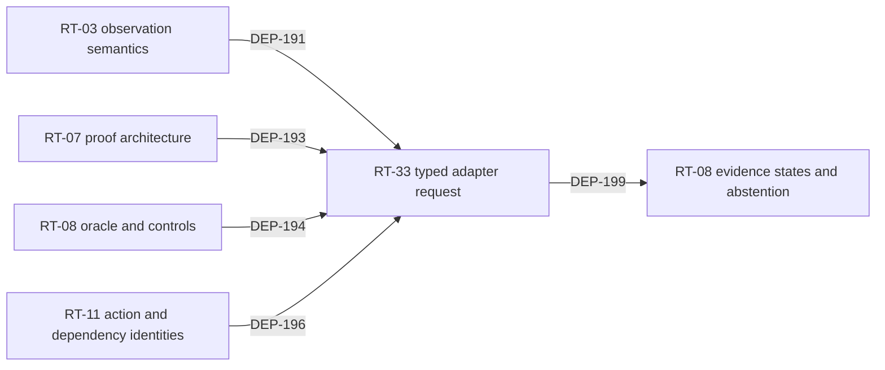

# Dependency evidence for backend obligations, checking and cache admission

[PLAN §0.3](../../../PLAN.md#03-research-taxonomy-and-cross-aspect-dependency-map) · [Tracking issue #286](https://github.com/aivibeflow/LLMLang/issues/286) · [Dependency register](../RESEARCH-DEPENDENCY-MAP.md)

This review asks which facts an adapter must receive from LLMLang semantics, proof architecture, independent validation and build identity before it can report a usable result. Five independently built research fixtures replay against the exact `research/all` tree at `b23901a91bc4eade228cab50be0276a00010961b`. The replayer extracts the pinned files, regenerates their ledgers and checks every ledger byte. The reviewed claims concern the declared fragments and pipeline stages. Independent human review under Stage 0.2 remains a distinct activity.



An adapter needs more than a transport protocol. These observations identify where the semantic question, evidence policy and exact dependency inventory affect the returned disposition.

| Edge | Checked dependency | Scope boundary |
| --- | --- | --- |
| DEP-191, RT-03 → RT-33 | Bounded Apalache safety through two steps and a violation at the third belong to different tasks. TLC's finite liveness result also depends on weak fairness. Removing fairness admits an explicit stuttering counterexample. | The tests know the exact counter transition and property. Arbitrary LLMLang-to-backend correspondence remains open. [Temporal adapters](../../formal-verification/RT-33/RT-33-TEMPORAL-ADAPTERS-2026-11-25.md) |
| DEP-193, RT-07 → RT-33 | Carcara accepts cvc5 artifacts from both measured SMT routes. In the separate integer VC fixture it identifies holes in the cvc5-generated certificate and accepts the separately authored reconstruction. Solver success, proof export and independent checking require separate records. | The certificate fixtures have bounded supported proof rules and known source maps. Other proof formats and frontend translations remain open. [SMT adapters](../../formal-verification/RT-33/RT-33-SMT-ADAPTER-COMPARISON-2026-11-25.md) · [Why3 and Boogie](../../formal-verification/RT-33/RT-33-WHY3-BOOGIE-ADAPTER-2026-11-25.md) |
| DEP-194, RT-08 → RT-33 | Raw Z3 accepts the tested Boolean-to-integer coercion. The common typed guard rejects it. The Pantograph echo route can return a term of another type, and the explicit comparison refuses its reuse. Typed oracles and negative checks distinguish both from admissible native behavior. | Candidate-independent adversarial coverage beyond the named kernels, protocol releases and type examples remains open. [SMT adapters](../../formal-verification/RT-33/RT-33-SMT-ADAPTER-COMPARISON-2026-11-25.md) · [Lean and Pantograph](../../formal-verification/RT-33/RT-33-PANTOGRAPH-ADAPTER-2026-11-25.md) |
| DEP-196, RT-11 → RT-33 | The scoped identity experiment enumerates 65,536 combinations. Generic cache shape accepts an omitted declared role for both obligation types. A rehashed signed replacement is also inadmissible without its independent check. Lean refuses old proof reuse under changed imports. | The checks use known closure rules and pinned roles. General dependency completeness and production cache reuse require their own validation. [Typed proof identities](../../formal-verification/RT-33/RT-33-TYPED-PROOF-KEYS-2026-11-25.md) · [Lean and Pantograph](../../formal-verification/RT-33/RT-33-PANTOGRAPH-ADAPTER-2026-11-25.md) |
| DEP-199, RT-33 → RT-08 | Boogie can exit successfully with zero verified procedures when the selected name is absent. An interrupted native Z3 context returns unknown. A Shai gRPC deadline leaves no admitted result and the subsequent check can succeed. Unified evidence needs explicit missing coverage, exhaustion, cancellation and native diagnostic data. | Transport readiness and an exit code do not settle a verification obligation. Contract design across further backends and cancellation guarantees remain open. [Why3 and Boogie](../../formal-verification/RT-33/RT-33-WHY3-BOOGIE-ADAPTER-2026-11-25.md) · [SMT adapters](../../formal-verification/RT-33/RT-33-SMT-ADAPTER-COMPARISON-2026-11-25.md) · [TLC and Apalache](../../formal-verification/RT-33/RT-33-TEMPORAL-ADAPTERS-2026-11-25.md) |

The map keeps the direction and relation of each edge. Confidence now records the bounded supporting experiment and the corresponding open implementation questions. The review does not choose a backend, cross-tool proof language, cache format or production evidence policy.

## Reproduce

Run from the branch checkout with CPython 3.12.14, OpenJDK 21.0.13 and OpenSSL 3.5.7. The individual linked reports specify the exact versions, checked package fingerprints and launch paths. The temporal replay needs the generated Shai stubs and `grpcio` dependencies. The SMT replay needs its versioned Python solver bindings. Add those to `PYTHONPATH`. The Why3 replay uses the extracted Debian package launcher recorded in its report. Use absolute executable paths for the tools below.

```sh
study=research/research-management/RT-00/VERIFICATION-DEPENDENCIES-01
python3 -B "$study/replay.py" \
  --tlc "$TLC_JAR" --apalache "$APALACHE_BIN" --why3-bundle "$WHY3_BUNDLE" \
  --dotnet "$DOTNET_BIN" --boogie-dll "$BOOGIE_DLL" \
  --z3 "$Z3_BIN" --cvc5 "$CVC5_BIN" --carcara "$CARCARA_BIN" \
  --lean "$LEAN_BIN" --pantograph-repl "$PANTOGRAPH_REPL" \
  --pantograph-library "$PANTOGRAPH_LIBRARY" --out /tmp/rt00-verification-edges.json
cmp "$study/evidence.json" /tmp/rt00-verification-edges.json
```

The [evidence](VERIFICATION-DEPENDENCIES-01/evidence.json) preserves each pinned source and evidence blob, the matching SHA-256, original register rows and checked counts. The table answers categorical questions about admission and scope with no latency claim.
