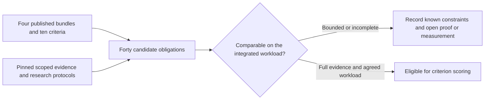

# Comparative evidence for the four integrated candidate vectors

**Date** 2026-11-25 · **Plan** §6.5 · **Issue** [#286](https://github.com/aivibeflow/LLMLang/issues/286)

The four candidate vectors each have a concrete requirement for all ten shared criteria. Four criteria have a bounded common discriminator, four have comparable component designs or fixtures that still need integration, and two have prepared protocols. These categories describe the evidence available for designing the comparison. The full criteria for all four integrated candidates remain unscored.

## Method

The audit reads the exact option matrix at `dcb74a975687e0305f03d81bbb8bb547c95eb479`. It matches all four candidate IDs and all ten criteria against the assessment. Each criterion records a common evidence requirement, a distinct condition for each candidate and exact source reports. The pinned reports include measured and checked results, scope notes and proposed protocols. Twenty pinned blobs establish which evidence informed the audit. The assessment reflects the research at that revision.



The current corpus takes the bounded or incomplete branch. `bounded_shared` identifies a common input or contract that distinguishes some candidate behaviors. It can coexist with additional component evidence. `component_only` marks a separately checked subsystem without a common run of all candidate integrations. `protocol_only` marks prepared evaluation material or a scope definition awaiting controlled observations. The checker verifies those labels and complete traceability. Expert reading supplies the classifications. It does not derive a product rating from fixture counts.

## Shared comparison

| Criterion | Present comparison boundary | Missing common evidence |
|---|---|---|
| Semantic clarity | The four restricted profiles agree under the same order, while an actor admits other orders. | Two independent source front ends and evaluators for the same admitted source and full observations. |
| Correctness assurance | Exact per-order correspondence, a checked invariant and targeted refutations reveal where a scalar or a stale proof misses behavior. | Source-to-artifact correspondence, explicit trust and the same proof obligations across integrated profiles. |
| Expressiveness | A shared state, cancellation and settlement task runs in all four scoped models. | A common representative task corpus with coverage, refusal and external escape hatches recorded. |
| Simplicity | Candidate rule dimensions and a controlled review instrument are documented. | Comparable rule and interaction counts with blinded implementer observations. |
| AI-agent usability | The controlled review packet and independent validation pilot identify what to measure. | Pinned approved model access, equally scoped tasks and measured success, repairs and context costs. |
| Incremental behavior | Native edits, exact identity envelopes and conditional reuse distinguish rebuild and reuse rules. | The same edits and independent dependency oracle applied to all candidate pipelines, with cold and warm costs. |
| Runtime feasibility | Worker settlement, Linux budgets and small native CLI data give distinct host-level observations. | A common workload on the selected target and reference route, with a controlled environment and resource bounds. |
| Interoperability | Exact C/Rust provider and release fixtures distinguish ABI, observation and artifact claims. | The same source-level foreign calls, callbacks, lifetime controls and target contract for each candidate. |
| Security and trust | A common cancellation and grant discriminator plus exact local revocation controls separate semantics, signed cache admission and publication. | An identical threat workload and approved current trust policy across the integrated candidates. |
| Evolution | Candidate identity, typed diff, wire versions and migration evidence expose separate compatibility boundaries. | The same source, wire and provider changes with measured migration and checked rollback for each candidate. |

The [machine-readable assessment](CANDIDATE-COMPARISON-01/inputs.json) retains forty profile-specific obligations and the report links behind each row. For **C1**, the pure description must preserve scoped external effects through an explicit execution adapter. For **C2**, in-place updates add obligations for aliases and ownership disposition. For **C3**, a single scheduled witness must be kept distinct from a property over all admitted deliveries. For **C4**, explicit handler composition must preserve forwarding, authority and ordered traces. These constraints affect the coherence and verification of the full combinations, even when all four agree on a scalar for one task. [Four-profile task](../../language-design/RT-03/RT-03-FOUR-RESOURCE-PROFILES-2026-11-25.md) · [Schedule-invariance proof](../../formal-verification/SCHEDULE-INVARIANCE-2026-11-25.md)

The common tasks can proceed from exact observations to integrated executions without assuming that the corpus already represents adoption. The CLI, owned-result and cancellation fixtures discriminate reference semantics, effect scope, exact ABI, provider changes and publication. Wider target selection, a representative workload, live approved model access, independent human observations and current trust policy remain external inputs. A complete comparison also needs the adopted scope and criterion definitions required before scoring. This assessment provides no overall ranking and records no architecture decision. [Shared criteria](../RESEARCH-OPTION-MATRIX-01.md#6-shared-evaluation-criteria) · [External dependencies](../../../PLAN.md#external-evidence-and-approval-dependencies)

## Reproduce

Use Git 2.56.1 and CPython 3.12.14 with the pinned research revision available. Six negative controls reject an unsupported numeric rating, missing criterion, omitted candidate, unresolved source, numeric cell and missing exit requirement. Different Python hash seeds reproduce the same audit bytes.

```sh
fixture=research/research-management/planning-and-synthesis/CANDIDATE-COMPARISON-01
PYTHONHASHSEED=23 python "$fixture/check.py" --out /tmp/llmlang-candidate-comparison.json
cmp "$fixture/evidence.json" /tmp/llmlang-candidate-comparison.json
```

[Exact check](CANDIDATE-COMPARISON-01/check.py) · [Audit ledger](CANDIDATE-COMPARISON-01/evidence.json)
