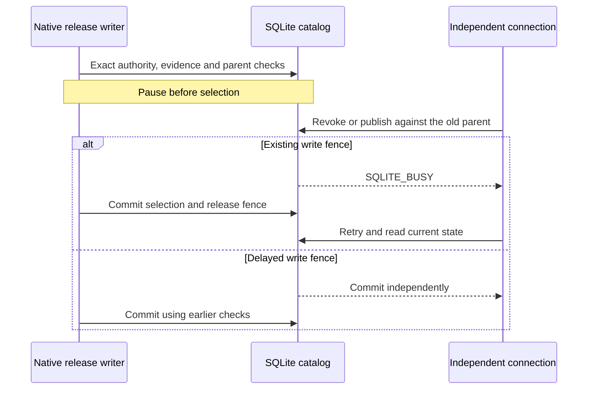

# Concurrent revocation and competing exact release admission

**Date** 2026-11-25 · **Plan** §6.5 · **Issue** [#286](https://github.com/aivibeflow/LLMLang/issues/286)

The same SQLite write fence that checks an exact native release candidate also serializes a concurrent revocation and a competing selection. On both C and Rust, locking only after evidence and parent checks admits a publication after revocation and permits two history rows to spend the same former parent.

## Scope and comparison

The [local release study](EXACT-PROVIDER-RELEASE-2026-11-25.md) exercises initial selection, provider replacement, stale inputs and sequentially authorized rollback. This follow-up reuses its gate and both exact native artifacts. It compiles each provider and both routes in two clean roots and reruns the same 20,992 observations per execution. It verifies the prior artifact, input and trace digests, reuses the previous declared action scope and signs each request with fresh temporary test keys.

The subject is one SQLite catalog with one selected release and a policy-generation row. The first publisher runs in a separate process and pauses after the existing gate has checked policy, signature, exact native artifact bytes, exact scoped evidence and the expected old release. An independent connection either revokes publication rights or attempts the same exact replacement using the same expected old release. Both connections have zero busy timeout, which makes held-lock refusal observable.

The existing policy holds `BEGIN IMMEDIATE` through selection and history update. The comparison wrapper delays that transaction until the paused publisher resumes. It leaves the same checks and writes in place. The test varies only fence placement.



## Observations

Eight schedules cross two native routes, two concurrent operations and two lock placements. Both routes produce the same categorical results. The competing selection intentionally shares the new artifact and expected parent so any extra history entry reveals duplicate acceptance even when final bytes match.

| Concurrent operation | Existing fence held at check | Lock delayed until write |
|---|---|---|
| Revoke publication and advance generation | Rival first receives `SQLITE_BUSY`. The writer publishes while generation 1 is current. The retry then commits generation 2 revocation. | Rival first commits generation 2. The old-generation writer resumes and publishes anyway. |
| Publish the same target from the same expected parent | Rival first receives `SQLITE_BUSY`. After the first publication it retries and receives `parent-refused`. The catalog records one transition. | Rival publishes, then the prior writer resumes. The catalog records two transitions from the same spent parent. |

The revocation cases finish at the same selected artifact and policy generation under both policies. The controlled order distinguishes authorized publication before revocation from an old-policy write after revocation. Likewise, observing the final artifact alone misses the duplicate parent transition. A generation check at selection can be implemented with one local transaction when the policy writer and release writer share the catalog. A different architecture needs a comparable linearization rule or a separately validated coordination protocol.

## Reproduction and limits

Run with the exact tools from the preceding report. The replay compares their hashes and checks the pinned program and ledger blobs. The two full runs produce identical evidence. The observed SQLite version is 3.53.1.

```sh
fixture=research/research-management/planning-and-synthesis/CONCURRENT-RELEASE-01
PYTHONDONTWRITEBYTECODE=1 python "$fixture/check.py" --out /tmp/llmlang-concurrent-release.json
cmp "$fixture/evidence.json" /tmp/llmlang-concurrent-release.json
```

[Cross-process schedule harness](CONCURRENT-RELEASE-01/check.py) · [Exact build inputs, admission results and catalog histories](CONCURRENT-RELEASE-01/evidence.json)

The experiment checks targeted schedule cuts on one host and one database. Network authorization, competing external signers, interrupted transactions, independent trust services, fairness under contention and arbitrary interleavings need separate evidence. The result extends the local DEP-048 and DEP-054 conditions for current authority and validation scope. [Dependency map](../RESEARCH-DEPENDENCY-MAP.md)
