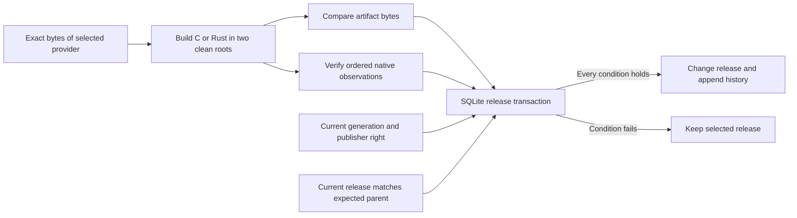

# Native provider replacement and local release admission

**Date** 2026-11-25 · **Plan** §6.5 · **Issue** [#286](https://github.com/aivibeflow/LLMLang/issues/286)

An unchanged COR-13 caller and declared contract support two provider implementations. Switching implementations changes 5,720 of 20,992 ordered result and descriptor observations on both the independent C and generated Rust routes. In a local release gate, exact signed cache records and scoped evidence admit the new artifacts. Eleven negative controls per route preserve the selected release. Each route also rolls back to the exact old bytes under a freshly authorized policy generation.

## Scope and interface

The [candidate enumeration](INTEGRATED-SOURCE-PUBLICATION-CANDIDATES-2026-11-25.md) assumes exact binding, rebuild admission, ordered evidence and current publication authority can be connected. This experiment implements that local composition using the existing before-cleanup COR-13 fixture. The scripted and consuming providers export the same ABI and satisfy the fixture's outcome contract. The consuming provider closes the descriptor when the scripted one reports a retained error. The ordered resource observations and physical descriptor checks distinguish the outcomes. [Provider binding and native callers](../../compiler-and-translation/RT-13/RT-13-BOUND-OWNED-PROVIDERS-2026-11-25.md)

The harness compiles both providers and both callers in two temporary roots on the same host. A primary build and clean corroborating build must have identical executable bytes within every route and provider combination. It compares each actual output to the fixture reference. A typed evidence record binds the native action, declared closure, encoded inputs, complete observation digest, projection and artifact. The local coordinator supplies the expected record from the checked run. The test gives these records a distinct job from the Ed25519 cache attestations, which bind workspace, action, declared closure, artifact and policy generation. [Signed cache admission](../../toolchain-and-collaboration/RT-11/RT-11-SIGNED-REBUILD-ADMISSION-2026-11-25.md)

The SQLite catalog stores one current release and its append-only selection history per route. This is a local index transition with test keys. A single write transaction checks the current policy generation, validates the signed cache request and exact artifact, matches the expected trace record, and checks the expected parent before updating history. The policy generation and selected release share the same database. The experiment deliberately reopens the catalog after revocation before attempting reauthorization and rollback.



## Results

Eight native executions cover the two routes, two provider objects and two build roots. Each checks 20,992 observations, for 167,936 observations per run. There are three successful selections and eleven refusals per route across 28 release attempts. The 5,720 changed rows per route are paired by the same input and reference observation key. The fixture includes multiple role alias assignments, local and second-operation outcomes, and modelled and physically audited rows.

| Control or transition | Outcome on both routes |
|---|---|
| Admit initial, admit exact replacement, reauthorize and roll back | Three catalog selections. The rollback selects the original artifact hash in generation 3. |
| Old signed attestation or original-generation signature after reauthorization | No applicable attestation. |
| Old trace, scalar projection, removed artifact field or replaced ordered/audited trace digest | Exact evidence is refused. |
| Signed request names a different action | The receipt-to-action check refuses. |
| Old bytes presented under the new address | Actual payload digest is refused. |
| Corroborating build supplies old artifact bytes | Rebuild disagrees. |
| Present a stale expected parent | Parent check refuses. |
| Revoke publisher before rollback | Authority check refuses. |

The cache, evidence and publication checks fail independently. In particular, a valid signature over an inconsistent action can pass cache verification and still fail the evidence check. An artifact hash identifies the data to select, while an authorized rollback still needs a fresh admission statement and the current expected parent. Snapshot-resolved and explicit-pin publication policies can share these checks once they identify an exact target. This fixture receives an exact provider selection and exercises one local replacement. Resolver behavior, a rebind authorization policy and time-to-rebuild trade-offs remain separate comparisons.

## Reproduction and limits

Run from the repository root with CPython 3.12.14, GCC 14.2.0, Rust 1.85.1, and the linker and OpenSSL shown in the ledger. The harness uses direct `rustc` from its reported sysroot. Use `--rustc` for a different location of the same tool. The recorded host was Linux x86-64 6.18.57 with glibc 2.41 and SQLite 3.53.1. The build and runtime checks use one host tool installation. Both runs produce the same evidence ledger byte-for-byte.

```sh
fixture=research/research-management/planning-and-synthesis/EXACT-PROVIDER-RELEASE-01
PYTHONDONTWRITEBYTECODE=1 python "$fixture/run.py" --out /tmp/llmlang-provider-release.json
cmp /tmp/llmlang-provider-release.json "$fixture/evidence.json"
```

[Harness](EXACT-PROVIDER-RELEASE-01/run.py) · [Evidence ledger with pinned inputs, tool hashes and exact selected history](EXACT-PROVIDER-RELEASE-01/evidence.json)

The recorded manifest is the fixture's declared closure. Dynamic host dependency discovery, external artifact availability, durable storage of the executable bytes, independent machine builds, and competing cross-process revocation schedules remain open. Publication uses a trusted local evidence oracle, a complete attestation view constructed by the harness, and a Boolean policy on the same database as the catalog. A real signed evidence issuer, remote authority and package registry need their own contracts and observations. The applicability conclusions preserve these limits and refine DEP-012, DEP-043, DEP-048 and DEP-054. [Dependency map](../RESEARCH-DEPENDENCY-MAP.md)
