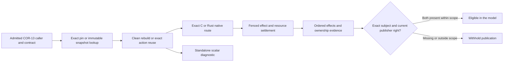

# Integrated candidate enumeration for a bounded owned-result workflow

**Date** 2026-11-25 · **Plan** §6.4–6.5 · **Issue** [#286](https://github.com/aivibeflow/LLMLang/issues/286)

A restricted source-to-publication model admits eight of 576 bundles for normal publication. Four can serve the same request after a provider rebind without an explicit caller repin. Two separately written classifications agree on all 4,608 bundle and scenario pairs. The result concerns compatibility within a declared model of one workflow. An implementation of the component interfaces and their composition remains open.

## Problem and scope

An owned-result caller can receive the same scalar status from two providers while owing different cleanup or recovery work. Build reuse, evidence, runtime authority and publication each consume a different part of that distinction. A combined decision record should identify which bundles meet the intended observations, which require a new action or unavailable evidence, and which weaken the request.

This experiment holds the admitted COR-13 source fragment fixed. The comparable backend choices are the exact C caller and Rust lowering described by the pinned owned-result study. The signed rebuild and directional receipt studies use different, narrower native fixtures. The cancellation example is a real native worker with its own schedule. The publication authority analogue uses a separately implemented SQLite-fenced local recovery service. These fixtures motivate explicit rules. Their binaries and test counts are component evidence and were outside this enumeration run. The rules for joining their interfaces are research assumptions. [Owned-result provider binding](../../compiler-and-translation/RT-13/RT-13-BOUND-OWNED-PROVIDERS-2026-11-25.md) · [Signed cache admission](../../toolchain-and-collaboration/RT-11/RT-11-SIGNED-REBUILD-ADMISSION-2026-11-25.md) · [Directional receipts](../../toolchain-and-collaboration/RT-11/RT-11-CROSS-LANGUAGE-RECEIPTS-2026-11-25.md) · [Native worker settlement](../../language-design/RT-01/RT-01-RESOURCE-WORKER-SETTLEMENT-2026-11-25.md) · [Recovery authority](../../toolchain-and-collaboration/RT-19/RT-19-RECOVERY-AUTHORITY-2026-11-25.md)

## Candidate choices

| Axis | Choices | Trade-off or boundary |
|---|---|---|
| Native route | C caller, Rust lowering | Two checked routes for the owned-result fixture. They share the same provider and its ABI. |
| Operation binding | Explicit implementation pin, snapshot-resolved exact provider, contract-only key | A pin requires explicit repin when a request calls for the new provider. Snapshot resolution adds immutable snapshot and exact selection dependencies. A contract-only identity loses the provider distinction. |
| Observation | Ordered effects plus ownership, scalar result | Full publication observes event order and retained ownership. A scalar diagnostic projects those observations to a result. |
| Build/cache | Clean rebuild, exact validated hit, caller-key hit | A rebuild repeats work. An exact hit requires current applicability, dependency closure, and verified bytes. The motivating signed-cache run independently rebuilds before first admission. A caller key can survive a provider change. |
| Evidence | Exact native scope, directional scalar receipt | Exact evidence names the request's fragment, input domain, artifact and observation scope. A scalar receipt is useful for its exact origin-to-destination diagnostic and carries no ownership-trace claim. |
| Effect authority | Fresh, fenced effect gate, initial admission | An initial check can precede revocation. A fresh gate assumes revocation and the actual effect share an effective synchronization boundary. |
| Terminal outcome | Settlement after release, body stopped | Settlement accounts for live resource obligations. A terminal body response can come earlier. |
| Publication | Authorized exact artifact, content-only | The modeled publication gate checks current publisher authority and exact publication identity. Content identity alone leaves authorization open. |

The diagram shows where the constraints attach. The standalone diagnostic consumes a scalar projection for observation only and does not request execution or publication.



`admitted` means the bundle can serve the scoped request under the model. For a cancellation scenario, serving the request means suppressing the cancelled effect, settling owned resources, and making the evidenced terminal outcome eligible for publication. `withheld` means the bundle has the required policy shape but a scenario premise requires explicit repin, additional evidence, or authority. `blocked` means a chosen policy conflicts with the request. Blocked rows preserve scenario conditions as well as all violated requirements. The publication case applies a strong default even if a benign schedule would hide the effect of a weaker policy. The scalar diagnostic is standalone and effect-free. Its unused authority, settlement and publication settings do not imply permission to perform those operations.

## Results

| Scenario | Admitted | Withheld | Blocked |
|---|---:|---:|---:|
| Normal publication | 8 | 0 | 568 |
| Request the rebound provider | 4 | 4 | 568 |
| Cancel before the observable effect | 8 | 0 | 568 |
| Widen the domain beyond the pinned inputs | 0 | 8 | 568 |
| Revoke publisher authority before a new publication | 0 | 8 | 568 |
| Standalone scalar diagnostic | 256 | 0 | 320 |
| Rebind, then cancel before the effect | 4 | 4 | 568 |
| Rebind, cancel, widen the domain and revoke the publisher | 0 | 8 | 568 |

The eight normal candidates are the product of the two routes, two exact binding methods and two exact build/cache strategies. Between routes the enumeration establishes no preference. The exact-hit strategy has extra closure, bytes and corroboration obligations. The snapshot-resolved path deals with a new provider under a new exact binding and refreshed evidence. The explicit-pin path withholds the new-provider request until an explicit repin. A separately requested run of the old exact provider can continue using its pinned identity. The standalone scalar result admits 32 distinct active-axis choices. Eight assignments of unused effect, terminal and publication settings replicate each choice in the full Cartesian product.

Changing only one axis at a time on a known admitted bundle produces seven distinct refusal reasons. The controls cover lost provider identity, weak observation, incomplete cache identity, a scalar receipt in a full-trace request, admission-time authority, premature terminal results, and content-only publication. This also shows why switching an entire bundle after one local counterexample could obscure the actual incompatibility.

A bounded architectural comparison follows. Both admitted binding methods support the same ordered result contract and locally evidenced route choices. Explicit pinning gives a stable, inspectable caller dependency and requires a separate edit or repin for a changed provider request. A snapshot can preserve the caller while changing the provider. Its selection, target bytes and evidence closure need separate inspection. Exact cache reuse is conditionally compatible with either method when it consumes the exact action and its relevant binding and verifies the candidate bytes. Adding agent-usable explanations, published packages, performance and migration criteria needs representative workflows and measurements. These results identify a checkable compatibility relation and its trade-offs without scoring whole language candidates.

## Reproduction and limits

Run the fixture from the repository root with CPython 3.12.14, Git, Z3 4.13.3 and cvc5 1.4.2 `282d5e0` on PATH. The optional `--z3` and `--cvc5` flags accept explicit tool paths.

```sh
fixture=research/research-management/planning-and-synthesis/INTEGRATED-CANDIDATES-01
python "$fixture/check.py" --out /tmp/llmlang-integrated-candidates.json
cmp /tmp/llmlang-integrated-candidates.json "$fixture/evidence.json"
```

Python enumerates the product and records reasons. A separately written SMT relation checks each expected label by requiring both satisfiability of its label and unsatisfiability of its negation for the same concrete row. Four global queries verify status coverage and exclusivity. Seven queries check the one-axis negative controls. Each solver returns 4,615 SAT and 4,612 UNSAT as expected. The encodings share the declared interface assumptions. Agreement can detect divergence between implementations of those rules and leaves their physical validity to the cited component experiments and future integration checks. The ledger identifies the input commit and exact report blobs. The same inputs and tool versions reproduce the ledger byte-for-byte. Counts are exhaustive for the declared table and carry no sampling uncertainty.

[Input axes, scenarios and adoption gates](INTEGRATED-CANDIDATES-01/space.json) · [Enumeration](INTEGRATED-CANDIDATES-01/check.py) · [Independent rule expression](INTEGRATED-CANDIDATES-01/rules.smt2) · [Evidence ledger](INTEGRATED-CANDIDATES-01/evidence.json)

This result refines the conditions on DEP-007, DEP-012, DEP-019, DEP-030, DEP-043, DEP-048 and DEP-054. A full candidate space still needs the remaining source semantics, type and architecture vectors, authoritative identity and trust rules, a joint integration fixture, and independent review. Publication after revocation is scoped to a new publication request. Existing history may need a separately authorized reconciliation policy. [Dependency map](../RESEARCH-DEPENDENCY-MAP.md) · [Option matrix](../RESEARCH-OPTION-MATRIX-01.md)
