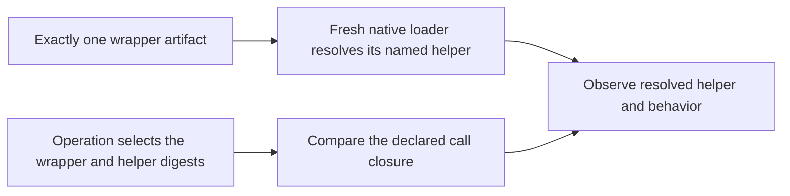

# RT-10 — Exact native call binding and transitive provider identity

Can a native call reproduce its selected operation when the wrapper bytes are unchanged but the linked helper differs? This fixture extends the [direct runtime provider comparison](RT-10-RUNTIME-VERSION-IDENTITY-2026-11-25.md) with one explicit dependency edge. The branch baseline is `864be0a0984a25e25ad74596ac49df5daf17e458`. [Operation identity and binding](../../semantic-representation/RT-05/RESEARCH-SCENARIO-92-OPERATION-IDENTITY-AND-IMPLEMENTATION-BINDING.md)

The wrapper delegates the entire operation to a helper with a fixed ELF shared-library name. GNU `readelf` confirms the dependency and the sibling-library search path. The experiment compiles the wrapper once and installs its exact bytes into four independent fixture directories. Each child loads one wrapper. It reports the actual helper's identity using the resolved symbol address and compares its result on inputs 0 through 15 with the reference successor operation. The helper and wrapper files remain fixed for the lifetime of each run.



| Fixture helper | Exact wrapper check | Declared closure check | Native operation |
|---|---|---|---|
| Selected revision | Pass | Pass | All 16 results match successor |
| Different behavior | Pass | Refuse | All 16 results differ |
| Different bytes with the same observed behavior | Pass | Refuse | All 16 results match successor |
| Absent | Pass | Refuse | Loader reports the missing helper |

The wrapper-only check accepts all four directories. Including the helper digest admits only the selected closure. Observational agreement on the bounded input set does not establish identity of a separately built helper. The exact selected call therefore needs both the wrapper artifact and its declared provider dependency. The source oracle and closure check answer different questions. [Raw identities and native observations](NATIVE-CALL-CLOSURE-01/evidence.json)

The check covers one declared non-system dependency on one ELF/glibc profile. The loader and system libraries are environmental assumptions. Production loading with concurrent changes, general dependency closure, retargeting rules, proof of compatible replacements and cross-platform runtime admission remain open. [Runtime architecture issue](https://github.com/aivibeflow/LLMLang/issues/325)

## Reproduction

Use x86-64 Linux 6.18.57, glibc 2.41, CPython 3.12.14, GCC 14.2.0 (Debian 14.2.0-19) and GNU Binutils 2.44. Hash seeds 1 and 2 produced byte-identical receipts. The diagram was checked as Mermaid source.

```bash
fixture=research/runtime-and-systems/RT-10/NATIVE-CALL-CLOSURE-01
LC_ALL=C PYTHONHASHSEED=1 python3 -B "$fixture/run.py" > /tmp/llmlang-rt10-native-call-closure.json
cmp "$fixture/evidence.json" /tmp/llmlang-rt10-native-call-closure.json
```
