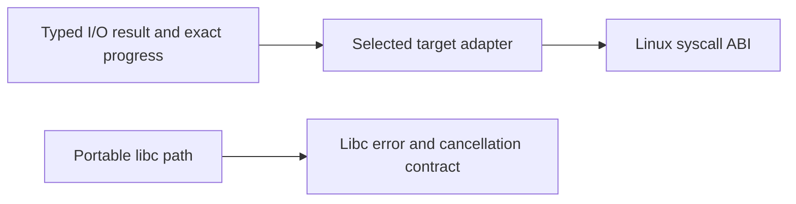

# RT-10 Linux syscall ABI isolation

Keep the application-facing I/O contract independent of syscall entry instructions, operation numbers and register assignments. Put those details in exact target adapters, with separate clauses for kernel structures, return conventions and libc behavior. The same freestanding C contract and outcome oracle now cover native x86-64, QEMU Linux-user AArch64, and QEMU Linux-user RV64GC with LP64D.

| Adapter | Selector | Entry | read / write / exit | Checked execution |
|---|---|---|---|---|
| x86-64 | eax | syscall | 0 / 1 / 60 | Native Linux, 12 archived cases |
| AArch64 | x8 | svc #0 | 63 / 64 / 93 | QEMU Linux-user, 12 archived cases |
| RV64GC LP64D | a7 | ecall | 63 / 64 / 93 | QEMU Linux-user, 12 new cases |



The RV64 builds at O0 and O2 have RISC-V ELF headers with the double-float ABI flag and no interpreter or dynamic-library requirement. All 12 observations preserve bad-descriptor, zero-request, partial-progress, exact-byte and EOF outcomes. They match the prior x86-64 and AArch64 archives field for field. Shared operation numbers across AArch64 and RV64 do not identify the call ABI. Reusing a libc layout or behavior also needs evidence. The ppoll probe observes different mask size and timeout behavior, while the cancellation probe shows that the raw read can consume a byte before the next cancellation check. [Architecture study](RT-10-LINUX-SYSCALL-ARCHITECTURES-2026-11-25.md) · [ppoll](RT-10-POSIX-PPOLL-FFI-BOUNDARY-2026-11-25.md) · [Cancellation](RT-10-LIBC-SYSCALL-CANCELLATION-2026-11-25.md)

The isolation result concerns read, write and startup exit with these adapters. The QEMU results use translated guest syscalls on a host kernel. Dedicated native AArch64 and RV64 execution, initial target selection, other kernel structures and the completeness of a production ABI remain open.

## Replay

Use Debian Clang and LLD 19.1.7 (package revision 3+b1), QEMU Linux-user 10.0.13, GNU readelf and CPython 3.12.14. Technical and artifact digests are in the [raw ledger](LINUX-SYSCALL-RV64-01/evidence.json). Hash seeds 37 and 71 produced byte-identical ledgers. [LLVM packages](https://deb.debian.org/debian/pool/main/l/llvm-toolchain-19/) · [QEMU package](https://deb.debian.org/debian/pool/main/q/qemu/qemu-user_10.0.13+ds-0+deb13u1_amd64.deb)

```sh
LC_ALL=C PYTHONHASHSEED=37 python -B research/runtime-and-systems/RT-10/LINUX-SYSCALL-RV64-01/check.py \
  --clang /path/to/clang-19 --linker /path/to/ld.lld-19 --qemu /path/to/qemu-riscv64
```
