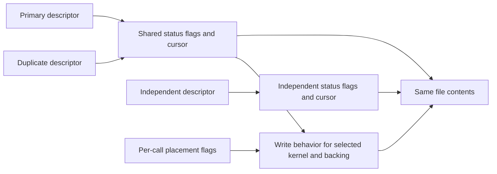

# RT-10 Positional writes under shared append state

**Issue** [#326](https://github.com/aivibeflow/LLMLang/issues/326)

A positioned-write API needs to state whether an explicit offset determines placement and whether the call advances the open file description's current offset. On Linux, append status can change placement through a duplicated descriptor. This experiment compares a regular overlayfs file and a memory-backed file on the same kernel. It tests libc `pwrite` and the raw x86-64 Linux `pwritev2` syscall with per-call flags. [Open-file identity study](RT-10-POSIX-FILE-IDENTITY-2026-11-25.md)

## Candidate interface

A descriptor slot references an open file description. Duplicating a descriptor shares the current offset and file status flags with the original. Opening the same file separately creates an independent open description. File contents remain shared. The fixture distinguishes positioned write, append write, and the Linux vector request with a current-offset sentinel. An LLMLang positioned-write contract could require an open description without append status or admit an exact backend profile with verified per-call placement. A separate description avoids changing the flags seen by peers using a shared one, but the application still needs to establish that both descriptions refer to the intended file. Temporarily clearing a shared status flag affects every duplicate and creates a coordination obligation.



The diagram separates open-description state from the selected file and the per-call placement choice. The ordinary POSIX `pwrite` contract requires placement at the given position regardless of `O_APPEND`, with no change to the current offset. The Linux `pwritev2` documentation describes `RWF_NOAPPEND` as ignoring `O_APPEND` for that call. Both are comparison targets for the exact observed native outcomes. [POSIX write specification](https://pubs.opengroup.org/onlinepubs/9799919799/functions/write.html) · [Linux vector I/O manual](https://man7.org/linux/man-pages/man2/pwritev2.2.html)

## Native evidence

Each case starts with the bytes `ABCD` and writes one `Z`. The explicit position is 1, the shared current offset starts at 2, and the independent current offset starts at 3. The two backings have distinct `fstatfs` types. Memory-backed files are created with `memfd_create` and opened independently through the live descriptor's procfs path. The runner checks static libc linkage with the archived cross-libc harness and runs the same ten cases at O0 and O2 with glibc and musl, for 80 native write observations.

| Operation and open-description state | Overlayfs final bytes | Memfd final bytes | Shared cursor after write |
| --- | --- | --- | ---: |
| `pwrite` with append clear | `AZCD` | `AZCD` | 2 |
| `pwrite` with append set | `ABCDZ` | `ABCDZ` | 2 |
| `pwritev2` without flags, append clear | `AZCD` | `AZCD` | 2 |
| `pwritev2` without flags, append set | `ABCDZ` | `ABCDZ` | 2 |
| `RWF_NOAPPEND` with append clear | `AZCD` | `AZCD` | 2 |
| `RWF_NOAPPEND` with append set | `ABCDZ` | `AZCD` | 2 |
| `RWF_APPEND`, explicit offset and append clear | `ABCDZ` | `ABCDZ` | 2 |
| `RWF_APPEND`, offset −1 and append clear | `ABCDZ` | `ABCDZ` | 5 |
| Clear append through the duplicate, then `pwrite` | `AZCD` | `AZCD` | 2 |
| Set append through the duplicate, then `pwrite` | `ABCDZ` | `ABCDZ` | 2 |

Every call returned a one-byte success and the independent cursor stayed at 3. Both per-call controls preserved the append flags. Changing the shared flag through the duplicate changed the placement selected by `pwrite`, while the independently opened description retained its original flag. The append-at-explicit-offset controls show that a preserved cursor alone cannot establish placement.

The `RWF_NOAPPEND` case with append set reproduces the documented offset behavior on memfd and differs from it on the overlayfs used here. This difference appears in the raw syscall in all four builds, so a capability rule based solely on libc or the presence of the flag constant would miss this profile. The experiment determines placement by reading the resulting file and does not trace the internal filesystem cause. The [ledger](POSIX-APPEND-WRITES-01/evidence.json) records exact bytes, return status, offsets, flags, filesystem types and tool inputs. The table presents discrete outcomes. No timing was measured.

An LLMLang adapter that promises absolute placement needs a supported open-description contract and evidence for the intended filesystem and kernel where it relies on per-call flags. This result applies to the measured Linux x86-64 6.18.57 fixtures only. It leaves races with concurrent flag changes, remote and other local filesystems, partial writes, interruption, durability and wider POSIX conformance open.

## Reproduction

Use GCC 14.2.0 (Debian 14.2.0-19), GNU binutils 2.44, glibc 2.41, musl 1.2.5 and CPython 3.12.14 on the recorded kernel. Obtain the pinned `musl-dev` package using the [cross-libc instructions](RT-10-POSIX-CROSS-LIBC-2026-11-25.md#reproduction). The runner verifies the imported helper against `4b9060f0fae2d71ea0b708019ff442ffed82458b`. Two runs with hash seeds 1 and 2 produced byte-identical ledgers. Local paths and Mermaid source structure were checked. GitHub rendering was not manually verified.

```sh
study=research/runtime-and-systems/RT-10/POSIX-APPEND-WRITES-01
LC_ALL=C PYTHONHASHSEED=1 python -B "$study/run.py" --musl-root "$MUSL_ROOT" >/tmp/llmlang-append-writes.json
cmp "$study/evidence.json" /tmp/llmlang-append-writes.json
```
